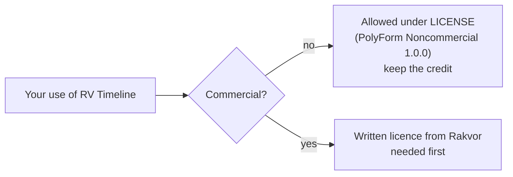

# Commercial use of RV Timeline · Uso comercial · Usage commercial

> **DRAFT — to be verified by counsel (Colombia, France).** This page is not legal advice and does not change
> [LICENSE](LICENSE); it says when a commercial licence is needed and how to ask for one.
> **BORRADOR — por verificar por abogados (Colombia, Francia).** No es asesoría jurídica.
> **PROJET — à vérifier par un avocat (Colombie, France).** Ceci n'est pas un conseil juridique.

[English](#english) · [Español](#español) · [Français](#français)

## English

RV Timeline is source-available under the PolyForm Noncommercial License 1.0.0 ([LICENSE](LICENSE)). Anyone may
use, study, change and share it for non-commercial purposes. Rakvor owns the copyright and keeps all commercial
rights.

- **Commercial use needs a written licence from Rakvor.** For example: selling the tool, a copy of it or a product
  that includes it; offering paid services that use it (paid forensic, incident-response or audit work); using it
  in the paid work of a for-profit business.
- **How to ask:** open a GitHub issue titled "Commercial licence" at <https://github.com/Panacota96/rv-timeline/issues>, or contact Rakvor
  through its GitHub profile <https://github.com/Panacota96>. Say who you are and how you want to use the tool.
  Do not put case data or personal data in the issue.
- **Credit in every use:** name the tool as "RV Timeline by Rakvor", and keep the `Required Notice:` line of
  [LICENSE](LICENSE) with every copy you share.

## Español

RV Timeline es software de código fuente disponible bajo la PolyForm Noncommercial License 1.0.0
([LICENSE](LICENSE)). Cualquier persona puede usarlo, estudiarlo, modificarlo y compartirlo con fines no
comerciales. Rakvor es titular de los derechos de autor y conserva todos los derechos comerciales.

- **El uso comercial requiere una licencia escrita de Rakvor.** Por ejemplo: vender la herramienta, una copia de
  ella o un producto que la incluya; prestar servicios remunerados que la usen (peritajes forenses, respuesta a
  incidentes o auditorías pagadas); usarla en el trabajo remunerado de una empresa con ánimo de lucro.
- **Cómo solicitarla:** abra un issue en GitHub titulado "Commercial licence" en <https://github.com/Panacota96/rv-timeline/issues>, o contacte a
  Rakvor a través de su perfil de GitHub <https://github.com/Panacota96>. Indique quién es y cómo quiere usar la
  herramienta. No incluya datos de casos ni datos personales en el issue.
- **Crédito en todo uso:** nombre la herramienta como "RV Timeline by Rakvor" y conserve la línea `Required Notice:`
  de [LICENSE](LICENSE) en cada copia que comparta.

## Français

RV Timeline est un logiciel à source disponible, sous la PolyForm Noncommercial License 1.0.0 ([LICENSE](LICENSE)).
Toute personne peut l'utiliser, l'étudier, le modifier et le partager à des fins non commerciales. Rakvor est
titulaire des droits d'auteur et conserve tous les droits commerciaux.

- **Tout usage commercial nécessite une licence écrite de Rakvor.** Par exemple : vendre l'outil, une copie de
  l'outil ou un produit qui l'intègre ; proposer des services payants qui l'utilisent (expertise forensique,
  réponse à incident ou audit rémunérés) ; l'utiliser dans le travail rémunéré d'une entreprise à but lucratif.
- **Comment la demander :** ouvrez une issue GitHub intitulée « Commercial licence » sur <https://github.com/Panacota96/rv-timeline/issues>, ou
  contactez Rakvor via son profil GitHub <https://github.com/Panacota96>. Indiquez qui vous êtes et l'usage prévu.
  Ne mettez ni données d'affaire ni données personnelles dans l'issue.
- **Mention obligatoire dans tout usage :** citez l'outil sous le nom « RV Timeline by Rakvor » et conservez la ligne
  `Required Notice:` de [LICENSE](LICENSE) dans chaque copie partagée.
