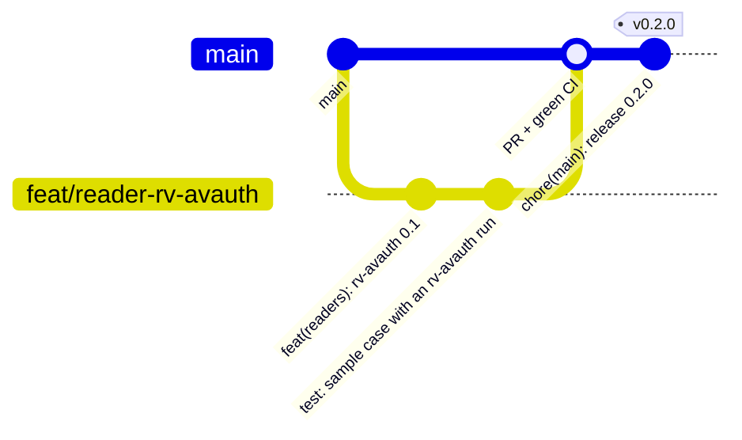
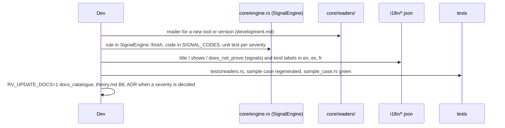

# Contributing to RV Timeline

Thank you for helping. This is a forensic tool: results may be presented in court, so every change
must keep results **correct, reproducible and explainable**.

## Workflow



1. Open an issue first for anything bigger than a typo.
2. Branch from `main`: `feat/…`, `fix/…`, `docs/…`.
3. Commit with [Conventional Commits](https://www.conventionalcommits.org/): `feat(core): …`, `fix(cli): …`,
   `docs: …`, `test: …`, `ci: …`. A `!` or `BREAKING CHANGE:` footer marks breaking changes. The changelog and
   version numbers are generated from these messages.
4. Open a pull request. CI must be green on Linux **and** Windows. Never push to `main`, force-push or merge
   without the owner's approval.
5. A maintainer reviews. Changes to hashing, the audit chain, run verification, the signal rules or report wording
   need two approvals.

## Before you push

```bash
cargo fmt --all
cargo clippy --workspace --all-targets --locked -- -D warnings
cargo test --workspace --locked
cargo deny check
cargo run -q -p rv-timeline-cli -- docs-cli > docs/usage-cli.md        # if you changed any --help text
RV_UPDATE_DOCS=1 cargo test -p rv-timeline-core --test docs_catalogue # if you changed signals, kinds or limitations
sh examples/sample/run.sh target/debug/rv-timeline                     # the sample case
python ../rakvor-tool-forge/scripts/validate_project.py .              # the Rakvor contract
```

## Rules that keep the tool defensible

| Area | Rule |
| --- | --- |
| Evidence and runs | rv-timeline never opens the evidence and never writes another tool's run or the registry: it writes only `runs/rv-timeline/<RUN-ID>/` and its two case-log entries. |
| Verification | A run is read only after `verify_run`; a reader reads only outputs its audit log records, through `RunData::json` / `check_file` (digest re-checked). Never widen a reader's supported version to "any". |
| Time | Keep the original wording; never apply a zone the source did not state; parse strictly (`readers/timefmt.rs`) and skip, never guess. |
| Data model | `model.rs` is frozen for v0.1: add fields with `#[serde(default)]`, never rename or remove one; follow its "Conventions" (event ids). |
| Core | The core never prints. Front-ends only render `Event`s. |
| Hashing | Any change needs known-answer tests (`hash::KNOWN_ANSWERS`). |
| Audit | Do not change the chain algorithm without bumping the log format and keeping `verify-log` able to read old logs. |
| Signals | Every signal has `title`, `shows` **and** `does_not_prove` wording in **all three** languages (`i18n/*.json`; a test checks the keys match); `docs/reports.md` is regenerated from `en.json`. |
| Sample case | `examples/sample` is generated by `tests/make_sample_case.sh`, never edited by hand. |
| Shared code | Never edit `src/core/src/trust.rs`, the AppId table in `src/cli/tests/packaging.rs` or `deny.toml` here alone: they are shared by every Rakvor tool. |
| Reports | Adding a field to a JSON report: update `schemas/` and `docs/reports.md`. Removing one is a breaking change. |
| Docs | Each page under `docs/` keeps at least one Mermaid diagram that renders on GitHub. |
| Dependencies | New crates need a reason in the PR and a permissive licence (MIT, Apache-2.0, BSD, ISC, Zlib) — no GPL/AGPL, because the tool is proprietary. |

## Adding a signal or a reader



Details: [docs/development.md](docs/development.md#adding-or-updating-a-reader).

## Code of conduct

Be respectful and precise. Assume good faith. Harassment is not tolerated.
