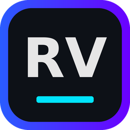
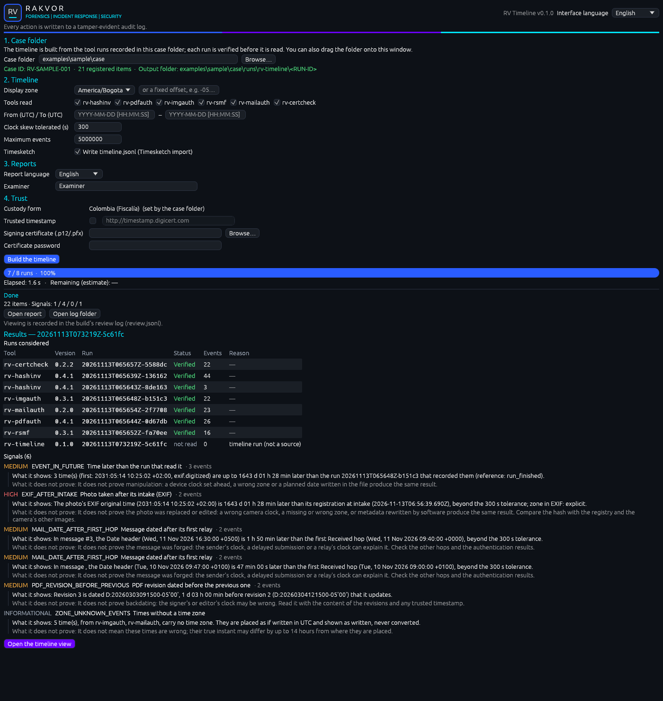
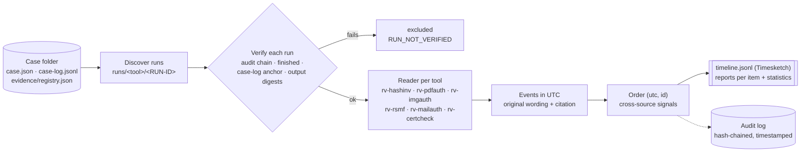
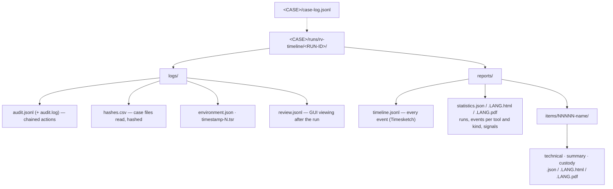

<p align="center"></p>

# RV Timeline

<!-- forge:description -->
**Case super-timeline.** Builds one cited timeline of a Rakvor case from the audited outputs of the other six tools (intake and file times, PDF dates and revisions, EXIF/XMP/PNG times, chat messages, email dates and relays, certificate validity and RFC 3161 times), verifying every run before reading it, and writes it for Timesketch.
<!-- /forge:description -->

[](https://github.com/Panacota96/rv-timeline/actions/workflows/ci.yml)
-6B00FF)


RV Timeline joins what the other Rakvor tools already established about the evidence of one case into **one
timeline**: every time value they wrote, in UTC, with the source's own wording, each event citing the tool run, the
output file, its SHA-256 and the place in it. It never opens the evidence itself, and it reads a tool run only after
checking that the run's own record is intact. Where sources disagree in time it reports **signals** (an EXIF date
after the intake, a mail Date after its first relay, a PDF revision dated before the previous one, …), never a
verdict: every signal says what it shows **and what it does not prove**.





## Contents

- [What it does](#what-it-does)
- [Install](#install)
- [Quick start](#quick-start)
- [Outputs](#outputs)
- [Limits](#limits)
- [Documentation](#documentation)
- [Project layout](#project-layout)
- [Contributing, security, licence](#contributing-security-licence)

## What it does

| | |
| --- | --- |
| **One timeline per case** | Reads the runs of rv-hashinv (intake, file-system times), rv-pdfauth (Info dates, signatures, revisions), rv-imgauth (EXIF, XMP, PNG, GPS times), rv-rsmf (chat events), rv-mailauth (Date, Received hops, attachments, mbox lines) and rv-certcheck (validity, revocation, RFC 3161 genTime). Its own input is the case folder, not evidence files. |
| **Verified before read** | A run is read only if its hash-chained audit log is intact, it finished, the case log anchors its final entry, a reader exists for its tool version, and every machine-readable output still has the digest its audit log recorded. Any other run is **excluded** with its reason (`RUN_NOT_VERIFIED`), never partly read. |
| **Times as written, placed in UTC** | Each event keeps the original string (`Tue, 10 Nov 2026 11:00:00 +0100`, `2026:11:10 10:00:00`) and its offset. A time with no zone (EXIF without OffsetTime, an mbox `From ` line) is **never converted with a guessed zone**: it is placed as if UTC, flagged and counted (`ZONE_UNKNOWN_EVENTS`). Reports add a display zone: UTC, a fixed offset, `America/Bogota` or `Europe/Paris` (CET/CEST built in). |
| **Cross-source signals** | `EXIF_AFTER_INTAKE`, `FILE_MODIFIED_AFTER_INTAKE`, `MAIL_DATE_AFTER_FIRST_HOP`, `PDF_REVISION_BEFORE_PREVIOUS`, `EVENT_IN_FUTURE`, `CLOCK_SKEW_SUSPECTED` (two tools a constant offset apart, or relays out of order in one message), `RUN_NOT_VERIFIED`, `ZONE_UNKNOWN_EVENTS`, all with a clock-skew tolerance (`--clock-skew`, 300 s). |
| **Timesketch** | `reports/timeline.jsonl`: one JSON line per event with `message`, `datetime`, `timestamp_desc` and every citation field (`rakvor_*`), ready for import; its digests are in the audit log. |
| **Any size** | Events are sorted on disk past 250 000 in memory (external merge sort); the GUI viewer indexes `timeline.jsonl` and reads only the rows it shows. |
| **Auditable** | Its own run lives in the case (`runs/rv-timeline/<RUN-ID>/`): hash-chained `audit.jsonl`, `hashes.csv` of every case file it read, RFC 3161 timestamp, signed PDFs, a custody form per item (Colombia / France), and a review log of what the examiner looked at in the GUI. `verify-log` and `verify-case` re-check all of it. |
| **Two front-ends** | `rv-timeline` (command line) and `rv-timeline-gui` (Windows 10/11 desktop app with a virtualised timeline viewer). Same engine, same results. |

## Install

**Windows 10/11** — from the [Releases](https://github.com/Panacota96/rv-timeline/releases) page, once a version is
released:

- `rv-timeline-<version>-windows-x64-setup.exe` — installer (per-user, Start-menu shortcut, CLI on PATH), or
- `rv-timeline-<version>-windows-x64.zip` — portable: unzip and run, nothing is installed.

Check the download before use ([docs/installation.md](docs/installation.md), [SECURITY.md](SECURITY.md)).

**From source** (Rust toolchain pinned in `rust-toolchain.toml`):

```bash
cargo build --release
# binaries: target/release/rv-timeline and target/release/rv-timeline-gui
```

## Quick start

The timeline comes last in a case: rv-hashinv registers the evidence, the analysis tools examine it, then
rv-timeline joins their results ([docs/usage.md](docs/usage.md)).

```powershell
# Check the build: every hash algorithm against published test vectors
rv-timeline self-test

# Build the timeline of a case folder, with local Colombian times next to UTC and Spanish reports
rv-timeline build --case-dir E:\CASE-014 --display-zone America/Bogota --lang es --actor "Ana Ruiz"

# Only mail and images, one week (UTC window)
rv-timeline build --case-dir E:\CASE-014 --tool rv-mailauth,rv-imgauth --from 2026-11-01T00:00:00Z --to 2026-11-08T00:00:00Z

# Prove later that nothing was altered: the run's audit log, then the whole case
rv-timeline verify-log E:\CASE-014\runs\rv-timeline\<RUN-ID>\logs
rv-timeline verify-case E:\CASE-014

# Try it on the sample case (a copy is built, the committed case is never changed)
sh examples/sample/run.sh target/release/rv-timeline
```

The desktop app: start **RV Timeline**, choose the case folder, press **Build the timeline**, then **Open the
timeline view** ([docs/usage-gui.md](docs/usage-gui.md)). RV Hub opens it on a case with
`rv-timeline-gui.exe --case-dir <CASE>`. Import into Timesketch: upload
`<CASE>/runs/rv-timeline/<RUN-ID>/reports/timeline.jsonl`.

Every option, example and exit code: [docs/usage-cli.md](docs/usage-cli.md) (generated from `--help`).

## Outputs



Nothing else in the case folder changes: the evidence and the other tools' runs are only read.

| Exit code (`build`) | Meaning |
| :-: | --- |
| 0 | Timeline built; every run verified and no medium- or high-severity signal |
| 1 | Runtime error (case log locked by another tool, output not writable, signing certificate unreadable) |
| 2 | Usage error (unknown option or tool, more than two hash algorithms, unknown display zone, `--from`/`--to` not RFC 3339 or reversed, `--max-events 0`, not a case folder, `--case` of another case) |
| 3 | Timeline built with at least one run excluded, or at least one medium- or high-severity signal to review; or the case folder fails verification (nothing is written to it) |
| 130 | Cancelled with Ctrl+C (partial reports written, cancellation audited) |

Every signal, its severity and wording: [docs/reports.md](docs/reports.md#signals-catalogue).

## Limits

- **Signals, not verdicts.** A timeline without signals does not prove the times are true; it shows that the
  sources read agree within the tolerance. A signal does not say who changed what.
- **Only what the tools recorded.** In v0.1 the sources are the audited outputs of the six Rakvor tools; a time no
  tool extracted (operating-system logs, other devices, file-system creation times) is not in the timeline.
- **Clocks and zones.** Every source depends on the clock and zone setting of the device that wrote it. Times
  without a zone may be off by up to 14 hours from where they are placed; they are never guessed.
- **Reader versions.** Each reader supports one released output version of its tool (`rv-hashinv 0.4.x`,
  `rv-pdfauth 0.4.x`, `rv-imgauth 0.3.x`, `rv-rsmf 0.3.x`, `rv-mailauth 0.2.x`, `rv-certcheck 0.2.x`); runs of other
  versions are excluded and listed, never guessed.
- **Derived analysis.** The timeline is only as reliable as each tool's own validation; it re-checks their records,
  not their analysis.

The full list, with owners and remedies: [docs/admissibility.md](docs/admissibility.md#consolidated-gap-list).

## Documentation

| Page | For |
| --- | --- |
| [docs/usage.md](docs/usage.md) | End-to-end case: intake with RV HashInv, the analysis tools, `rv-timeline build`, reading the outputs, Timesketch, RV Hub, troubleshooting |
| [docs/usage-gui.md](docs/usage-gui.md) | The desktop app and the timeline viewer |
| [docs/usage-cli.md](docs/usage-cli.md) | Every command and option (generated from `--help`) |
| [docs/installation.md](docs/installation.md) | Installing and verifying a release, building from source for auditors |
| [docs/theory.md](docs/theory.md) | Why one timeline, what "verified before read" means, why times disagree (Part A); event model, verification, zones, ordering, signal rules, Timesketch mapping (Part B) |
| [docs/reports.md](docs/reports.md) | Signals catalogue, event kinds per tool, `timeline.jsonl` fields, reports, `hashes.csv`, `review.jsonl` |
| [docs/admissibility.md](docs/admissibility.md) | Colombia, France/EU, ISO/IEC and US/UK requirements mapped to the tool, gaps, examiner checklist (**draft pending a lawyer's review**) |
| [docs/case-folder.md](docs/case-folder.md) | What rv-timeline reads in a case folder and the one place it writes |
| [docs/forensic-audit.md](docs/forensic-audit.md) | Audit trail, hash chain, timestamps, signed reports, actions recorded |
| [docs/architecture.md](docs/architecture.md) | How the readers, the engine, the CLI and the GUI fit together |
| [docs/development.md](docs/development.md) | Building, testing, readers and how to add one, the sample case, CI/CD, releasing |
| [docs/HANDOFF.md](docs/HANDOFF.md) | State, layout, everyday commands, decisions, open work |
| [docs/adr/](docs/adr/) | Architecture decisions (language, timestamp verification, advisories, timeline design) |

## Project layout

```text
rv-timeline/
├── src/
│   ├── core/      engine: readers/ (one per tool), engine.rs (order, signals, Timesketch), model.rs (frozen data model),
│   │              run.rs (pipeline), audit, case folder, reports, trust (shared)
│   ├── cli/       rv-timeline command line (clap): build, verify-log, verify-case, timestamp, self-test, describe
│   └── gui/       rv-timeline-gui desktop app (egui); state.rs and viewer.rs hold the testable rules
├── templates/     HTML report templates + CSS
├── i18n/          report and GUI wording: en.json, es.json, fr.json
├── schemas/       JSON Schemas of the reports, case folder and describe output
├── docs/          documentation (Mermaid diagrams render on GitHub)
├── tests/         sample-case generator, Python verifiers, golden case, TSA fixtures
├── examples/      the sample case written by the six tools, tampered copies, expected timeline, run scripts
├── packaging/     Windows installer (Inno Setup)
└── .github/       CI and release workflows
```

## Contributing, security, licence

- How to contribute: [CONTRIBUTING.md](CONTRIBUTING.md) · Changes: [CHANGELOG.md](CHANGELOG.md)
- Report a vulnerability privately: [SECURITY.md](SECURITY.md)
- **Licence status: draft.** The Rakvor Source-Auditable Licence ([LICENSE](LICENSE)) is a draft pending a lawyer's
  review (Colombia, France): the tool is used locally by Rakvor; customers, courts and their experts may inspect and
  rebuild the source for audit; no redistribution. Third-party notices: [NOTICE](NOTICE).
