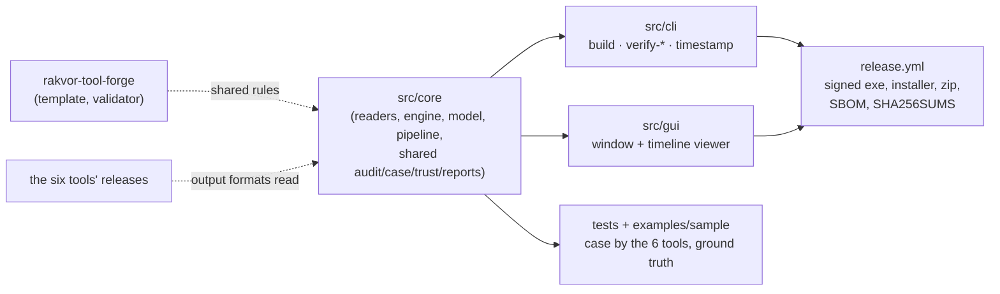

# Handover — rv-timeline 0.1.0 (unreleased)

State on 2026-11-13 (branches `timeline-core`, draft PR rv-timeline#3, and `timeline-docs`; not yet merged to
`main`). **rv-timeline** — analysis: one cited timeline of a Rakvor case folder from the audited outputs of
rv-hashinv, rv-pdfauth, rv-imgauth, rv-rsmf, rv-mailauth and rv-certcheck, each run verified before it is read,
with cross-source time signals and a Timesketch import file.

This page is for whoever picks the project up next: where things are, how to build, test and release it, the
decisions already made and what is still open. The user-facing guides are [usage.md](usage.md),
[usage-gui.md](usage-gui.md) and [installation.md](installation.md); the method is in [theory.md](theory.md).



## 1. State at handover

| Item | Value |
| --- | --- |
| Version | 0.1.0 in `version.txt`; nothing released yet (release-please starts after the first merge to `main`) |
| Branches | `timeline-core`: core, CLI and GUI code-complete (draft PR #3); `timeline-docs`: documentation written from that code. Merging needs the owner's approval |
| Toolchain | Rust pinned in `rust-toolchain.toml` (1.97.0); `rust-version` = 1.88 ([development.md](development.md#toolchain-pin)) |
| Readers | rv-hashinv 0.4.x, rv-pdfauth 0.4.x, rv-imgauth 0.3.x, rv-rsmf 0.3.x, rv-mailauth 0.2.x, rv-certcheck 0.2.x |
| CI | `ci.yml`: lint (fmt, cargo-deny, clippy `-D warnings`, actionlint) on Linux; tests on Linux and Windows (with Windows clippy), ground truth, determinism, self-test, sample build (exit 3), Python verifiers, sample scripts, golden case from the Python profile, real-TSA smoke test; `large` job (200 000 events, 3 000 hostile mutations, release build with overflow checks) |
| Releases | signed with the internal Rakvor code-signing certificate once released; the chain ends at "Rakvor Internal Code Signing Root CA", SHA-256 `DC:9B:A1:A2:FC:D4:F0:63:3C:52:14:B7:CC:EB:25:BE:D8:F3:F7:D9:EB:AF:11:15:90:25:0C:BC:AA:83:DF:60` |
| Forge | the contract this repository follows and its validator live in [rakvor-tool-forge](https://github.com/Panacota96/rakvor-tool-forge); the pinned versions are in its [version table](https://github.com/Panacota96/rakvor-tool-forge#using-a-pinned-commit) |

## 2. Where things are

| Path | What it holds |
| --- | --- |
| `src/core/src/model.rs` | the frozen data model and the **conventions** (event ids, what counts as an event, kinds per tool, zones) |
| `src/core/src/readers/` | `mod.rs`: run discovery, `verify_run`, `RunData`, `Emitter`, reader table; `timefmt.rs`: strict parsers; one reader per tool |
| `src/core/src/engine.rs` | display zones (CET/CEST), ordering, external sort, `SignalEngine`, Timesketch lines |
| `src/core/src/run.rs` | `run_timeline` / `timeline_pipeline`: the build, `hashes.csv` of the files read, reports (also the template's evidence pipeline, unused by `build`) |
| `src/core/src/audit.rs`, `case.rs`, `verify.rs`, `review.rs`, `trust.rs`, `report/` | the forensic pipeline shared with the other tools: audit chain, case folder, `verify-log` (incl. `review.jsonl`), RFC 3161 and PDF signing, reports |
| `src/cli`, `src/gui` (`state.rs`, `viewer.rs`, `app.rs`) | thin front ends; the GUI logs every setting (`ui_*`) and writes `review.jsonl` from the timeline viewer |
| `i18n/` | all report and GUI wording, EN/ES/FR, same keys (signals, exclusion reasons, kind labels, limitations) |
| `examples/sample`, `tests/make_sample_case.{sh,ps1,py}` | the sample case written by the six released tools, three tampered copies, `expected_timeline.json`, and their generator |
| `src/core/tests/` | `readers.rs`, `sample_case.rs`, `determinism.rs`, `hostile.rs`, `large_case.rs`, `docs_catalogue.rs` (the generated tables of `docs/reports.md`) |
| `tests/fixtures/tsa-chains` | 34 TSA certificate chains with OpenSSL's verdicts (shared by every tool) |
| `docs/` | theory (Part A for non-experts, Part B for experts), admissibility (draft), usage, reports, ADRs |
| `packaging/`, `deny.toml` | Inno Setup script; licence allow-list (no GPL/AGPL/LGPL) and advisory exceptions |

**Shared code.** `src/core/src/trust.rs` is byte-identical in rv-hub, rv-hashinv, rv-rsmf, rv-certcheck,
rv-imgauth, rv-pdfauth, rv-mailauth, rv-timeline and the forge template; the installer AppId table in
`src/cli/tests/packaging.rs` and the `deny.toml` policy are shared too. Change all copies in one go and compare
their SHA-256; never edit them here alone.

## 3. Everyday commands

```bash
export RV_TEST_PYTHON=<workspace>/.venv/Scripts/python.exe     # blake3 jsonschema pyhanko
cargo fmt --all -- --check
cargo clippy --workspace --all-targets --locked -- -D warnings
cargo test --workspace --locked
cargo deny check
cargo build -q -p rv-timeline-cli && sh examples/sample/run.sh target/debug/rv-timeline
python <forge>/scripts/validate_project.py . --run --tests       # the Rakvor contract (forge checkout)
tests/make_sample_case.sh <workspace>                             # regenerate the sample case (six release builds)
```

Generated docs: `docs/usage-cli.md` (`rv-timeline docs-cli`) and the signals, kinds and limitations tables of
`docs/reports.md` (`RV_UPDATE_DOCS=1 cargo test -p rv-timeline-core --test docs_catalogue`); tests fail when they
drift. On Windows set `core.longpaths` for the sample case's deep paths ([development.md](development.md#windows-long-paths)).

## 4. Releasing

Conventional Commits drive release-please: `feat:` minor, `fix:` patch, `docs:`/`test:`/`chore:` no release.
Merging the release PR tags the version and the release workflow builds, signs, packages and uploads. Full steps,
secrets (`SIGN_PFX_BASE64`, `SIGN_PFX_PASSWORD`) and the manual fallback: [release-process.md](release-process.md).

- Never merge, push to `main`, force-push or publish a release without the owner's approval.
- CI on release-please's own PRs can stop at *action required*: approve the run (Actions tab) before merging.
- After a release, verify it independently: `SHA256SUMS` over the downloaded assets, and every `.exe` (installer,
  CLI, GUI) chaining to the root above (`signtool verify /pa /v`).
- When one of the six tools releases a new **minor** version, its runs are excluded until a reader supports it:
  update the reader table, regenerate the sample case, release.

## 5. Decisions

| ADR | Decision |
| --- | --- |
| [0001](adr/0001-language.md) | Implementation language (Rust) |
| [0002](adr/0002-tsa-token-verification.md) | How RFC 3161 tokens and TSA chains are verified |
| [0003](adr/0003-dependency-advisories.md) | Dependency advisories, exceptions and RSA blinding |
| [0004](adr/0004-timeline-design-decisions.md) | Tool outputs only in v1; verify before read; UTC + original; zone-unknown never guessed; signal severities; Timesketch JSONL; event-id convention |

Standing rules: no private key, password or real personal data in the repository (the sample case is synthetic and
was written from a neutral drive, host and user); secrets only through environment variables or prompts and never
logged; no GPL/AGPL/LGPL components; tools report signals, not verdicts.

## 6. Open work

- The licence (`LICENSE`) and the admissibility analysis ([admissibility.md](admissibility.md)) are drafts pending a
  lawyer's review (Colombia and France); every citation marked [to verify] must be checked first.
- **Skipped time values** are counted per run (`run_read`), in `statistics.json` and as `TL_TIMES_SKIPPED`, but
  not listed per item in the technical review (G-TL4).
- **Template leftovers.** `examples/sample/evidence` and `expected_hashes.csv` are still used by the template
  pipeline's tests in `run.rs` and by `tests/golden/regenerate.py`; `build` does not use them.
- **Unknown chat zone names.** rv-rsmf events converted with a `--timezone` this version has no rules for are
  explicit with `offset_min: null` (documented in model.rs); add rules if such zones occur in cases.
- No measured rates for how often each signal is innocent (gap G5); no per-release validation record (G6); TSA
  revocation is never checked (G18, [ADR 0002](adr/0002-tsa-token-verification.md)); RUSTSEC-2023-0071 stays an
  exception until `cms` 0.3 ([ADR 0003](adr/0003-dependency-advisories.md)).
- Further sources (OS logs, plaso, file-system creation/access times) need readers with their own verification
  (G-TL3).

The gap table in [admissibility.md](admissibility.md#consolidated-gap-list) lists every known limitation with its
owner (engineering, counsel, examiner, firm).
