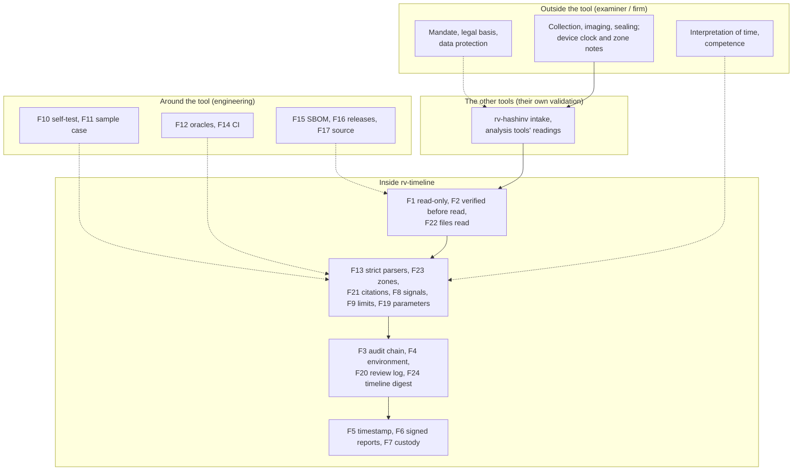
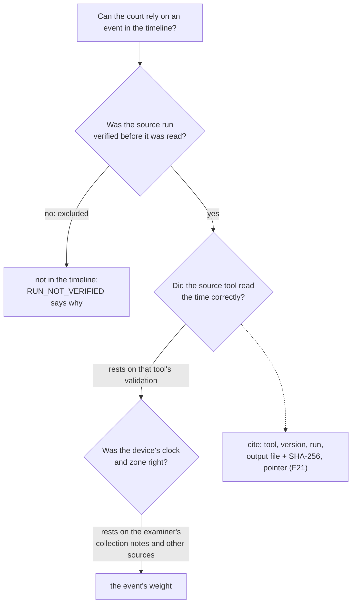

# Admissibility and reliability

> **DRAFT — pending review by a lawyer. Not legal advice.** This page maps legal and technical requirements to
> what RV Timeline actually does, so that an examiner, a lawyer or an opposing expert can see where the tool helps
> and where it does not. It reuses the structure and the verified citations of the sister tools' pages (rv-mailauth,
> rv-imgauth and rv-pdfauth, built on the Rakvor legal research note of 2026-10-21) and adds the points specific to
> a timeline: a timeline is **derived analysis** built on the other tools' results. **It must be reviewed by counsel
> in each jurisdiction before it is relied on or quoted.** Anything marked **[to verify]** must not be cited before
> a lawyer or engineer has checked it against the primary source; no mark on this page was upgraded beyond what the
> sister pages record.

## Contents

- [1. Purpose and how to read this page](#1-purpose-and-how-to-read-this-page)
- [2. Evidence lifecycle and where each control sits](#2-evidence-lifecycle-and-where-each-control-sits)
- [3. The reliability argument for a derived timeline](#3-the-reliability-argument-for-a-derived-timeline)
- [4. Timeline-specific issues every jurisdiction raises](#4-timeline-specific-issues-every-jurisdiction-raises)
- [5. Colombia](#5-colombia)
- [6. France and the European Union](#6-france-and-the-european-union)
- [7. International standards](#7-international-standards)
- [8. United States and United Kingdom](#8-united-states-and-united-kingdom)
- [Limitations stated in every report](#limitations-stated-in-every-report)
- [Consolidated gap list](#consolidated-gap-list)
- [Examiner checklist before filing a report](#examiner-checklist-before-filing-a-report)
- [Sources](#sources)

## 1. Purpose and how to read this page

RV Timeline is used **locally** by Rakvor; it is not distributed. Clients, courts and opposing experts may audit
its source ([LICENSE](../LICENSE), itself a draft pending legal review). Its results are **signals for an
examiner, never a verdict** ([theory.md](theory.md#a1-what-the-tool-is-and-is-not)). Admissibility and weight are
decided by a court about the **examiner's evidence**, of which the timeline is one part — and a part that rests on
the outputs of other tools.

| Status | Meaning |
| --- | --- |
| **met** | A tool feature satisfies or directly supports the requirement (the file or command is named) |
| **partial** | Supported, with a named shortfall |
| **examiner** | An obligation of the examiner or of Rakvor as a firm, not a tool feature |
| **gap** | Not met today; listed in the [consolidated gap list](#consolidated-gap-list) |
| **context** | Background that frames the other rows |

| Mark | Meaning |
| --- | --- |
| **[V]** | Article or clause number and substance checked against the primary text in the research note, as recorded in the sister tools' pages |
| **[S]** | Checked against a secondary source; the number is reliable, check the wording before quoting |
| **[to verify]** | Not verified against the primary text (including every citation new to this page); do not cite before checking |

Research limits that still apply: the Colombian project PDFs were verified against official web copies, not the
project files; only the free preview of ISO/IEC 27037 was read; ISO/IEC 27041/27042 clause text is paywalled
[to verify]; Légifrance refused automated access (French texts read from the Pappers LEGI mirror). No primary
source was read for this page: every citation that does not appear in the sister pages is marked [to verify].

### Tool features referred to in the tables

| Key | Feature | Where it is implemented |
| --- | --- | --- |
| F1 | Never opens the evidence; reads only the case folder's records and the runs' recorded outputs; writes only its own run folder and two case-log entries | [run.rs](../src/core/src/run.rs), [case-folder.md](case-folder.md) |
| F2 | **Verified before read**: audit chain, finished run, case-log anchor (`audit_entries`/`audit_head`), supported reader version, every machine-readable output's recorded digest; re-checked per file when read; failures excluded and reported (`RUN_NOT_VERIFIED`) | [readers/mod.rs](../src/core/src/readers/mod.rs); [theory.md B3](theory.md#b3-run-discovery-and-verification) |
| F3 | SHA-256 hash-chained audit log of the build + independent verifier | [audit.rs](../src/core/src/audit.rs); `verify-log`; [tests/verify_chain.py](../tests/verify_chain.py) |
| F4 | `environment.json`: tool, compiler and every dependency version, OS, host, user, command line or GUI settings | [env.rs](../src/core/src/env.rs) |
| F5 | RFC 3161 timestamp of the audit chain head | [trust.rs](../src/core/src/trust.rs) (shared); `--tsa-url`, `--no-timestamp`, `timestamp` |
| F6 | PDF reports signed with the examiner's certificate (CMS `adbe.pkcs7.detached`) | `--sign-cert`; [report/pdf.rs](../src/core/src/report/pdf.rs) |
| F7 | Per-item chain-of-custody form: Colombia (Fiscalía style) or France (scellés), plus English | `custody.json/.html/.pdf` |
| F8 | Signals state what they show **and** what they do not prove; no verdict, no score | [reports.md](reports.md#signals-catalogue) (generated from [i18n/en.json](../i18n/en.json)); es, fr |
| F9 | Six limitations printed in every report (+ the event cap when reached) | [reports.md](reports.md#limitations-printed-in-every-report) |
| F10 | Known-answer self-test (hash algorithms) | `rv-timeline self-test` |
| F11 | Sample case written by the six released tools on synthetic evidence, three tampered copies, and a ground truth derived independently | [examples/](../examples/README.md); [sample_case.rs](../src/core/tests/sample_case.rs) |
| F12 | Independent oracles: [tests/make_sample_case.py](../tests/make_sample_case.py) derives the expected events and signals from the tools' outputs; each tool's own `verify-case` grades the tampered copies; Python chain and schema verifiers | [tests/](../tests/make_sample_case.py) |
| F13 | Strict time parsers: one format each, a value that does not parse is skipped, never guessed, and counted (`times_skipped`, `TL_TIMES_SKIPPED`); reader tests with malformed values; hostile-input test (mutated, re-sealed case folders: no panic, no event cited from outside its run, recorded paths confined to the case folder) | [timefmt.rs](../src/core/src/readers/timefmt.rs), [readers.rs](../src/core/tests/readers.rs), [hostile.rs](../src/core/tests/hostile.rs) |
| F14 | CI on Windows and Linux | `.github/workflows/ci.yml` |
| F15 | SBOM and build provenance | `.github/workflows/release.yml` |
| F16 | Versioned releases with `SHA256SUMS`, signed with the internal Rakvor certificate | [installation.md](installation.md) |
| F17 | Source auditable by customers and opposing experts; local use only | [LICENSE](../LICENSE) (draft) |
| F18 | Case folder: the build's run anchored in the case log; `verify-case` re-checks every run | [case-folder.md](case-folder.md) |
| F19 | Every build parameter recorded: display zone, clock skew, tools, UTC window, event cap, sort threshold, Timesketch output (`run_started.details.timeline`); every run discovered, skipped (with reason), verified, read (events read / kept / outside the filters) or excluded (reason, detail) | `audit.jsonl`; `statistics.json` |
| F20 | Review log: what the examiner viewed in the GUI after the build, hash-chained and anchored to `run_finished`; checked by `verify-log` and `verify-case` | [review.rs](../src/core/src/review.rs); `review.jsonl` |
| F21 | Every event cites its run, output file, the file's SHA-256 as audited, and a JSON pointer or log line; stable event ids; events of an item whose examined copy differed from the registry carry `registry_match: differs` | [theory.md B4](theory.md#b4-event-model-and-id-convention) |
| F22 | `hashes.csv`: every case file the build read, hashed when read | [reports.md](reports.md#hashescsv-the-files-read) |
| F23 | Times kept as written with their offset; UTC placement; **zone-unknown values never converted with a guessed zone**, flagged, counted, widened tolerance | [theory.md B6](theory.md#b6-utc-zones-and-display-zones) |
| F24 | `timeline.jsonl` digest-recorded (`timeline_written`); the GUI viewer refuses a timeline whose digest differs and re-checks each row's hash | [viewer.rs](../src/gui/src/viewer.rs) |

## 2. Evidence lifecycle and where each control sits

```mermaid
flowchart LR
    A["Collection<br/>(devices, exports, mailboxes)"] --> B["Forensic copy"]
    B --> C["Intake<br/>rv-hashinv: registry + hashes"]
    C --> D["Analysis<br/>rv-pdfauth · rv-imgauth · rv-rsmf<br/>rv-mailauth · rv-certcheck"]
    D --> T["Timeline<br/>rv-timeline build<br/>(verifies each run, then reads it)"]
    T --> E["Examiner review<br/>timeline viewer → review.jsonl<br/>Timesketch"]
    E --> F["Report<br/>signed PDF, timestamped log"]
    F --> G["Disclosure<br/>party, court, opposing expert"]
    G --> H["Counter-expertise<br/>rebuild on a copy of the case,<br/>source review"]
```

## 3. The reliability argument for a derived timeline

Courts ask, in different words, whether the method is **reliable** and whether it was **reliably applied** here.
A timeline adds no new measurement of the evidence: it **collects, normalises and orders** values that the other
tools measured, and compares them. Its reliability therefore has two layers:

1. **Its own steps** — that it reads exactly what the tools recorded (F2, F21), converts each time correctly (F13,
   F23), orders them deterministically and applies fixed comparison rules (F8, F19). These are testable and tested
   here (F11, F12).
2. **The sources' validation** — that each tool read the time correctly from the evidence in the first place. That
   rests on each tool's own validation, documented in its repository (rv-hashinv, rv-pdfauth, rv-imgauth, rv-rsmf,
   rv-mailauth, rv-certcheck). rv-timeline checks their **records**, not their **analysis**.

| Factor | What RV Timeline offers | Status |
| --- | --- | --- |
| **Testability** | Deterministic output: the same case and options give the same event ids, order and `timeline.jsonl` bytes ([theory.md B14](theory.md#b14-determinism-and-repeatability)); sample case with a ground truth derived by an independent script and graded per event and signal (F11, F12); tampered copies graded by the six tools' own `verify-case` | met |
| **Known or potential error rate** | Parsing and ordering are deterministic and tested; the signals are comparison rules with a stated tolerance, not statistical detectors. **No error rates measured on a documented corpus of real cases** (how often a signal is innocent) (G5) | partial / gap |
| **Peer review and standards** | Time formats from published standards (RFC 3339, RFC 5322, Exif, ISO 32000, RFC 5280); EU summer-time rule; Timesketch import format. No external review of this implementation (G7) | partial |
| **Standards controlling the operation** | Fixed rules, severities and wording (F8); every parameter recorded (F19); release verification ([installation.md](installation.md)); examiner checklist below | partial |
| **General acceptance** | Super-timelines (log2timeline/plaso, Timesketch) are standard practice in digital forensics [to verify a citable source]; the cross-source checks are what examiners do by hand | met / partial |
| **Validation for intended use** (ISO/IEC 27041; ISO/IEC 17025 §7.2.2 [V]) | Inputs exist (F10–F14) but no per-release validation report (G6), and each reader depends on the version of the tool it reads | gap |
| **Reliable application in this case** (FRE 702(d) [V]) | Audit chain of every step (F3), every run's status and reason (F19), files read (F22), events viewed (F20), timestamp (F5), signed report (F6) | met |

## 4. Timeline-specific issues every jurisdiction raises

### 4.1 A timeline is derived analysis

Every event can be traced back to the exact place in a tool's output (F21), and that output to the run's sealed
audit log (F2). That makes the timeline **reproducible and auditable**, not independently **true**: an error in a
source tool's reading (for example an EXIF parser) passes into the timeline unchanged. The report must therefore
present each event with its source and, where an event matters, the expert should examine the source tool's report
for that item, and its validation, too. A timeline built from runs of tool versions whose validation is not
documented inherits that gap (G-TL1).

### 4.2 Verification before reading, and what it does not cover

A run is read only if its record is intact and anchored in the case log (F2). Excluded runs are listed with their
reason, and the build exits 3, so an incomplete timeline is never presented as complete. Verification does **not**
re-run the tool's analysis, does not re-hash the evidence (use `verify-case --rehash` for that), and does not check
the HTML/PDF renderings of the tool's reports (only its machine-readable outputs). A record rewritten consistently
together with the case log is detectable only through the RFC 3161 tokens of the logs involved (F5), which is why
offline runs should be timestamped later (`timestamp`).

### 4.3 Time zones: never guessed

A time without a zone can be wrong by up to 14 hours from where it is placed. The tool never assigns a zone it was
not given (F23): it places the value as if UTC, marks it, counts it (`ZONE_UNKNOWN_EVENTS`), never converts it for
display and widens every comparison involving it. Where the zone of a device matters, the examiner establishes it
from collection notes (device settings, photographs of the device screen, other sources) and says so in the report;
the tool's output must not be read as having established it (G-TL2). For chat exports the zone comes from the
examiner's `--timezone` given to rv-rsmf, recorded in each event's details: it is the examiner's statement, not a
property of the export.

### 4.4 What a timeline cannot establish

- **Who** did something at a time, or that a device's clock was right.
- That a time is **authentic**: agreement between sources set by the same wrong clock is still agreement
  (`TL_CLEAN_IS_NOT_PROOF`).
- **Events no tool recorded**: in v0.1 only the six tools' audited outputs are sources (`TL_TOOL_OUTPUTS_ONLY`);
  operating-system logs, file-system creation and access times, and other devices are absent (G-TL3).
- **The exact instant** of a value with day or minute precision, or without a zone.
- That an event **did not happen**: a gap in the timeline is an absence of records.

## 5. Colombia

### 5.1 Ley 906 de 2004 (Código de Procedimiento Penal)

Context: adversarial criminal procedure; data messages are *elementos materiales probatorios / evidencia física*
(art. 275 lit. g [V]); authenticity rests on the chain of custody (arts. 254–266, 277 [V]); expert evidence is
tested orally (arts. 405–423 [V]); a novel technique must meet at least one of the criteria of art. 422 [V].

| # | Requirement | Source | How rv-timeline meets it | Status |
| --- | --- | --- | --- | --- |
| CO-P1 | Data messages are EMP/EF and enter the custody regime | Art. 275 lit. g [V] | F7 per-item form, by evidence id; the timeline itself is an expert work product, not an EMP | met / context |
| CO-P2 | *Cadena de custodia* shows identity, original state, collection, preservation, places, dates, custodians | Art. 254 [V] | F7, F18; intake dates from the registry; physical custody by the examiner | met (digital) / examiner (physical) |
| CO-P3 | Custodians record full name, cédula and position | Art. 264 [V] | F7 persons and transfer rows filled in by hand | partial (G9) |
| CO-P4 | Each custodian prevents destruction, substitution, alteration | Art. 261 [V] | F1 (evidence never opened, other runs never written), F2, F3 | met |
| CO-P5 | Authenticity = detected, fixed, collected, packed and kept in custody | Art. 277 [V] | F2, F3, F18 (every source run verified against its own record and the case log) | met |
| CO-P6 | Evidence legal only if collected lawfully | Art. 276 [V] | None | examiner |
| CO-P7 | Lab report describes procedures, instruments and their state, scientific principles, interpretation | Art. 210 [V] | F4, F10, F19; method and limitations in every report; [theory.md](theory.md) | met |
| CO-P8 | Perito holds recognised competence; party report with *certificación de idoneidad* | Arts. 408, 413 [V] | None | examiner |
| CO-P9 | Summary report disclosed ≥ 5 days before the hearing | Art. 415 [V] | F6 produces the report | examiner |
| CO-P10 | Perito examined on instruments, principles, methods and corroboration by other experts | Art. 417 [V] | F4, F12, F17, F19, F21; validation dossier missing (G6); source tools' validation (G-TL1) | partial |
| CO-P11 | Court weighs competence, acceptance of principles, instruments, consistency | Art. 420 [V] | Standard time formats and super-timeline practice; signals without measured error rates (G5) | partial |
| CO-P12 | Novel technique: verifiable; published and peer-reviewed; reliability level established; academic acceptance | Art. 422 [V] | Verifiable (F11, F12, F21); reliability of the signals not measured (G5) | partial |
| CO-P13 | Peritos have access to the EMP referred to | Art. 416 [V] | F17, F11, F16; the whole case folder (runs read listed in F22) can be disclosed and rebuilt | met |
| CO-P14 | Data messages authenticated by certification or "informe de experto" | Art. 424 #7, art. 426 [V] | F6 expert report route | met (expert route) |
| CO-P15 | Documentary appraisal: not altered in form or content | Art. 432 #1 [V] | Time inconsistencies as signals (F8); the tool never concludes on this point | partial (examiner opinion) |
| CO-P16 | Best evidence: original required where part of custody or technical study | Arts. 433–434 [V] | The timeline cites the tools' outputs over registered originals; it is not a substitute for them | examiner |

### 5.2 Ley 1564 de 2012 (Código General del Proceso) — documentary evidence

Context: a *dictamen* must be "claro, preciso, exhaustivo y detallado" with ten disclosures (art. 226 [V]),
weighed by *sana crítica* (art. 232 [V]); data-message documents are presumed authentic (art. 244 [V]) and valued
as such only in native format or exact reproduction (art. 247 [V]); a disowned document needs its authenticity
established (art. 272 [V]); a *tacha de falsedad* leads to a *cotejo pericial* (art. 270 [V]).

| # | Requirement | Source | How rv-timeline meets it | Status |
| --- | --- | --- | --- | --- |
| CO-C1 | *Dictamen* clear, precise, exhaustive and detailed, explaining exams, methods, technical bases | Art. 226 [V] | F6, F8, F9, F19, F21; [theory.md](theory.md) | met (template) / examiner |
| CO-C2 | Ten disclosures, incl. whether methods differ from earlier reports (#8, #9) and attaching the documents used (#10) | Art. 226 #1–10 [V]; look-back periods [to verify] | #8–#9: F4, F16 pin the method and reader versions; #10: F3, F22 (`hashes.csv` lists every document read), `timeline.jsonl` | met (#8–#10) / examiner |
| CO-C3 | Expert declares independence; specialised institution or professional | Arts. 226, 227 [V] | None | examiner |
| CO-C4 | Opposing party may summon the expert or file a competing dictamen | Art. 228 [V] | F11, F12, F16, F17, F19: a rebuild on a copy of the case gives the same `timeline.jsonl` | met (support) |
| CO-C5 | *Sana crítica* on soundness, foundations, competence | Art. 232 [V] | F8, F9; validation dossier missing (G6) | partial |
| CO-C6 | No fees contingent on the outcome | Art. 235 [V] | None | examiner |
| CO-C7 | Data messages count only in native format or exact reproduction | Art. 247 [V] | The timeline is derived analysis about native items registered at intake; it is not itself the data message | context |
| CO-C8 | Data-message documents presumed authentic; disowned ones need authenticity established | Arts. 244, 272 [V] | Time inconsistencies across sources (F8) support or question authenticity; never decide it | met (support) |
| CO-C9 | *Tacha de falsedad*: judge orders a *cotejo pericial* | Art. 270 [V] | rv-timeline with the analysis tools, F6 | met (support) |

### 5.3 Ley 527 de 1999 (mensajes de datos)

| # | Requirement | Source | How rv-timeline meets it | Status |
| --- | --- | --- | --- | --- |
| CO-L1 | Evidential effect not denied solely because information is a data message | Arts. 5, 10 [V] | None | context |
| CO-L2 | "Original": a reliable guarantee that integrity was kept since the information was first generated in final form | Art. 8 lit. a [V] | From intake onward: the registry, F2, F5. **Before** intake: the timeline can only show whether the items' own times are consistent with each other and with the intake (`EXIF_AFTER_INTAKE`, `PDF_REVISION_BEFORE_PREVIOUS`, …) | partial |
| CO-L3 | Integrity = "completa e inalterada", except changes inherent to communication, storage, display | Art. 9 [V] | `FILE_MODIFIED_AFTER_INTAKE` explicitly lists copying and restoring (changes inherent to storage) as alternatives; content integrity is the registry's hash comparison | met (support) |
| CO-L4 | Weight by *sana crítica*: reliability of generation, archiving, communication, integrity, originator | Art. 11 [V] | Generation and communication times from each source, ordered and compared (F8, F21); originator: never | partial |
| CO-L5 | Retention in a format that "reproduce con exactitud", with origin, destination, date and time | Art. 12 [V] | Each time kept exactly as written with its offset (F23) | met |
| CO-L6 | Signature requirement met by a reliable, appropriate method | Art. 7 [V] | The examiner's report is signed with F6 | context / met (reports) |
| CO-L7 | *Firma digital* presumption needs an authorised *entidad de certificación* | Art. 28 parágrafo, arts. 29–30 [V] | F6 uses the examiner's own certificate | gap (G3) |
| CO-L8 | Trusted time-stamping is a service of authorised certification entities | Art. 30 #5 [V]; art. 2 lit. d [V] | F5 uses an RFC 3161 TSA (default DigiCert) | gap (G2) |

### 5.4 Fiscalía chain-of-custody manual

The current manual is *Manual del Sistema de Cadena de Custodia* v4 (2018) [S]; it has no procedure specific to
digital evidence; ISO/IEC 27037 and the Rama Judicial cartilla fill that.

| # | Requirement | Source | How rv-timeline meets it | Status |
| --- | --- | --- | --- | --- |
| CO-F1 | Validity requirements: autenticidad, capacidad demostrativa, identidad, integridad, preservación, seguridad, almacenamiento, continuidad, registro | Manual 2018 §5.3 [S] | identidad: evidence ids and registered digests; continuidad, registro: F3, F7, F18, F20; preservación: F1 | met / examiner |
| CO-F2 | One *Registro de Cadena de Custodia* per EMP/EF | Manual 2018 §6 [S] | F7 is an internal record, not the official form | partial (G9) |
| CO-F3 | Minimum fields: dates, NUNC, EMP/EF identifier, description, parties and ID | Manual 2018 §7.3 [S] | F7 has case id, evidence id, intake date, transfer rows; persons filled by hand | partial (G9) |
| CO-F4 | Receiver inspects; only the designated perito opens | Manual 2018 §6 [S] | F1: the timeline never opens the evidence; F20 logs each later viewing | met / examiner |

### 5.5 Personal data

Timelines aggregate personal data from every source: chat participants and messages' times, email senders and
relays, photo GPS times, certificate subjects.

| # | Requirement | Source | How rv-timeline meets it | Status |
| --- | --- | --- | --- | --- |
| CO-D1 | Principles incl. *acceso y circulación restringida*, *seguridad*, *confidencialidad* | Ley 1581 art. 4 [V] | Local processing, no telemetry, no network access except the optional timestamp (only a hash is sent) | met (tool) / examiner |
| CO-D2 | Sensitive data for the "defensa de un derecho en un proceso judicial" | Ley 1581 art. 6 lit. d [V] | None | examiner |
| CO-D3 | Security conditions; breach reporting | Ley 1581 arts. 17, 18 [V] | `timeline.jsonl` and the reports gather details (senders, subjects of certificates, relay hosts) in one file; no encryption at rest | examiner / gap (G13) |
| CO-D4 | International transfers only to adequate countries | Ley 1581 art. 26 [V] | Local processing; importing into a Timesketch server is a transfer to that server's location | examiner |

### 5.6 Judicial-school criteria

The Escuela Judicial cartilla reproduces CSJ Sala Civil, 16 Dec. 2010 (exp. 11001-3110-005-2004-01074-01) [S],
separating *autenticidad* from *veracidad* and applying art. 11 Ley 527.

| # | Requirement | Source | How rv-timeline meets it | Status |
| --- | --- | --- | --- | --- |
| CO-J1 | *Integralidad*, *inalterabilidad* | CSJ Civ. 16-12-2010 via cartilla [S] | F2, F3, F5, F24 | met (from intake) |
| CO-J2 | *Rastreabilidad* | Same [S] | F21: every event traced to the run, file, digest and pointer | met |
| CO-J3 | *Autenticidad*: identify the author and link them to the content | Same [S] | Never; times are not authorship | examiner |
| CO-J4 | Never access original media without write-blocking; clocks synchronised | Cartilla §9.4, §9.5 [V] | F1 (evidence never opened); the workstation clock matters for the build's own record only; device clocks are the subject of the signals | partial (G12, G-TL2) |
| CO-J5 | Tested procedures, known tool error rates, two tools to cross-check | Cartilla §9.10.1 [V] | F12 (independent derivation of the sample's timeline); signal error rates not measured (G5) | partial |

## 6. France and the European Union

### 6.1 Code de procédure pénale (CPP)

Evidence is free in criminal matters (art. 427 [to verify]); expertise on "une question d'ordre technique" (arts.
156 ff. [S]). **Recodification:** ordonnance n° 2025-1091 of 19 Nov. 2025 rewrote the legislative part of the CPP;
the articles below are shown as repealed on **1 January 2029** [S]; a concordance table is needed then (G14).

| # | Requirement | Source | How rv-timeline meets it | Status |
| --- | --- | --- | --- | --- |
| FR-P1 | Data seized as the medium or a copy made in the presence of those attending; inventoried and sealed | Arts. 56, 97 [V] | Intake by rv-hashinv; F7 FR form (internal record) | partial (G9) / examiner |
| FR-P2 | Qualified person copies data "sans porter atteinte à leur intégrité", reports under arts. 163, 166 | Art. 60-3 [V] | F1, F2, F3, F6 | met |
| FR-P3 | Expertise limited to technical questions | Arts. 156, 158 [S] | F8: technical signals only, no verdict, no legal conclusion | met |
| FR-P4 | Experts from the national or cour d'appel lists; others swear at each appointment | Arts. 157, 160 [V] | None | examiner (G8) |
| FR-P5 | Experts may open and re-seal; mention it in the report | Art. 163 [V] | The timeline opens no seal; F3 | context |
| FR-P6 | Report describes operations and conclusions, signed | Art. 166 [V] | F6, F3, F19 (every run read or excluded), F20 (what was examined in the viewer) | met |
| FR-P7 | Parties may request a *complément d'expertise ou contre-expertise* | Art. 167 [S] | F11, F12, F16, F17, F19 make counter-expertise reproducible on a copy of the case | met (support) |

### 6.2 Civil side: Code civil art. 1366

C. civ. art. 1366 [V]: an electronic writing has the same probative force as paper "sous réserve que puisse être
dûment identifiée la personne dont il émane et qu'il soit établi et conservé dans des conditions de nature à en
garantir l'intégrité".

| # | Requirement | Source | How rv-timeline meets it | Status |
| --- | --- | --- | --- | --- |
| FR-C1 | Integrity of the electronic writing "établi et conservé" | C. civ. art. 1366 [V] | Since intake: the registry and F2. Before: consistency of the item's own dates (signals) | partial |
| FR-C2 | The person "dont il émane" can be identified | C. civ. art. 1366 [V] | Never: a timeline orders times, it does not identify persons | examiner |
| FR-C3 | Reliable identification process linked to the act; presumption under decree conditions | C. civ. art. 1367 al. 2 [V]; décret 2017-1416 [V] | Applies to Rakvor's reports: F6 is not a qualified signature | gap (G3) |
| FR-C4 | The judge resolves conflicts of written evidence by the most plausible title | C. civ. art. 1368 [V] | Signals and their alternative explanations (F8) feed that assessment | context |
| FR-C5 | Freedom of proof of legal facts; adversarial principle; technician's personal and impartial work | C. civ. art. 1358, CPC arts. 16, 233, 237, 238, 276 [to verify] | F17, F11, F12; F8 (no legal verdict) | met (support) / examiner |

### 6.3 eIDAS — Regulation (EU) 910/2014 as amended by (EU) 2024/1183 (time stamps)

Verified [V] against the EUR-Lex consolidated text (CELEX 02014R0910-20241018), as recorded in the sister pages.

| # | Requirement | Source | How rv-timeline meets it | Status |
| --- | --- | --- | --- | --- |
| EU-1 | A time stamp is not denied legal effect solely because it is electronic or not qualified | Art. 41(1) [V] | F5; `run.timestamped` and `tsa.gen_time` events report the case's own tokens | met (no presumption) |
| EU-2 | A **qualified** time stamp enjoys a presumption of accurate date/time and integrity | Art. 41(2) [V] | F5 with the default non-qualified TSA | gap (G2) |
| EU-3 | Qualified ETS requirements | Art. 42 [V]; CIR (EU) 2025/1929 [S; annex to verify] | `--tsa-url` pointed at a QTSP on an EU Trusted List | gap (configure a QTSP) |
| EU-4 | Advanced electronic signature: uniquely linked, under sole control, changes detectable | Art. 26 [V] | F6 (key in a `.p12` file) | met technically; not qualified (G3) |

What a non-qualified RFC 3161 token gives: cryptographic proof that the audit chain head existed no later than the
TSA time. What it does not give: the art. 41(2) presumption; any proof about **when the evidence's events
happened**. Among the events of the timeline, only `tsa.gen_time` (a token examined by rv-certcheck) and
`run.timestamped` are times vouched for by a third party; every other time comes from a device or software clock.

### 6.4 GDPR (Regulation (EU) 2016/679)

| # | Requirement | Source | How rv-timeline meets it | Status |
| --- | --- | --- | --- | --- |
| EU-D1 | Lawful basis; special categories only under an exception such as legal claims | Arts. 6, 9(2)(f) [V] | None | examiner |
| EU-D2 | Data minimisation and storage limitation | Art. 5(1)(c), (e) [V] | `--tool`, `--from`/`--to` narrow the timeline (recorded, F19); details capped at 200 characters; no message content beyond what the source tools wrote | partial (G13) / examiner |
| EU-D3 | Processor contract, security, breach notification, DPIA | Arts. 28, 32, 33, 35 [V] | Local processing, no telemetry; F3. A Timesketch server is a separate processing system | met (tool) / examiner |
| EU-D4 | Data protection by design and by default | Art. 25 [V] | Offline by default except the optional timestamp (a hash only) | met |
| EU-D5 | Transfers to Colombia need art. 46 safeguards | Art. 46 [V] | Local processing | examiner |
| EU-D6 | Criminal matters for a judicial authority may fall under Directive (EU) 2016/680 | [to verify] | None | examiner (counsel) |

## 7. International standards

### 7.1 ISO/IEC 27037:2012 — identification, collection, acquisition and preservation

| # | Requirement | Source | How rv-timeline meets it | Status |
| --- | --- | --- | --- | --- |
| ISO-1 | Auditability | §5.3.2 [V title / S content] | F3, F19, F20, F21, F22 | met |
| ISO-2 | Repeatability (same environment) | §3.17 [V] | Byte-identical `timeline.jsonl` on rebuild ([theory.md B14](theory.md#b14-determinism-and-repeatability)) | met |
| ISO-3 | Reproducibility (different environment, operator) | §3.18 [V] | CI on Windows and Linux (F14); independent derivation (F12); releases not bit-reproducible (G22) | met / partial |
| ISO-4 | Justifiability | §5.3.5 [V title] | F8, F9, F19; [theory.md](theory.md) | met |
| ISO-5 | A copy includes verification means; hash at intake, work on a copy | §3.6 [V] | F22 (files read), F2; evidence digests from the registry | met |
| ISO-6 | Verification function must be collision-resistant | §3.25 [V] | Source runs verified with every digest they recorded; the build's own files with `--hash` (`md5,sha1` accepted without SHA-2/3) | partial (G11) |
| ISO-7 | Avoid spoliation and tampering | §3.19, §3.21 [V] | F1 | met |
| ISO-8 | Chain of custody, documentation of all actions | §6.1, §6.6 [V titles] | F7, F3, F20 | met |

### 7.2 ISO/IEC 27041:2015 (assurance of methods) and ISO/IEC 27042:2015 (analysis and interpretation)

Editions verified on iso.org [V]; clause text [to verify].

| # | Requirement | Source | How rv-timeline meets it | Status |
| --- | --- | --- | --- | --- |
| ISO-9 | Validate each method for its intended use before use, with documented requirements, tests and results | 27041 [to verify clauses]; 17025:2017 §7.2.2 [V] | Sample case with an independently derived ground truth (F11, F12); **no validation dossier per release; no error rates for the signals** | gap (G5, G6) |
| ISO-10 | Re-validate after changes to the tool or its dependencies | 27041 [to verify]; 17025 §7.11.2 [V] | F14 CI, F15 SBOM; each reader pinned to one minor version of its tool (`unsupported_version` otherwise) | partial (G6) |
| ISO-11 | Verification by the user before casework | 27041 [to verify]; 17025 §7.2.1 [V title] | `self-test` + sample case run ([installation.md](installation.md#6-first-run-self-test-and-sample-case)) | met |
| ISO-12 | Repeatability and reproducibility of analysis | 27042 [V title; to verify clauses] | F11, F14, F19 | met |
| ISO-13 | Interpretation states limitations and alternative explanations | 27042 [to verify] | F8 ("does not prove" = alternative explanations), F9 | met |
| ISO-14 | Competence of the examiner in interpretation | 27042 [to verify] | None | examiner |
| ISO-15 | Laboratory accreditation | 17025:2017 [V] | None | gap (G1) |

## 8. United States and United Kingdom

None of these binds a Colombian or French court; opposing experts use them as the vocabulary of reliability.

| # | Requirement | Source | How rv-timeline meets it | Status |
| --- | --- | --- | --- | --- |
| US-1 | Opinion based on sufficient facts and data | FRE 702(b) [V] | F2, F19 (what was read and left out), F21 | met |
| US-2 | Product of reliable principles and methods | FRE 702(c) [V] | Published time formats; F11–F13; validation report missing | partial (G6) |
| US-3 | Reliable application to the facts (2023 amendment) | FRE 702(d) [V] | F3, F4, F19, F20 | met |
| US-4 | Daubert: testability | *Daubert v. Merrell Dow*, 509 U.S. 579 (1993) [to verify citation] | F11, F12 | met |
| US-5 | Daubert: peer review and publication | Daubert | Standards published; this implementation not reviewed externally | partial (G7) |
| US-6 | Daubert: known or potential error rate | Daubert | Parsing and ordering deterministic; signals' innocent-rate not measured | partial / gap (G5) |
| US-7 | Daubert: standards controlling operation | Daubert | F19, F16, checklist below | partial |
| US-8 | Daubert: general acceptance; Kumho extends the gatekeeping to technical expertise | Daubert; *Kumho Tire v. Carmichael*, 526 U.S. 137 (1999) [to verify citation] | Super-timelines are accepted practice [to verify a citable source] | partial |
| US-9 | Process producing an accurate result | FRE 901(b)(9) [V] | F10–F12 | met |
| US-10 | Self-authentication by hash certification | FRE 902(14) [V] | F22; no certification template | partial |
| US-11 | Summaries of voluminous records admissible if the underlying records are made available | FRE 1006 [to verify] | A timeline is such a summary: every line cites its record (F21) and the records are in the case folder | met (support) |
| UK-1 | Expert's overriding duty to the court; report contents, statement of truth, range of opinion | CPR Part 35 and PD 35 [to verify rule numbers] | F8, F9 support stating limits and alternatives | examiner |
| UK-2 | Methods validated before use; accreditation for regulated forensic activities | FSR Code of Practice v2 (in force 2 Oct. 2025) §24 [V] | F11–F14 | gap (G1, G6) if UK work is in scope |

## Limitations stated in every report

The limitations printed in every timeline report, with their exact English wording, are generated into
[reports.md](reports.md#limitations-printed-in-every-report) from `i18n/en.json`: `TL_ZONE_UNKNOWN`,
`TL_CLOCK_SKEW`, `TL_TOOL_OUTPUTS_ONLY`, `TL_READER_VERSIONS`, `TL_CLEAN_IS_NOT_PROOF`,
`TIMESTAMP_PROVES_EXISTENCE_ONLY`, and `TL_MAX_EVENTS` when the event cap was reached.

## Consolidated gap list

Owners: **Eng.** = engineering, **Counsel**, **Examiner**, **Firm** = Rakvor management.

| ID | Gap | Affected | Mitigation now | Remedy | Owner |
| --- | --- | --- | --- | --- | --- |
| G1 | No ISO/IEC 17025 accreditation (COFRAC / ONAC) | ISO-15, UK-2 | State "not accredited" | Accreditation roadmap | Firm |
| G2 | TSA not qualified (eIDAS 41(2)) and not a Colombian ECD (Ley 527 art. 30 #5) | EU-2, EU-3, CO-L8 | `--tsa-url` to a QTSP or ONAC-accredited ECD | Dual stamping for cross-border cases | Eng. + Counsel |
| G3 | Reports signed with the examiner's own certificate: not a QES or *firma digital* | CO-L7, FR-C3, EU-4 | Publish the certificate fingerprint | Qualified certificates on a QSCD | Eng. + Examiner |
| G5 | **No measured rates** for how often each signal is innocent (clock and zone errors) on a documented corpus of real cases | CO-P11, CO-P12, CO-J5, ISO-9, US-6 | Signals with alternative explanations (F8, F9); tolerance stated | Corpus of cases with known device clocks; rates per signal per release | Eng. |
| G6 | No per-release validation record (plan, criteria, results, sign-off) | ISO-9, ISO-10, US-2, CO-P10, CO-C5 | Keep CI logs and the sample run with the case | CI-generated signed validation report per tag | Eng. + Firm |
| G7 | No external review of this implementation | CO-P12, US-5 | Offer source review to opposing experts | External review | Firm |
| G8 | Examiner status (French lists, oath; Colombian idoneidad, CGP art. 226 disclosures) | FR-P4, CO-P8, CO-C2 | Examiner prepares them | Report fields for art. 226 and CPP art. 166 | Examiner + Eng. |
| G9 | Custody forms are internal records, not the official Fiscalía *Registro* or scellés | CO-F2, CO-F3, CO-P3, FR-P1 | Use the official forms alongside | Map to the official forms | Eng. + Counsel |
| G11 | `md5,sha1` accepted without SHA-2/3 for the build's own files | ISO-6 | Always select sha256 or sha512 | Enforce the policy | Eng. |
| G12 | Host clock of the workstation; only the chain head is stamped | CO-J4 | Check time sync before the build | Record clock source and offset | Eng. |
| G13 | Personal data gathered from every source in one file; no encryption at rest or retention tooling | CO-D3, EU-D2 | Encrypted case volume; narrow with `--tool`, `--from`/`--to`; control access to the Timesketch server | Retention and secure-deletion tooling | Firm + Eng. |
| G14 | CPP renumbering on 1 Jan. 2029 | FR section | Cite with the version date | Concordance table | Counsel |
| G17 | Source access without a defined protocol; LICENSE is a draft pending legal review | CO-P13, FR-P7 | Provide the tagged source on request | NDA / inspection protocol | Firm + Counsel |
| G18 | `verify-log` does not check TSA revocation, policy OID or accuracy | EU-2 | `openssl ts -verify` as a second check; revocation from CRL/OCSP evidence covering genTime | Revocation and policy checks | Eng. |
| G19 | Re-verification of the run's outputs against the digests in the audit log — **closed**: `verify-log` and `verify-case` re-hash every file the audit log records (`timeline.jsonl`, reports, `hashes.csv`, `environment.json`) with every recorded algorithm; an edited, deleted or replaced output, or a recorded path leading outside the run folder, is a problem (exit 3) named in the output ([src/core/src/outputs.rs](../src/core/src/outputs.rs)). Files the run never recorded are not checked; kept for numbering | — | — | — | — |
| G22 | Release binaries not bit-for-bit reproducible | ISO-3 | Provenance attestation + functional equivalence | Path remapping, deterministic packaging | Eng. |
| G-TL1 | **Derived analysis**: each event's correctness rests on the source tool's own validation, which this tool does not repeat | CO-P10, US-2, ISO-9 | Cite the source tool and version for every event relied on; attach that tool's report and validation status | Suite-level validation record listing each tool version | Examiner + Eng. |
| G-TL2 | Device clocks and zones are not established by the tool; zone-unknown values may be off by up to 14 h; chat zones come from the examiner's `--timezone` to rv-rsmf | CO-J4, US-1 | Record device settings at collection; state the zone basis in the report | Per-source zone evidence fields in the case folder | Examiner + Eng. |
| G-TL3 | v0.1 reads only the six tools' audited outputs: no OS logs, no file-system creation/access times, no other timelines (plaso) | US-1, ISO-4 | State it (`TL_TOOL_OUTPUTS_ONLY`); add other sources by hand in Timesketch, clearly separated | Further readers with their own verification | Eng. |
| G-TL4 | Time values a reader cannot parse are left out of the timeline (counted per run in `run_read` with examples, in `statistics.json` and as `TL_TIMES_SKIPPED`; not listed per item in the reports) | ISO-1, US-1 | Read `times_skipped_examples` in the audit log; compare the item's events with the source tool's report | Per-item list in the technical review; parsers for the formats met | Eng. |
| G-TL5 | Each reader supports one minor version of its tool; runs of newer tool versions are excluded until a reader is added | ISO-10 | Use supported tool versions within a case; the exclusion is reported | Readers for new versions with their own sample case | Eng. |

## Examiner checklist before filing a report

1. **Mandate and legal basis** documented (order, contract, consent; Ley 1581 / GDPR basis). Fees not contingent.
2. **Competence documents** ready (Colombia: idoneidad, CGP art. 226; France: list status or oath).
3. **The installed tool was verified**: `SHA256SUMS`, provenance, Authenticode against the Rakvor root;
   `self-test` passed; the sample case gave the expected result ([installation.md](installation.md)).
4. **The case is intact**: `rv-timeline verify-case <CASE>` (and `--rehash` where the evidence copies are
   reachable) exits 0 before and after the build.
5. **Every run is accounted for**: no run excluded, or each `RUN_NOT_VERIFIED` explained (why the run did not
   finish, which tool version is unsupported) and the incompleteness stated; `TL_TIMES_SKIPPED` absent, or the
   skipped values (audit `run_read`) explained; no event relied on carries `registry_match: differs` without
   saying so.
6. **Filters disclosed**: `--tool`, `--from`/`--to`, `--max-events` and `--clock-skew` as recorded in the
   statistics report; `TL_MAX_EVENTS` absent, or explained.
7. **Zones**: the zone basis of every source relied on is stated (device settings, rv-rsmf `--timezone`); every
   zone-unknown event relied on is presented as wall-clock time with its ±14 h uncertainty.
8. **Source validation**: for every event relied on, the source tool, version and report are cited and that tool's
   validation status is known (G-TL1).
9. **Workstation clock** synchronised; time source noted.
10. **The build is complete** (`run_finished`) and `rv-timeline verify-log <RUN>/logs` prints OK, including the
    review entries; `python tests/verify_chain.py <RUN>/logs` exits 0.
11. **Timestamp** obtained and checked (`verify-log --tsa-ca`, `openssl ts -verify`), and the TSA certificate's
    revocation status at genTime established from CRL/OCSP evidence covering genTime.
12. **Every signal relied on** is presented with what it does **not** prove; alternative explanations (wrong device
    clock, zone, copying, delayed submission, planned dates) were considered and, where possible, checked against
    other sources.
13. **Limitations** kept, plus case-specific ones; the absence of measured rates for the signals is stated (G5).
14. **Custody**: official forms completed alongside the internal form (G9).
15. **Report signed** (`--sign-cert`); certificate fingerprint stated.
16. **Case file kept together**: the whole case folder (registry, case log, every run read — listed in
    `hashes.csv`), `runs/rv-timeline/<RUN-ID>/` (incl. `review.jsonl`, `.tsr`, `timeline.jsonl`), tool releases and
    this page's version (git commit). Timesketch annotations, if any, exported and kept separately from the tool's
    outputs.
17. **Counsel reviewed** the legal statements for the jurisdiction and date.

## Sources

Legal sources (Colombian, French, EU, ISO, US/UK) are those of the Rakvor research note of 2026-10-21, as recorded
with the same marks in the sister pages (rv-mailauth, rv-imgauth and rv-pdfauth `docs/admissibility.md`). Citations
first made on this page (FRE 1006; a citable source for super-timeline practice) and those the sister pages already
mark (CPP art. 427, CGP look-back periods, C. civ. art. 1358 and the CPC articles, Directive (EU) 2016/680, the
Daubert and Kumho citations, CPR Part 35) have **not** been checked against a primary source and are marked
[to verify].

Colombia

- Ley 527/1999: project file `Ley_527_de_1999.pdf` (read in full for the research note).
- Ley 906/2004: <https://www.secretariasenado.gov.co/senado/basedoc/ley_0906_2004_pr005.html>,
  <https://normativa.colpensiones.gov.co/colpens/docs/ley_0906_2004_pr009.htm>
- Ley 1564/2012 (CGP): <https://normativa.colpensiones.gov.co/colpens/docs/ley_1564_2012_pr005.htm>,
  <https://normativa.colpensiones.gov.co/colpens/docs/ley_1564_2012_pr006.htm>
- Ley 1581/2012: <https://www.secretariasenado.gov.co/senado/basedoc/ley_1581_2012.html>
- Fiscalía manual: <https://www.fiscalia.gov.co/colombia/wp-content/uploads/MANUAL-DEL-SISTEMA-DE-CADENA-DE-CUSTODIA.pdf>

France and EU

- CPP arts. 56, 60-3, 97, 157, 160, 163, 166 via justice.pappers.fr (LEGI mirror) [V]; ordonnance n° 2025-1091 [S];
  Code civil arts. 1366–1368 and décret 2017-1416 [V]: <https://justice.pappers.fr/loi/LEGITEXT000006070721/article/LEGIARTI000032042461>
- eIDAS consolidated: <https://eur-lex.europa.eu/legal-content/EN/TXT/HTML/?uri=CELEX:02014R0910-20241018>
- GDPR: <https://eur-lex.europa.eu/eli/reg/2016/679/oj>

Standards and guidance

- ISO/IEC 27037 <https://www.iso.org/standard/44381.html>, 27041 <https://www.iso.org/standard/44405.html>,
  27042 <https://www.iso.org/standard/44406.html>, 17025 <https://www.iso.org/standard/66912.html>
- Time formats and zone rules used by the method: [theory.md B15](theory.md#b15-references).

US and UK

- FRE 702 <https://www.law.cornell.edu/rules/fre/rule_702>, 901 <https://www.law.cornell.edu/rules/fre/rule_901>,
  902 <https://www.law.cornell.edu/rules/fre/rule_902> [V for 702, 901(b)(9), 902(14)]; FRE 1006 [to verify]
- Daubert v. Merrell Dow Pharmaceuticals, 509 U.S. 579 (1993); Kumho Tire Co. v. Carmichael, 526 U.S. 137 (1999)
  [to verify citations]
- UK Civil Procedure Rules Part 35 and Practice Direction 35 [to verify]; UK FSR Code of Practice v2 [V]:
  <https://www.gov.uk/government/publications/forensic-science-activities-statutory-code-of-practice-version-2/forensic-science-activities-statutory-code-of-practice-version-2-accessible>
