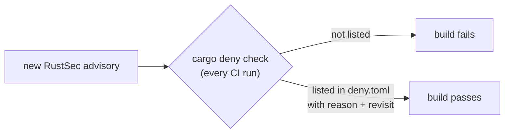

# ADR 0003 — Dependency advisories, exceptions and RSA blinding

- **Status:** accepted (2026-11-11); adopted by rv-timeline on 2026-11-13 (copied from rv-mailauth; the rv-timeline part is added below)
- **Scope:** every Rakvor tool; the forge template (Rust: `cargo deny`; Python: `pip-audit`)

## Context

CI checked dependency licences but not advisories. A check on 2026-11-10 found, in every tool: tokio 1.54.0
(yanked), `time` 0.3.45 (RUSTSEC-2026-0009) and `ctutils` 0.4.2 (RUSTSEC-2026-0385), plus RUSTSEC-2023-0071
("Marvin", a timing side channel in rsa 0.9). Four repositories had no cargo-deny configuration at all.

## Decision

1. Every repository runs `cargo deny check advisories licenses bans sources` in CI with the same `deny.toml`
   policy; a new advisory fails the build. Python projects from the forge run `pip-audit` over the hash-pinned
   `uv export`.
2. An exception is an `ignore` entry naming the advisory, why it does not apply to how the crate is used, and when
   it is revisited.
3. Fixed versions may need a newer compiler: `rust-version` was raised from 1.85 to 1.88 (the build toolchain is
   pinned at a newer version anyway, so releases were unaffected). rv-timeline declares `rust-version` 1.88 and
   pins 1.97.0 in `rust-toolchain.toml` ([development.md](../development.md#toolchain-pin)).
4. **RUSTSEC-2023-0071 is an exception.** rsa 0.9 comes in through `cms` 0.2, and no stable `cms` uses rsa 0.10.
   The examiner's key only signs (never decrypts), and since 2026-11-10 it signs only through `BlindedSigningKey`
   in `trust.rs`: `cms` signs through the plain `Signer` trait, which rsa 0.9 implements **without** blinding, so
   the wrapper signs with OS randomness. PKCS#1 v1.5 signatures are deterministic: the bytes are unchanged and a
   test proves it. Revisit when a stable `cms` 0.3 is released.
5. **In rv-timeline** rsa 0.9 comes in only through `cms` 0.2 and `trust.rs`, as in the other tools: the
   examiner's key signs PDF reports through `BlindedSigningKey`, and TSA tokens are only verified (public keys).
   The shared `deny.toml` entry for RUSTSEC-2023-0071 also names rv-mailauth's verify-only use through
   `mail-auth`, which this tool does not link; the policy file is identical in every tool and is not edited here.
   The timeline readers parse other tools' JSON outputs with `serde_json` and add no cryptographic dependency.

## Consequences

- A dependency advisory published between two commits can turn CI red without a code change; that is intended.
- The Python profile signs PDFs through pyHanko and `cryptography` (OpenSSL), which blinds RSA by default.
