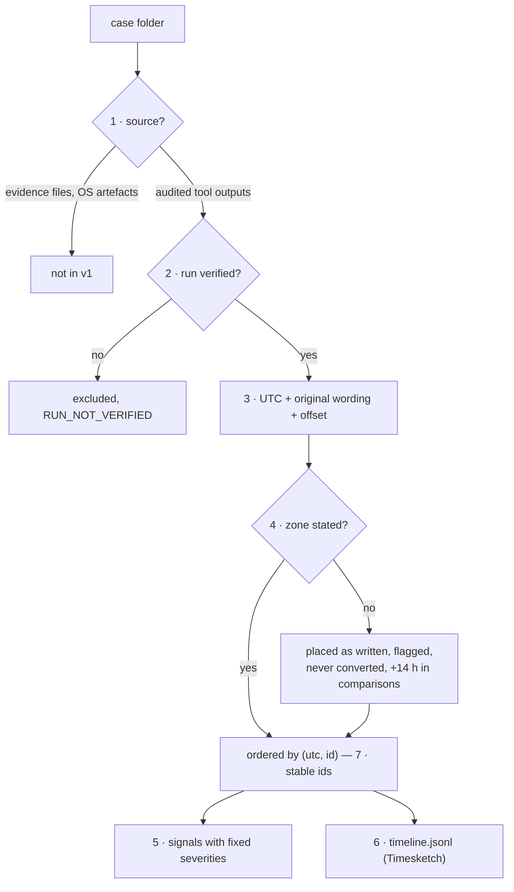

# ADR 0004 — Timeline design: sources, verification, time handling, signals, output, event ids

- **Status:** accepted (2026-11-13)
- **Scope:** rv-timeline (`src/core/src/model.rs`, `readers/`, `engine.rs`, `run.rs`, `src/gui/src/viewer.rs`)

## Context

A case timeline is only useful in court if every line can be traced to evidence, if it never presents a guess as
a fact, and if it is the same every time it is built. It joins the results of six tools that each have their own
validation, written by different runs at different times, from devices whose clocks and zones are unknown to the
tool. Seven decisions follow; each is visible in the code and in the reports.

## Decision

1. **Tool outputs only, in v1.** The sources are the audited outputs of the six Rakvor tools' runs in the case
   folder; the evidence files are never opened. Every time therefore has a citation into an output whose digest is
   in a hash-chained, case-anchored audit log, and the timeline adds no new parser of evidence formats (each
   tool's parser has its own validation). A time no tool extracted is absent, and every report says so
   (`TL_TOOL_OUTPUTS_ONLY`). Other sources (OS logs, plaso) need readers with an equivalent verification story.
2. **Verify before read.** A run is read only if its audit chain is intact, it finished, the case log announces it
   and anchors its final entry, a reader supports its exact major.minor version, and every machine-readable output
   it recorded still has its digest; readers re-check each file's digest when they read it. Any failure excludes
   the **whole** run (never a partial read), with a reason, a `RUN_NOT_VERIFIED` signal and exit code 3. An
   unsupported version is excluded rather than read "best effort": a format change must not silently change the
   timeline.
3. **UTC plus the original.** Every event is placed by its UTC instant (integers: seconds and nanoseconds, because
   the audit chain is canonical JSON without floats) and keeps the source's own wording, offset and precision. The
   display zone (UTC, fixed offsets, `America/Bogota`, `Europe/Paris` with built-in CET/CEST rules, no tz database
   to ship or update) only adds a column; ordering is always by UTC.
4. **Zone-unknown is never guessed.** A value without a stated zone is placed as its wall clock read as UTC,
   flagged (`zone: unknown`, `offset_min: null`), never converted for display, counted (`ZONE_UNKNOWN_EVENTS`,
   info), and every comparison involving it widens its tolerance by 14 h (`ZONE_MARGIN_S`). Guessing the
   examiner's or the case's zone would look precise and could be wrong by hours; a flagged value is honest. The
   only zone applied to a zone-less source is one the examiner gave a tool explicitly (rv-rsmf `--timezone`),
   recorded in the event's details.
5. **Signal severities.** Signals compare sources with a stated tolerance (`--clock-skew`, default 300 s) and
   never conclude. **High** only where a source contradicts the audited intake itself (`EXIF_AFTER_INTAKE` with a
   stated zone, or beyond 14 h); **medium** where two sources disagree beyond what clocks usually explain
   (`MAIL_DATE_AFTER_FIRST_HOP`, `PDF_REVISION_BEFORE_PREVIOUS`, `FILE_MODIFIED_AFTER_INTAKE`, `EVENT_IN_FUTURE`,
   and `RUN_NOT_VERIFIED` when a run's own record is inconsistent); **low** where a clock or zone offset is the
   likely explanation (`CLOCK_SKEW_SUSPECTED`, both bases) or a run is merely missing (`RUN_NOT_VERIFIED` for
   `not_finished`, unsupported tool or version, unreadable); **info** for counts. Exit code 3 for any excluded run
   or any medium/high signal. These are proposals: no error rates have been measured (gap G5).
6. **Timesketch JSONL.** The machine output is one JSON line per event with Timesketch's required `message`,
   `datetime` and `timestamp_desc` and every citation field as `rakvor_*` attributes, keys sorted, so the file is
   byte-identical on every rebuild and its digest is meaningful. Timesketch is the open-source tool examiners
   already use for super-timelines; signals stay in `statistics.json` and cite event ids.
7. **Event-id convention.** `<tool>:<run_id>:<item>[/]:<kind>:<n>` with `n` from 0 per (run, item/sub, kind)
   in file order: unique in a timeline, stable across rebuilds, readable by a person, and derivable independently
   from the tools' outputs (the sample's ground truth is computed that way). One event per time value written, per
   run; nothing derived.

## Alternatives considered

- *Parse the evidence directly (EXIF, PDF, mail) in the timeline:* rejected for v1 — a second parser per format to
  validate, and two tools that may disagree about the same file without either being audited for it.
- *Read runs that fail verification, with a warning:* rejected — a timeline mixing verified and unverified times
  cannot be relied on line by line; excluding and saying why is clearer.
- *Assume the case's or the examiner's zone for zone-less values:* rejected (decision 4). *Drop them:* rejected —
  they are often the only time a photo carries.
- *Use the IANA tz database:* rejected for v1 — two named zones cover the firm's jurisdictions, and their rules are
  short enough to test exhaustively; other zones can be given as fixed offsets.
- *Plaso storage or CSV:* plaso's format ties the output to one tool's version; CSV loses types. JSONL is what
  Timesketch imports directly and what scripts read.
- *Hash-based or random event ids:* rejected — not readable, and a random id changes on every rebuild.

## Consequences

- The timeline is **derived analysis**: an error in a tool's reading passes into it unchanged, so its weight rests
  on each tool's validation ([admissibility.md](../admissibility.md#41-a-timeline-is-derived-analysis), G-TL1).
- A new minor version of any tool excludes its runs until a reader supports it (G-TL5); the sample case must be
  regenerated with the tools' released versions.
- A run of a tool without a reader (for example a future Rakvor tool) in the case makes every build exit 3 with a
  low `RUN_NOT_VERIFIED` (`unsupported_tool`) until a reader exists.
- Signals depend on the filters: `--tool`, `--from`/`--to` and `--max-events` remove events before the signals are
  computed; the options are recorded and printed.
- Changing a severity or a rule changes exit codes and reports; it needs a new ADR entry, the unit tests in
  `engine.rs` and a regenerated `docs/reports.md`.
