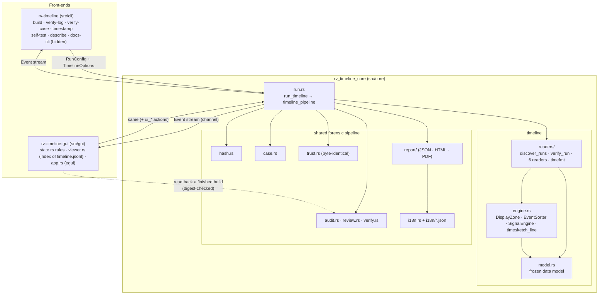
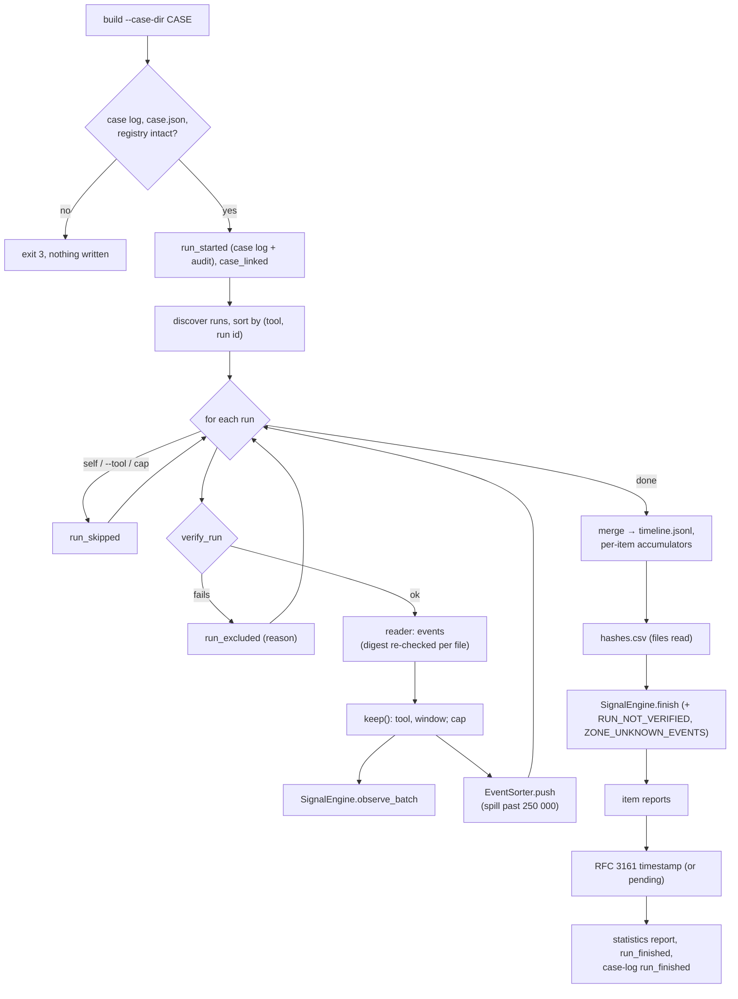
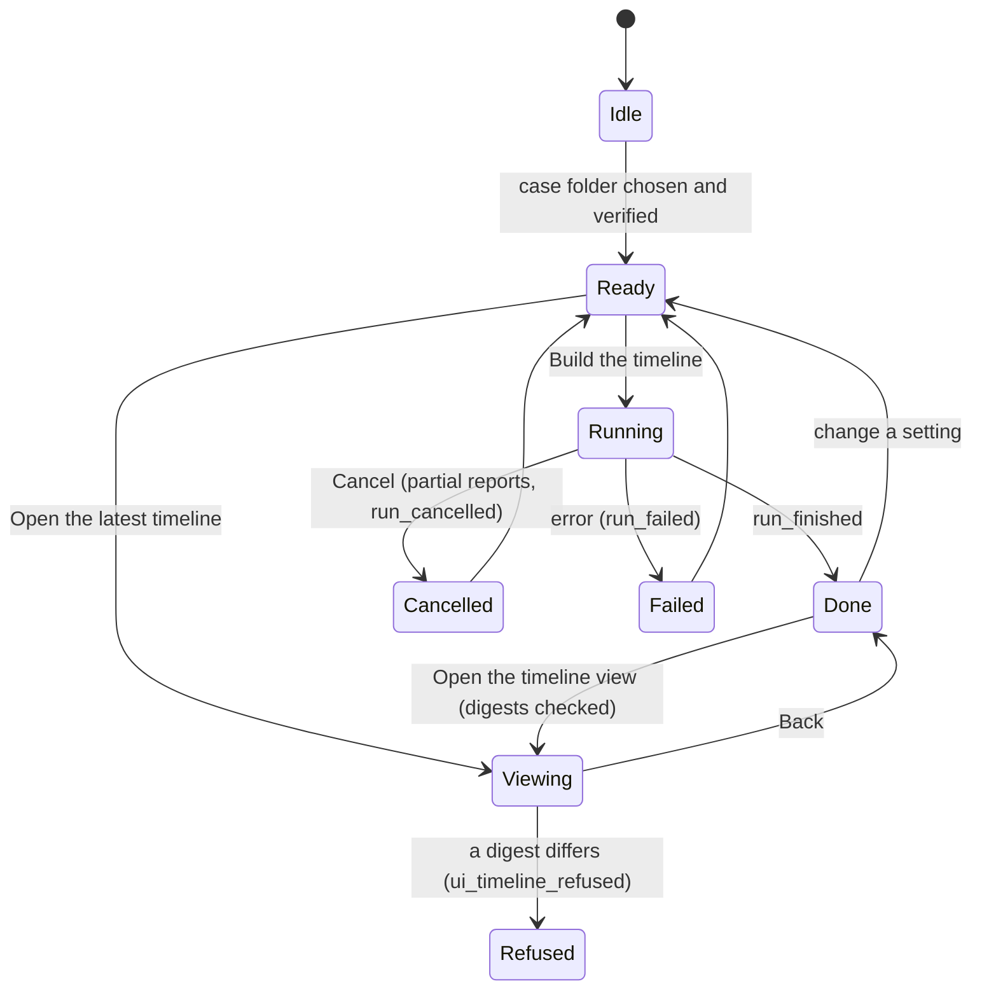

# Architecture

One engine, two front-ends. The engine (`src/core`) does all the work and never prints; the CLI and the GUI only
turn user input into a `RunConfig` plus `TimelineOptions` and render the `Event`s the engine emits, so both
interfaces produce identical logs, timelines and reports. Inside the engine, the forensic pipeline (hashing, audit
chain, case folder, reports, trust) is shared with every Rakvor tool; the timeline adds the **readers** (one per
tool, with run discovery and verification) and the **engine** (ordering, signals, Timesketch output), driven by
`run::run_timeline`.

## Modules

| Module | Responsibility |
| --- | --- |
| `model.rs` | The data model shared by readers, engine, outputs and front-ends: `TimeEvent`, `ItemRef`, `SourceRef`, `RunRef`, `Signal`, `Timeline`, `TimelineOptions`, the `SourceReader` trait. Frozen for v0.1; its module doc holds the **conventions** (event ids, what counts as an event, kinds per tool, zones). |
| `readers/mod.rs` | `discover_runs` (case log, then unannounced folders), `verify_run` (chain, finished, case-log anchor, reader version, output digests), `RunData` (a run's audit log, recorded digests, items; `check_file` re-checks a digest when reading), `Emitter` (event ids and skipped-value count), the reader table. |
| `readers/timefmt.rs` | Strict parsers: RFC 3339/ISO 8601, RFC 5322, EXIF (+ OffsetTime, SubSecTime), PDF dates, X.509, OpenSSL text; precision and zone kept. |
| `readers/<tool>.rs` | One reader per tool (hashinv, pdfauth, imgauth, rsmf, mailauth, certcheck). |
| `engine.rs` | `DisplayZone` (UTC, fixed offsets, America/Bogota, Europe/Paris with CET/CEST), formatting, `cmp_events` and `keep`, `EventSorter` (external merge sort past 250 000 events), `SignalEngine` (incremental cross-source signals), `timesketch_line`. |
| `run.rs` | Orchestration: case link, discovery, verify-then-read loop with filters and cap, ordering, `timeline.jsonl`, `hashes.csv` of the files read, signals, item reports, timestamp, statistics, case-log `run_finished`; cancellation. (The module also keeps the shared evidence pipeline the forge template provides; `build` does not use it.) |
| `audit.rs`, `review.rs`, `verify.rs` | Append-only hash-chained `audit.jsonl`; the review log of GUI viewing anchored to `run_finished`; `verify-log` (chain, timestamps, truncation anchors, review log). |
| `case.rs` | Shared case folder: `case.json`, hash-chained `case-log.jsonl` under a lock, the registry (read only: analysis role), `verify_case`. See [case-folder.md](case-folder.md). |
| `trust.rs` | RFC 3161 client and verifier, PDF signing — byte-identical in every Rakvor tool ([ADR 0002](adr/0002-tsa-token-verification.md)). |
| `report/` | View models → minijinja HTML (`templates/`), built-in PDF writer, schema-versioned JSON; the timeline sections (runs, events, signals) of the statistics and item reports. |
| `hash.rs`, `env.rs`, `events.rs`, `i18n.rs` | Digests and the known-answer self-test; `environment.json`; typed progress events; the EN/ES/FR catalogues. |
| `src/gui/src/state.rs`, `viewer.rs` | Every rule the window enforces (settings validation, `ui_*` actions, review log), and the read-back of a finished build: digest checks of `statistics.json` and `timeline.jsonl`, a compact line index, rows read on demand with their hash re-checked — headless-testable. |

## One build, step by step

Memory stays bounded whatever the case size: the sorter keeps at most 250 000 events in memory and spills sorted
chunks to `<RUN>/tmp/`; the signal engine keeps only the few kinds it compares (intake, `exif.original`,
`fs.modified`, mail dates and hops, PDF revision times, the first value per tool for skew); item reports keep at
most 200 events per item; the GUI viewer keeps an index of a few dozen bytes per event.

## Build states (as the GUI sees them)

## Concurrency and cancellation

The build runs on one worker thread (GUI) or the main thread (CLI); runs are verified and read one after the other,
in a fixed order, so the audit log and the event ids are deterministic. The case log is shared with other tools and
written only under `case-log.lock`. Cancellation (Ctrl+C, GUI *Cancel*) is checked between runs: the current run
finishes, `run_cancelled` is recorded, partial reports are written and the exit code is 130.

## Why Rust

Same language as the other Rakvor tools, whose shared code this tool reuses (`trust.rs` byte for byte; the
case-folder and audit-chain rules), a single static executable per front-end, and memory safety for parsers that read
attacker-influenced outputs. Decision record: [ADR 0001](adr/0001-language.md). Timeline design decisions:
[ADR 0004](adr/0004-timeline-design-decisions.md).
