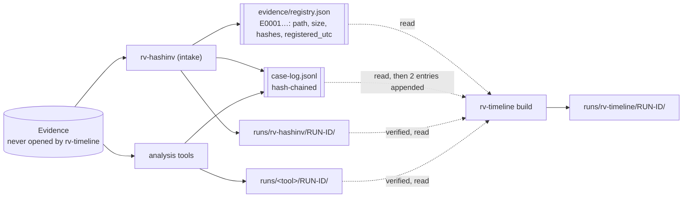
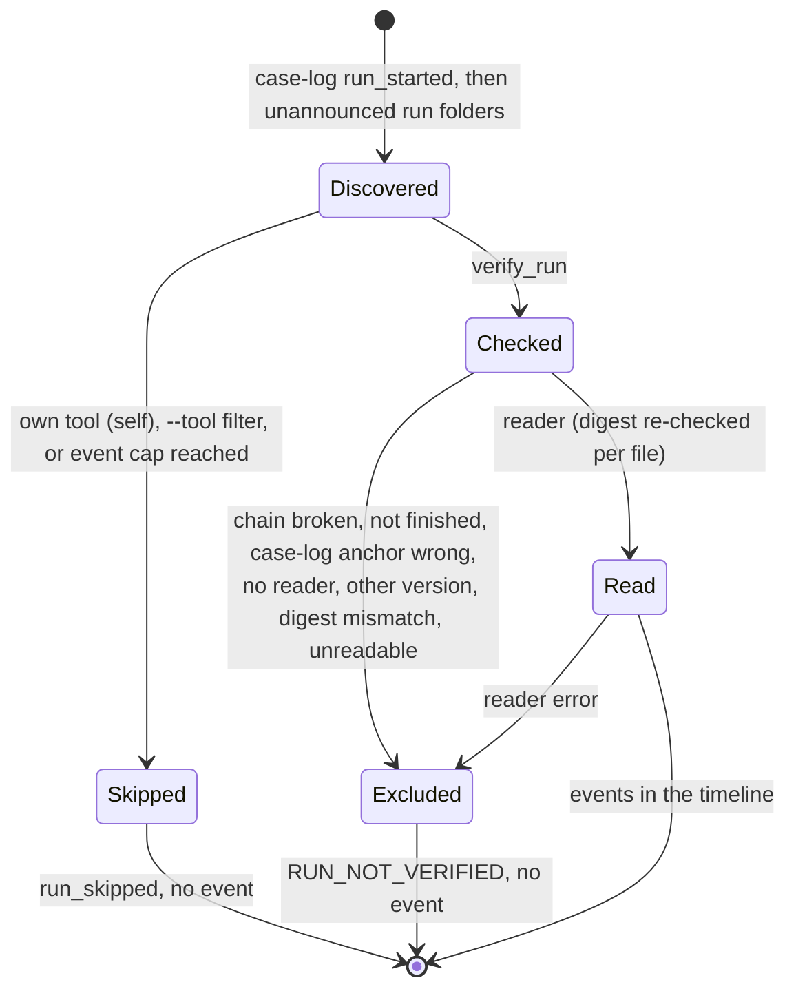

# Case folder

Every Rakvor tool of a case works in **one case folder** (`rakvor.case/1`): RV HashInv, the **intake** tool,
registers each evidence file once and gives it an evidence id (`E0001`, `E0002`, …); every **analysis** tool
re-hashes each file it examines, compares it with that registry and links its own audit chain to the case log.
RV Timeline is an analysis-role tool of a special kind: its input is the case folder itself. It **reads** the
case's records and the other tools' runs, **never writes** them, and puts its own run in
`runs/rv-timeline/<RUN-ID>/`.



The contract (schemas, events, rules) is the same in every Rakvor tool and in both forge profiles (Rust and
Python); `verify-case` of any tool checks the same things.

## Layout (`rakvor.case/1`)

```text
<CASE>/
  case.json                   {"schema":"rakvor.case/1","case_id","jurisdiction","created_utc",
                               "created_by":{"tool","version","run_id","actor"}}       (written once, at intake)
  case-log.jsonl              hash-chained case log (same algorithm as audit.jsonl), append-only
  case-log.lock               exists only while a tool appends to the case log
  evidence/registry.json      {"schema":"rakvor.registry/1","items":[{evidence_id, path, size, hashes,
                               registered_by:{tool, version, run_id, audit_seq}, registered_utc}]}
  evidence/registry.csv       the same, one row per item
  runs/<tool>/<RUN-ID>/       one folder per tool run: logs/ (audit.jsonl, environment.json, hashes.csv,
                               timestamp-*.tsr|.json, review.jsonl) and reports/ (and tool-specific outputs)
  runs/rv-timeline/<RUN-ID>/  the timeline builds
```

## What rv-timeline reads, and what it writes

| Path | Read | Written |
| --- | --- | --- |
| `case.json` | schema (`rakvor.case/1`), case id, jurisdiction | never |
| `case-log.jsonl` | chain, the `run_started` / `run_finished` of every run (version, folder, status, `audit_entries`, `audit_head`) | `run_started` and `run_finished` of the build, under the lock |
| `evidence/registry.json` | evidence ids, paths, registered digests, `registered_utc` (the intake anchor of the signals) | never |
| `runs/<tool>/<RUN-ID>/logs/audit.jsonl` | chain, `run_started`, `run_finished`, items, recorded outputs and their digests, run-level times | never |
| `runs/<tool>/<RUN-ID>/…` outputs recorded with a digest (`.json`, `.csv`, `.jsonl`) | digest checked, then read by the tool's reader | never |
| HTML / PDF renderings of other tools' reports | not read | never |
| Evidence files | not read | never |
| `runs/rv-timeline/<RUN-ID>/` | — | everything the build produces ([reports.md](reports.md)); a temporary `tmp/` for the external sort, removed at the end |

`hashes.csv` of the build lists the files of the first, third, fourth and fifth rows that were read, with their
digests at the moment of reading ([reports.md](reports.md#hashescsv-the-files-read)). The forge's project validator
checks this contract: after a build, nothing in the case folder outside `runs/rv-timeline/` and `case-log.jsonl`
may have changed.

## Using it

```powershell
# 1. Intake: open the case and register the evidence (rv-hashinv)
rv-hashinv scan -i E:\export -r --case-dir E:\CASE-014 --case CASE-014 --jurisdiction co

# 2. Analysis: each tool re-verifies the items against the registry
rv-pdfauth analyze -i E:\export\pdf --case-dir E:\CASE-014
rv-mailauth analyze -i E:\export\mail --dkim-keys E:\keys\case-keys.txt --case-dir E:\CASE-014

# 3. The timeline of everything recorded so far
rv-timeline build --case-dir E:\CASE-014 --display-zone America/Bogota

# 4. Check the whole case before handing it over (any tool's verify-case; they agree)
rv-timeline verify-case E:\CASE-014 --rehash
```

A build can be repeated at any time: each build is a new run folder; earlier builds stay (and are skipped as
sources: rv-timeline never reads its own runs, reason `self`). Building again after a new tool run includes it.

## Which runs become sources



A run folder the case log never announced is discovered too, and excluded (`not_finished`: the case log does not
announce it): a run copied into the folder by hand is listed, never used. Rules in detail:
[theory.md B3](theory.md#b3-run-discovery-and-verification).

## Safety rules

| Rule | Why |
| --- | --- |
| A broken case is never extended: before appending, the case log, `case.json` and the registry digest are re-verified under the lock; on failure the build stops with exit 3 and nothing is written | a build cannot silently rest on an edited case |
| One writer at a time: `case-log.lock` is created exclusively; a tool waits up to 30 s; a lock older than 10 minutes is reported as stale and **never deleted automatically** | two tools never interleave case-log entries |
| The registry is written only by the intake role | the reference digests and intake times cannot drift |
| `--case <ID>` must match `case.json` (exit 2 otherwise) | the build is about the case you think it is |
| The case's jurisdiction (`case.json`) sets the custody form; `--jurisdiction` is recorded as requested | the forms of one case agree |
| Run folders are read only through `runs/<tool>/<run>` paths; every output path an audit log records must be a plain relative path (forward slashes, no `..`, root, drive, empty component or `:`); folders and files are resolved with symbolic links and junctions followed and must stay inside the case folder, else the run is `unreadable` | a crafted case log, audit log or link cannot make the build read outside the case |
| Events of an item whose examined copy differed from the registry carry `registry_match: differs` | a time read from the wrong copy is never presented as the registered evidence's |

## Windows: paths

Paths in the registry and the tools' outputs are kept **as the tools recorded them** (for example `R:\evidence\…`
in the sample case, written from a `subst` drive). rv-timeline does not open them, so a case folder copied to
another machine or drive builds the same timeline. Deep run folders (rv-rsmf's per-conversation outputs) can exceed
260 characters on Windows: keep case folders near the root of a drive, and for git checkouts of this repository set
`core.longpaths` ([development.md](development.md#windows-long-paths)).

## Exit codes with a case folder

| Situation | `build` exit |
| --- | --- |
| Not a case folder (no readable `case.json` with schema `rakvor.case/1`) | 2 |
| `--case` names another case | 2 |
| The case log is locked by another tool | 1 |
| The case fails verification (nothing is written) | 3 |
| Built, with an excluded run or a medium/high signal | 3 |
| Built, every run verified, no medium/high signal | 0 |

## How a reviewer verifies a case

```powershell
rv-timeline verify-case E:\CASE-014                 # case log, case.json, registry, every run (the builds included)
rv-timeline verify-case E:\CASE-014 --rehash        # + every reachable evidence file against the registry
rv-timeline verify-log E:\CASE-014\runs\rv-timeline\<RUN-ID>\logs   # one build, its timestamp and review log
```

`verify-case` checks, for every `run_started` in the case log: the run's `audit.jsonl` chain and timestamp tokens;
that its `case_linked` names this case and quotes the `run_started` hash; that entry `audit_entries` has hash
`audit_head`, with only `timestamp_obtained` after it; and the run's `review.jsonl` when present. It warns about
run folders the case log never announced and runs still in progress. It does **not** re-check other tools' output
files against their digests — `rv-timeline build` does that for the files it reads, which is why the tampered copy
`digest-mismatch` of the sample passes `verify-case` and is caught by the build
([examples/sample](../examples/sample/README.md#tampered-copies)).

## Tests

The sample case ([examples/sample](../examples/sample/README.md)) is a real case folder written by the six released
tools; its three tampered copies each break one run in one way (digest mismatch, broken chain, not finished).
[src/core/tests/sample_case.rs](../src/core/tests/sample_case.rs) builds the timeline of each and compares runs,
events and signals with `expected_timeline.json`; [src/core/tests/readers.rs](../src/core/tests/readers.rs) covers
discovery, every verification rule and each reader; the CI job "Cross-profile golden case" verifies a case folder
written by the forge's Python profile.
