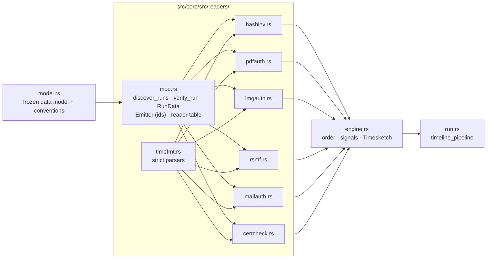
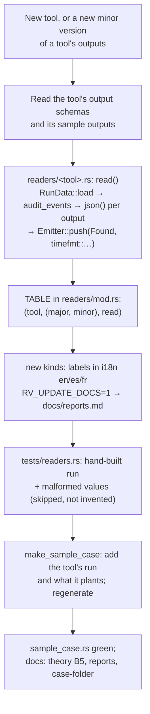
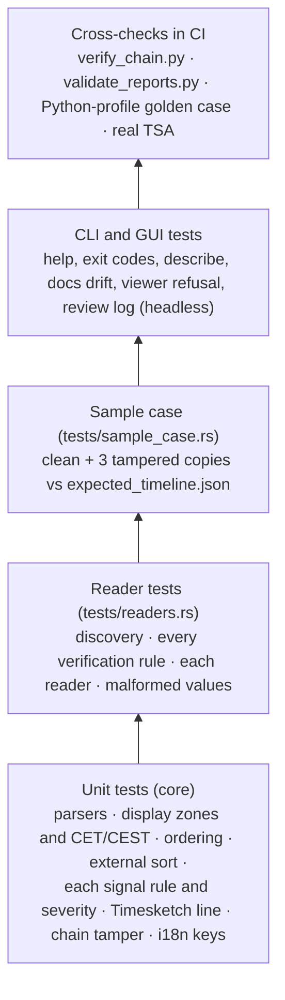
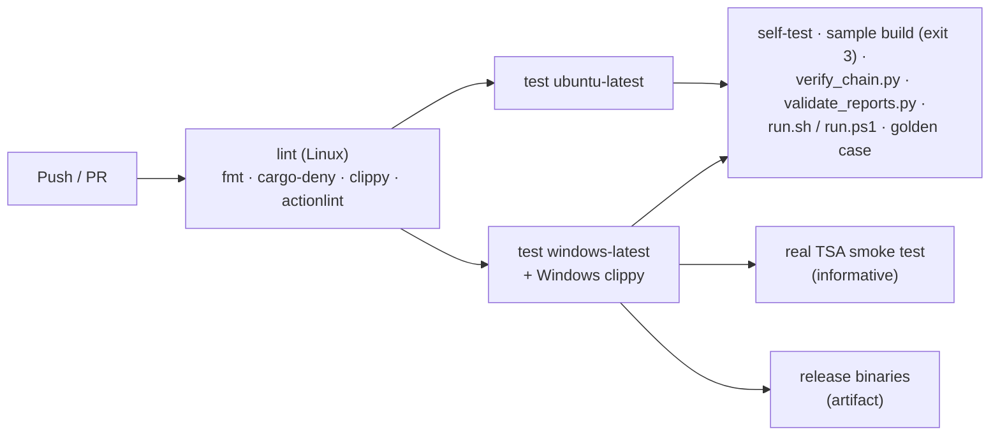
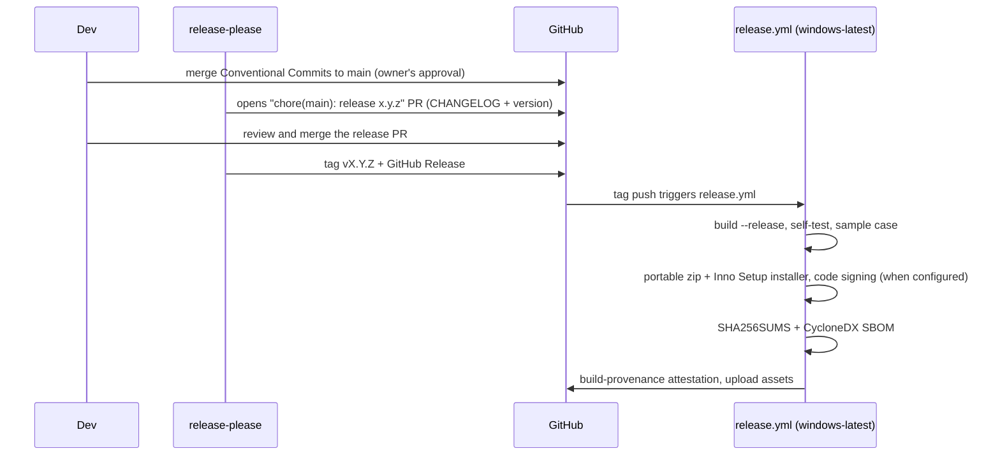

# Development, CI/CD and releases

For the project's state, layout and open work start with [HANDOFF.md](HANDOFF.md); the design decisions are in
[adr/](adr/). This page is the developer's reference: how to build and test, how the readers work and how to add
one, the conventions they follow, the sample case and its ground truth, and how CI and releases run.

## Build and test locally

```bash
export RV_TEST_PYTHON=python          # Python with blake3 jsonschema pyhanko (the test helpers)
cargo build --workspace               # debug build of core, CLI and GUI
cargo test  --workspace --locked      # unit + integration tests (GUI tests are headless)
cargo clippy --workspace --all-targets --locked -- -D warnings
cargo fmt --all -- --check
cargo deny check                      # advisories, licences (no GPL/AGPL/LGPL), bans, sources
cargo build -q -p rv-timeline-cli && sh examples/sample/run.sh target/debug/rv-timeline   # the sample case
python ../rakvor-tool-forge/scripts/validate_project.py . --run --tests                    # the Rakvor contract
cargo run -p rv-timeline-gui
```

Linux needs no system packages to build. On Windows use the MSVC toolchain; binaries are linked with the static C
runtime (`.cargo/config.toml`), so they run on a clean Windows 10/11. On a small Windows machine,
`CARGO_PROFILE_DEV_DEBUG=0 CARGO_INCREMENTAL=0` keeps the debug build small.

### Windows long paths

The sample case holds deep run folders (rv-rsmf writes one RSMF file per conversation and day; the longest path in
the repository is 157 characters before the checkout folder). Together with a checkout under a long folder (a
user profile, a temporary folder) they pass Windows' 260-character limit and git fails to check them out. Enable
long paths once:

```bash
git config --global core.longpaths true          # or per clone: git clone -c core.longpaths=true …
```

and, for tools that use the Win32 API without long-path awareness, keep clones near the root of a drive. The
Rust code uses `std::path` throughout and is not affected by the limit.

### Toolchain pin

| Pin | Value | Why |
| --- | --- | --- |
| `rust-toolchain.toml` | **1.97.0** (rustfmt, clippy, minimal profile) | One compiler for local builds, CI and releases, so lints do not drift and an auditor rebuilds a release with the compiler recorded in its `environment.json` (`tool.rustc`). Bump it deliberately, in this one file, with a green CI. |
| `rust-version` (workspace `Cargo.toml`) | **1.88** | The minimum (edition 2024; the fixed versions of `time` and `tokio`, [ADR 0003](adr/0003-dependency-advisories.md)). |
| `chrono` | workspace | Calendar arithmetic for the strict parsers, the CET/CEST rule and formatting; no tz database is used. |

## How the code is organised



Architecture overview: [architecture.md](architecture.md).

## Readers

One reader per tool, each a function `read(case_dir, run) -> Result<ReadOutcome, ReadError>` registered in the
table of [readers/mod.rs](../src/core/src/readers/mod.rs) with the **major.minor** of the tool's output it
understands:

| Tool | Version | Reads |
| --- | --- | --- |
| rv-hashinv | 0.4 | `reports/items/*/technical.json` (`/case/intake_utc`), audit `evidence_registered`, `item_started` |
| rv-pdfauth | 0.4 | `objects.json` (Info dictionaries, signature `/M` per revision), `technical.json` (CMS signing time, XMP save dates) |
| rv-imgauth | 0.3 | `metadata.json` (EXIF tags with OffsetTime* / SubSecTime*, GPS, XMP, XMP history, PNG) |
| rv-rsmf | 0.3 | `rsmf/trace.json` (one row per chat event: kind, `source_time`, `utc`, conversation, RSMF file) |
| rv-mailauth | 0.2 | `headers.json` (Date, Received hops with positions, attachments, `.msg` times), `mbox_index.json` |
| rv-certcheck | 0.2 | `chain.json` (validity, revocation, RFC 3161 genTime) |

Every reader starts with `RunData::load` (audit chain checked, recorded digests collected), emits the run-level
events with `Emitter::audit_events` (`run.started`, `run.finished`, `run.timestamped`, `fs.modified`), then reads
only outputs its audit log records, through `RunData::json` / `check_file`, which re-check the digest at the moment
of reading. Each time value goes through `Emitter::push(Found { item, kind, original, file, file_sha256, pointer,
details }, timefmt::<parser>(value))`: the emitter assigns the id and counts a value whose parser returned `None`
as skipped, with a warning (never invented).

### Conventions (the contract with the engine and the sample's ground truth)

The module documentation of [model.rs](../src/core/src/model.rs) ("Conventions") is authoritative; in short:

- **One event per time value written in an audited output, per run.** Nothing derived (first/last, durations).
  Two source values with the same instant are two events.
- **Event id** `<tool>:<run_id>:<item>[/<sub>]:<kind>:<n>`: item = evidence id, `i<index>` when the run did not
  link the item to the registry, `run` for run-level events; `/<sub>` only when there is a sub-item; `n` from 0 per
  (run, item/sub, kind) in file order.
- **Sub-items**: PDF revision `r<n>` (from 1), mbox message `#<n>`, chat `<conversation>/<day>`, certificate `c<n>`
  only in files holding several.
- **Zone**: explicit only when the value or the tool's output states it; otherwise `Unknown`, wall clock read as
  UTC, `offset_min` null. Never apply a zone the source did not give.
- **Kinds** are dotted keys; each needs a label in the `kind` section of `i18n/en.json`, `es.json` and `fr.json`
  (a test checks the three catalogues have the same keys, and [reports.md](reports.md#event-kinds) is generated).
- **Details** are short strings (capped at 200 characters): sender, relay host, revision, camera model.
- **The data model is frozen for v0.1**: new fields only with `#[serde(default)]`; never rename or remove one.

### Adding or updating a reader



1. Write `src/core/src/readers/<tool>.rs` following an existing reader ([hashinv.rs](../src/core/src/readers/hashinv.rs)
   is the shortest). Use the strict parsers of [timefmt.rs](../src/core/src/readers/timefmt.rs); add a parser there
   (with tests) for a new format rather than parsing loosely in the reader.
2. Register it in `TABLE` with the major.minor it supports. A tool's new **minor** version needs a reader decision:
   if the outputs read are unchanged, bump the entry (and say so in the commit); otherwise add the new handling.
   Never widen `supports` to "any version": an unknown format must exclude the run (`unsupported_version`).
3. Give every new kind a label in the three i18n catalogues, and regenerate the generated tables:
   `RV_UPDATE_DOCS=1 cargo test -p rv-timeline-core --test docs_catalogue`.
4. If the tool brings a time the signals should compare, extend `SignalEngine` in [engine.rs](../src/core/src/engine.rs)
   (unit tests for each rule and its severity), the i18n `signals` section and `SIGNAL_CODES`.
5. Test it in [tests/readers.rs](../src/core/tests/readers.rs) (hand-built run folders: ids, pointers, digests,
   skipped values, exclusion reasons) and in the sample case below.
6. Update [theory.md B5](theory.md#b5-readers-and-time-formats), the model.rs conventions table and
   [reports.md](reports.md).

## The sample case and its ground truth

[examples/sample](../examples/sample/README.md) holds a real case folder written by the six released tools on
curated synthetic evidence, three tampered copies, and `expected_timeline.json`. They are **generated, never edited
by hand**:

```bash
tests/make_sample_case.sh [RAKVOR_ROOT]          # Linux, macOS, Git Bash
.\tests\make_sample_case.ps1 [-RakvorRoot C:\…]  # Windows wrapper (Git for Windows' bash)
```

`RAKVOR_ROOT` (default: the parent folder) holds the six tool repositories, each built with
`cargo build --release --locked -p <tool>-cli` at its released version (the script refuses a binary whose
`--version` differs from its `version.txt`). On Windows the tools run from a `subst` drive (`RV_SAMPLE_DRIVE`,
default `R:`) with neutral host and user names, so the case records no local path or account. Steps:

1. `make_sample_case.py evidence`: copy the tools' sample files and derive three planted files (same-length byte
   replacements, listed in `derived-evidence.json`); fix every modification time.
2. Run rv-hashinv (intake), touch one file, run rv-hashinv again on it, then rv-pdfauth, rv-imgauth, rv-rsmf
   (`--timezone Europe/Paris`), rv-mailauth and rv-certcheck, all with `--case-dir`, `--no-timestamp`.
3. Prune the HTML/PDF renderings (their digests stay in the audit logs); `verify-case` of each of the six tools
   must pass.
4. `make_sample_case.py tamper`: write the three tampered copies (`digest-mismatch`, `chain-broken`,
   `not-finished`) and check each tool's `verify-case` verdict on them (`check-verify`).
5. `make_sample_case.py expected`: derive `expected_timeline.json` from the tools' outputs with the **standard
   library only** — independently of the Rust readers — following the conventions above.

[src/core/tests/sample_case.rs](../src/core/tests/sample_case.rs) builds the timeline of the clean case and of each
tampered copy and compares runs, every event id, UTC time and original, the zone-unknown count and each signal's
code, item and severity with the ground truth. A disagreement means a reader, the engine or the script is wrong:
fix the code or the convention, never the JSON. Run ids and run/intake times change on every regeneration (the
tools have no fixed clock), so the whole folder is replaced at once.

## Test pyramid



Generated documentation, checked by tests: `docs/usage-cli.md` (`rv-timeline docs-cli`; regenerate with
`cargo run -q -p rv-timeline-cli -- docs-cli > docs/usage-cli.md`) and the generated tables of `docs/reports.md`
(`RV_UPDATE_DOCS=1 cargo test -p rv-timeline-core --test docs_catalogue`).

## Continuous integration



`ci.yml` runs on every push and pull request with read-only permissions.

## Releasing



| Artifact | Built by |
| --- | --- |
| `rv-timeline-X.Y.Z-windows-x64.zip` | portable: both exes + README + LICENSE + NOTICE + CHANGELOG + `docs/` + `examples/` |
| `rv-timeline-X.Y.Z-windows-x64-setup.exe` | Inno Setup (`packaging/windows/installer.iss`), per-user install, adds the CLI to PATH |
| `SHA256SUMS` | `sha256sum` over the assets |
| `sbom.cdx.json` | `cargo cyclonedx` |
| Attestation | `actions/attest-build-provenance` |

Full procedure (secrets, signing certificate, test packages, rebuilding a release, manual packaging):
[release-process.md](release-process.md). Never merge, push to `main`, force-push or publish a release without the
owner's approval.

### Release checklist (manual)

- [ ] `rv-timeline self-test` on the released exe passes on Windows 10 **and** Windows 11
- [ ] `examples\sample\run.ps1` with the released exe passes (exit 3 from `build`, timeline listed, verify OK)
- [ ] GUI opens on the sample case, builds, *Open the timeline view* works, *Open report* works
- [ ] `SHA256SUMS` matches the downloaded files; `gh attestation verify` passes; every `.exe` chains to the Rakvor root
- [ ] CHANGELOG entry reviewed by a human
