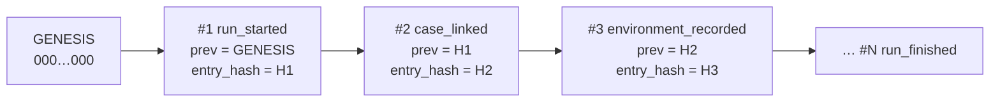
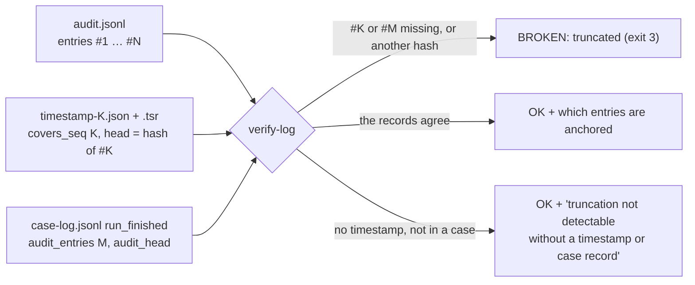
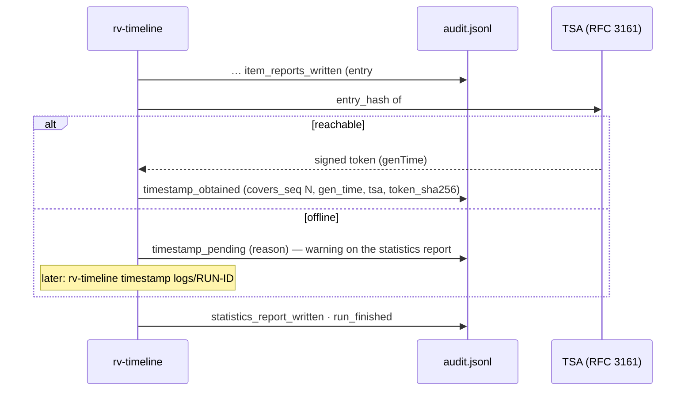
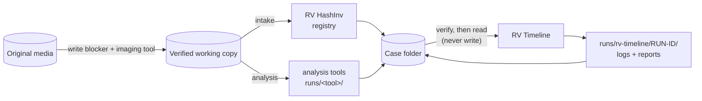

# Forensic audit trail

Everything RV Timeline does is written to `<CASE>/runs/rv-timeline/<RUN-ID>/logs/`. The folder is designed so that
a second examiner, months later, can check **which tool runs were read or left out, which files were read, by
whom, with which tool version and options**, and that the record was not altered.

| File | Content |
| --- | --- |
| `audit.jsonl` | One JSON object per action, hash-chained (authoritative) |
| `audit.log` | The same actions as readable text (convenience copy) |
| `hashes.csv` | Register of the case files the build read: `index,path,size,<algo1>[,<algo2>],status,error` ([reports.md](reports.md#hashescsv-the-files-read)) |
| `review.jsonl` | GUI viewing after the build, hash-chained and anchored to `run_finished` (when any) |
| `environment.json` | Tool version, compiler, target, every dependency version, OS, host, OS user, working folder, command line |

## The hash chain



Each entry has: `seq`, `ts_utc`, `run_id`, `actor`, `action`, optional `item`, `details`,
`prev_entry_hash`, `entry_hash`.

```text
entry_hash = SHA-256( canonical JSON of the entry without "entry_hash" )
canonical  = keys sorted at every level, no spaces, UTF-8, integers only
             (Python: json.dumps(e, sort_keys=True, separators=(",", ":"), ensure_ascii=False))
```

Editing a value changes that entry's hash; deleting or re-ordering breaks `seq` and `prev_entry_hash`.
Verify with either implementation:

```bash
rv-timeline verify-log <CASE>/runs/rv-timeline/<RUN-ID>/logs          # exit 0 intact, 3 broken or truncated
python tests/verify_chain.py <CASE>/runs/rv-timeline/<RUN-ID>/logs   # independent re-implementation (chain + hashes.csv)
```

> The chain proves the log is **internally consistent**. On its own it does not prove *when* it was written —
> that is what the trusted timestamp below adds — nor that it is *complete*: removing the last entries leaves a
> shorter chain that is still valid. Storing the final `entry_hash` (printed in the statistics report) in your
> case management system remains good practice.

### Truncation: what anchors the end of the log

A chain cannot vouch for its own length, so `verify-log` compares the end of the log with the records kept
**outside** it:



| Record | Where | What `verify-log` checks |
| --- | --- | --- |
| RFC 3161 timestamp | `timestamp-<K>.json` / `.tsr` next to the log | entry `#K` still exists and its `entry_hash` is the head the token signs; every `timestamp_obtained` entry still has its token file |
| Case log | `<CASE>/case-log.jsonl`, for a run in `<CASE>/runs/<tool>/<RUN-ID>/logs` | `run_finished` of this run records `audit_entries` and `audit_head`: entry `#M` exists with that hash, and only `timestamp_obtained` follows it |

The output names the last anchored entry. A build is always in a case folder, so the case log anchors its last
entry. (For comparison, a standalone run of another tool timestamps the head **before** writing
`timestamp_obtained`, `statistics_report_written` and `run_finished`, so those 3 entries are reported as
"cannot be proven complete".) Without either
record `verify-log` prints `truncation not detectable without a timestamp or case record` (exit 0: nothing
contradicts the log, but nothing vouches for its length). Deleting the timestamp files **and** the entries that
refer to them is detectable only through the case log or a head kept elsewhere.

## Trusted timestamp (RFC 3161)

Every run asks a Time-Stamp Authority (TSA) to sign the chain head **just before the statistics report** is
written, so the report can show the result. Default TSA: `http://timestamp.digicert.com` (`--tsa-url` to change).



- The token is stored next to the log: `timestamp-<N>.tsr` (DER) and `timestamp-<N>.json` (readable summary).
- Offline or air-gapped: the run still completes. When the network is back, `rv-timeline timestamp <log folder>`
  re-verifies the chain and appends `timestamp_obtained` — earlier entries are never rewritten.
- The TSA receives the chain head itself: the `entry_hash` of entry `#N` (already a SHA-256 digest) is the
  message imprint of the request (hash algorithm SHA-256); it is not hashed a second time.
- `verify-log` checks each token: imprint = stored head, and entry `#N` still exists with that hash (a missing
  entry `#N` is reported as truncation), and the TSA's CMS signature (ESS signing-certificate, message digest,
  RSA signature, critical `timeStamping`-only key usage); `verify-case` does the same for every run. The tokens
  come from the log's `timestamp_obtained` entries: a recorded token whose `.tsr` or `.json` is missing is a
  problem, never a skipped check.
- The TSA certificate chain is validated only with `verify-log --tsa-ca <CA bundle>` (at genTime); without it
  the output says "chain not checked". Revocation is never checked.
- Independent signature/chain check: `openssl ts -verify -digest <head> -in timestamp-<N>.tsr -CAfile <TSA chain>`.
  It does not check revocation (no CRL supplied, no OCSP query): establish the TSA certificate's revocation
  status separately from CRL/OCSP evidence covering genTime (e.g. `openssl verify -crl_check -CRLfile <crl>
  -attime <genTime-epoch> …`, or `rv-certcheck analyze --crl/--ocsp`).
- `--no-timestamp` (or `RV_NO_TIMESTAMP=1`) disables it; tests use a local TSA (`tests/fake_tsa.py`).
- **Limitation:** a timestamp proves the log existed at that time, not that its content is true.

> **CRL dates and `-attime`.** OpenSSL applies `-attime` to the CRL as well, so `openssl verify -crl_check -attime <genTime-epoch>` only works with a CRL whose `thisUpdate`–`nextUpdate` interval contains genTime; a CRL issued after genTime fails with "CRL is not yet valid". To use a later CRL as evidence, check its signature (`openssl crl -in tsa-ca.crl -CAfile <TSA root.pem> -noout -verify`), then look up the TSA certificate's serial in it (`openssl crl -in tsa-ca.crl -noout -text`): absent, or listed with a revocation date after genTime, means not revoked at genTime. A CA may drop expired certificates from its CRLs, so for a TSA certificate that has since expired an absent serial is not conclusive: use a CRL from before its expiry, or an OCSP response archived at stamping time.

## Signed PDF reports

`--sign-cert examiner.p12` (GUI: *4. Trust → Certificate*) signs every PDF — statistics, technical, summary and
custody — with **your own** certificate. The password comes from the environment variable named by
`--sign-pass-env` (default `RV_SIGN_PASSWORD`) or an interactive prompt; it is never written to any log.
The log records `signing_certificate_loaded` with the certificate subject and SHA-256 fingerprint; a wrong password
stops the build (`run_failed`, exit 1) before any run is read. HTML and JSON reports are not signed: their
digests are in the audit chain, which is timestamped.

## Chain-of-custody form per item

`--jurisdiction co` (default) writes, for each item, a Colombian *registro de cadena de custodia* in Spanish
(fields of the Fiscalía manual, Ley 906 de 2004); `--jurisdiction fr` a French *fiche de scellé / suivi* in French
(Code de procédure pénale art. 156 ff.). An English version is always added. The form is pre-filled from the run
(case, item, size, both digests, UTC times, tool, examiner, audit entries) and leaves signature lines for the
physical transfers. This is a working aid, not legal advice: check it against the current official form.

## Actions recorded

| Action | When | Key details |
| --- | --- | --- |
| `ui_*` | GUI only, before the build (audit preamble) | case folder, display zone, tools, window, clock skew, max events, Timesketch, languages, trust settings, start clicked |
| `run_started` | first | tool, version, frontend, algorithms, langs, case folder, `timeline` options (display zone, clock skew, tools, from/to, max events, sort threshold, Timesketch) |
| `case_linked` | | case id, role `analysis`, case-log seq and head at start, registry SHA-256 and item count |
| `environment_recorded` | | digests of `environment.json` |
| `signing_certificate_loaded` | with `--sign-cert` | subject, SHA-256 fingerprint |
| `runs_discovered` | | every run found (tool, version, run id, folder) |
| `run_skipped` | per run not considered | reason `self`, `tool_filter` or `max_events` |
| `run_verified` | per run that passed verification | the run |
| `run_read` | per run read | events read, kept, outside the filters |
| `event_cap_reached` | when `--max-events` is reached | events dropped, total kept |
| `run_excluded` | per run left out | reason (`chain_broken`, `digest_mismatch`, `not_finished`, `unsupported_tool`, `unsupported_version`, `unreadable`) and detail |
| `run_cancelled` | on cancel | runs processed of the total |
| `events_ordered` | | events, order `utc_s, utc_ns, id`, sort `memory` / `external`, chunks, threshold |
| `timeline_written` | unless `--no-timesketch` | digests of `timeline.jsonl`, lines, format, display zone |
| `hash_register_written` | | digests of `hashes.csv`, rows |
| `signals_computed` | | count, by code, by severity, clock skew, zone-unknown events |
| `item_timeline` | each item | evidence id, events, events listed, tools, signal codes |
| `item_reports_written` | each item | digests of every report file |
| `timestamp_obtained` / `timestamp_pending` | | token or reason |
| `statistics_report_written` | | digests of statistics files |
| `run_finished` / `run_failed` | last | items, events, runs verified / excluded, signals, cap reached, severities, elapsed, cancelled |

The case log receives `run_started` and `run_finished` (with `audit_entries` and `audit_head`) for the build.

## Evidence handling



- RV Timeline never opens the evidence files: its sources are the case folder's records and the tool runs'
  recorded outputs.
- It never writes into another tool's run or into the registry; it only creates its own run folder and appends
  two entries to the case log, under the case lock.
- Every run is verified before it is read, and every output file's digest is re-checked when it is read
  ([theory.md B3](theory.md#b3-run-discovery-and-verification)).

## Mapping to ISO/IEC 27037:2012

| 27037 principle / activity | How RV Timeline supports it |
| --- | --- |
| Auditability (5.3.2) | Every action logged with actor, UTC time and chain hash; every run's status and reason; `verify-log` checks the chain and its end against the timestamp and the case log |
| Repeatability (5.3.3) | `environment.json` and `run_started` record the tool, dependency versions and every option; same case and options → same `timeline.jsonl` bytes |
| Reproducibility (5.3.4) | Independent verifier (`tests/verify_chain.py`); the sample's ground truth derived by an independent script ([examples/sample](../examples/sample/README.md)) |
| Justifiability (5.3.5) | Every signal states what it shows and what it does **not** prove; limitations in every report |
| Preservation (7.1.4) | Evidence never opened; other runs never written; digests of every file read (`hashes.csv`) and of every output produced |
| Documentation / chain of custody | Runs read, files read, timeline, reports and log folder form the record of this step of the examination |

Colombian practice (Ley 906 de 2004, Manual de cadena de custodia) and French practice (Code de procédure
pénale, art. 156 ff. for expertise) both expect the examiner to document the method and preserve integrity;
the log folder plus the reports are that documentation for this step of the examination
([admissibility.md](admissibility.md)).
