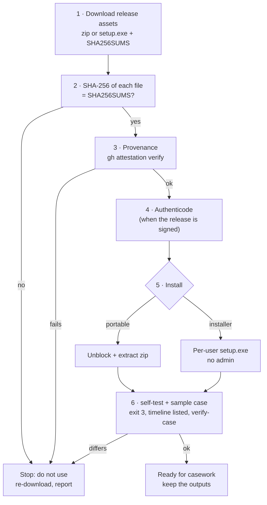

# Installation and verification (Windows 10/11)

RV Timeline runs **locally** on the examiner's Windows 10 or 11 PC (x64). It needs no administrator rights, no
runtime (static C runtime) and no network, except for the optional RFC 3161 timestamp. This page covers: getting a
release, **proving it is the genuine build**, installing it (portable zip or per-user installer), the first-run
self-test, offline use, building from source for auditors, where files live, and uninstalling.

Why verification matters: a court may ask how you know the program you ran is the one whose source an expert
reviewed. Steps 2–4 and 6 produce that answer; keep their output with the case file
([admissibility.md](admissibility.md#examiner-checklist-before-filing-a-report), step 3).



## Requirements

| Item | Requirement |
| --- | --- |
| Operating system | Windows 10 or 11, x64 (`MinVersion=10.0`, `ArchitecturesAllowed=x64compatible` in the installer). Linux/macOS: build from source. |
| Rights | Standard user. The installer is per-user (`PrivilegesRequired=lowest`). |
| Disk | The two executables and the docs (a few MB). A build writes `timeline.jsonl` (about 1 KB per event), about 11 report files per evidence item for one language (19 with `--lang all`), and the logs, inside the case folder. Past 250 000 events, sorted chunks are written temporarily under the run folder (`tmp/`, removed at the end). |
| Memory | Bounded: events are sorted on disk past 250 000 in memory; the GUI viewer keeps a few dozen bytes per event and reads rows on demand. |
| Graphics | None required: the GUI also runs on VMs without a GPU driver (software rendering). |
| Network | None, except the optional timestamp request (see [step 7](#7-offline-and-air-gapped-use)). |

## 1. Download

Release assets on the GitHub Releases page of the repository (`Panacota96/rv-timeline`):

| Asset | What it is |
| --- | --- |
| `rv-timeline-X.Y.Z-windows-x64.zip` | Portable: `rv-timeline.exe`, `rv-timeline-gui.exe`, README, LICENSE, NOTICE, CHANGELOG, `docs/`, `examples/` |
| `rv-timeline-X.Y.Z-windows-x64-setup.exe` | Inno Setup installer, per-user |
| `SHA256SUMS` | SHA-256 of the zip, the installer and the SBOM (`sha256sum` format: `<hash>  ./<file>`) |
| `sbom.cdx.json` | CycloneDX software bill of materials (every Rust dependency and version) |

Put them in one folder, e.g. `C:\Rakvor\downloads\rv-timeline-0.1.0\`.

## 2. Verify the download

```powershell
cd C:\Rakvor\downloads\rv-timeline-0.1.0
Get-Content .\SHA256SUMS | ForEach-Object {
    $hash, $name = $_ -split '\s+', 2
    $name = $name.TrimStart('*').Replace('./', '')
    if (Test-Path $name) {
        $actual = (Get-FileHash -Algorithm SHA256 $name).Hash.ToLower()
        if ($actual -eq $hash) { "OK    $name" } else { "FAIL  $name  (got $actual)" }
    } else { "skip  $name (not downloaded)" }
}
```

```bash
sha256sum -c --ignore-missing SHA256SUMS      # Linux, or Git Bash on Windows
```

Every downloaded file must print `OK`. `SHA256SUMS` is produced by the same workflow and is not attested itself:
step 3 is the stronger check.

## 3. Verify build provenance

Each zip and installer carries a GitHub build-provenance attestation (`actions/attest-build-provenance`): a signed
statement that this exact file was built by the repository's release workflow from a given commit. On a machine
with internet access and the GitHub CLI:

```powershell
gh attestation verify .\rv-timeline-0.1.0-windows-x64.zip --repo Panacota96/rv-timeline
gh attestation verify .\rv-timeline-0.1.0-windows-x64-setup.exe --repo Panacota96/rv-timeline
```

The output names the workflow (`.github/workflows/release.yml`) and the source commit; record both. For an
air-gapped lab, verify on a connected machine and carry the verified files on write-protected media (the GitHub CLI
can also download the attestation bundle and trusted root for offline checks; see `gh attestation verify --help`).
`SHA256SUMS` and the SBOM are not attested.

## 4. Verify the Authenticode signature (signed releases)

The release workflow signs `rv-timeline.exe`, `rv-timeline-gui.exe` and the installer **only when a code-signing
certificate is configured** for the repository. Releases are signed with Rakvor's **internal** code-signing
certificate ("Rakvor Code Signing (internal)", issued by "Rakvor Internal Code Signing Root CA"). It is not a public
certificate: Windows trusts it only on machines where the Rakvor root is installed — Rakvor's own laptops, since the
tool is used locally and not distributed. Auditors and customers verify releases with steps 2–3 and can inspect the
signature with the root's fingerprint below.

Install the root once per Rakvor machine (PowerShell as the user who runs the tool; the file is
`packaging/signing/rakvor-code-signing-root.cer` in the repository):

```powershell
# Check the fingerprint first — it must be exactly:
#   SHA-256 DC9BA1A2FCD4F0633C5214B7CCEB25BED8F3F7D9EBAF111590250CBCAA83DF60
(New-Object System.Security.Cryptography.X509Certificates.X509Certificate2 .\rakvor-code-signing-root.cer).GetCertHashString([System.Security.Cryptography.HashAlgorithmName]::SHA256)
Import-Certificate -FilePath .\rakvor-code-signing-root.cer -CertStoreLocation Cert:\CurrentUser\Root
```

Windows shows a confirmation dialog for the new root; accept it only if the fingerprint matched. Without the root,
`Get-AuthenticodeSignature` reports `UnknownError` (chain to an untrusted root) and SmartScreen may still warn on
first run. Check:

```powershell
Get-AuthenticodeSignature .\rv-timeline-0.1.0-windows-x64-setup.exe |
    Format-List Status, StatusMessage, SignerCertificate, TimeStamperCertificate
# after extracting the zip:
Get-AuthenticodeSignature .\rv-timeline.exe, .\rv-timeline-gui.exe | Format-Table Status, Path
```

| Status | Meaning |
| --- | --- |
| `Valid` | Signed and intact; the signer must be "Rakvor Code Signing (internal)" |
| `UnknownError` | Signed, but the Rakvor root is not installed on this machine (install it as above) |
| `NotSigned` | The release was built without a signing certificate: rely on steps 2–3; Windows SmartScreen will warn |
| `HashMismatch` / other | Stop: the file was altered after signing |

With the Windows SDK, `signtool verify /pa /v rv-timeline.exe` gives the full chain.

## 5. Install

### 5a. Portable zip

```powershell
# only after steps 2–4
Unblock-File .\rv-timeline-0.1.0-windows-x64.zip
Expand-Archive .\rv-timeline-0.1.0-windows-x64.zip -DestinationPath C:\Rakvor\tools\rv-timeline-0.1.0
cd C:\Rakvor\tools\rv-timeline-0.1.0
.\rv-timeline.exe --version
```

Keep one folder per version so a past case can be re-run with the exact version recorded in its
`environment.json`. Optional, current session only: `$env:Path += ";C:\Rakvor\tools\rv-timeline-0.1.0"`.

### 5b. Installer (per-user, no administrator)

Double-click `rv-timeline-X.Y.Z-windows-x64-setup.exe` (English, Spanish or French wizard). It installs to
`%LOCALAPPDATA%\Programs\Rakvor\RV Timeline\`, creates a *Rakvor* Start-menu group (app + documentation), and offers
two tasks: **Add the rv-timeline command to PATH** (user PATH, checked on first install) and a desktop icon. Open a
**new** terminal afterwards for PATH to apply.

Unattended:

```powershell
.\rv-timeline-0.1.0-windows-x64-setup.exe /VERYSILENT /SUPPRESSMSGBOXES /NORESTART /TASKS="addtopath"
```

The installer copies the executables, README, LICENSE, NOTICE, CHANGELOG and `docs\`. The sample case
(`examples\sample\case\`) and its scripts are in the zip and the source tree; the installer script still lists the
template's `examples\sample\evidence\` instead (to be corrected in `packaging/windows/installer.iss`), so use the
zip or the source tree for step 6.

<!-- forge:domain -->
### 5c. Native libraries

None. RV Timeline is two self-contained executables: hashing, the PDF writer, the RFC 3161 client and the CMS
signer are compiled in (pure Rust crates, listed in the SBOM), and the C runtime is linked statically
(`.cargo/config.toml`). There is no DLL to verify or to keep next to the executables.
<!-- /forge:domain -->

## 6. First-run self-test and sample case

```powershell
rv-timeline --version
rv-timeline self-test
```

`self-test` prints `PASS` for md5, sha1, sha256, sha512, sha3-256 and blake3 (known answers for `"abc"`), exit code
0. It tests the hash implementations only. Then build the timeline of the sample case, a real case folder written
by the six released Rakvor tools on synthetic evidence ([examples/sample](../examples/sample/README.md)):

```powershell
# portable zip or source tree: works on a copy (examples\sample\out\case), the committed case is never changed
.\examples\sample\run.ps1 -Bin .\rv-timeline.exe
```

```bash
examples/sample/run.sh target/release/rv-timeline     # Linux, or Git Bash
```

<!-- forge:domain -->
The script runs `self-test`, then `build --hash sha256,md5 --lang all --display-zone America/Bogota`, and fails
unless: `build` exits **3** (every run verifies, but the sample plants medium- and high-severity signals),
`reports\timeline.jsonl` exists and its SHA-256 is listed in the audit entry `timeline_written`, and `verify-log`
and `verify-case` print OK. Expected summary (this build, real output):

```text
DONE (to review: excluded runs or medium/high signals)  run <RUN-ID>
  case:     RV-SAMPLE-001
  runs:     verified 7, excluded 0, skipped 0
  events:   154 (zone unknown: 5)  items: 21
  signals:  high 1, medium 5, low 1, info 1
```

The exact events and signals are the ground truth in `examples\sample\expected_timeline.json`, derived by an
independent Python script from the tools' own outputs; `cargo test` compares them in the source tree.
<!-- /forge:domain -->

Keep the console output and the run folder (`examples\sample\out\case\runs\rv-timeline\<RUN-ID>`) as the record
of this verification.

## 7. Offline and air-gapped use

The **only** network access in the code is the RFC 3161 timestamp request (one HTTP POST of a 32-byte hash to the
TSA, [src/core/src/trust.rs](../src/core/src/trust.rs)). There is no telemetry, update check or licence check.

| To disable the timestamp | How |
| --- | --- |
| One CLI run | `--no-timestamp` |
| All CLI runs on this PC / session | `$env:RV_NO_TIMESTAMP = "1"` (or set it as a user environment variable) |
| GUI | untick **4. Trust → Trusted timestamp** before *Build the timeline* |

An offline run with the timestamp enabled still completes: it logs `timestamp_pending` and the statistics report
shows a warning. Later, on a machine that can reach the TSA, run `rv-timeline timestamp <log folder>` (it
re-verifies the chain, then appends `timestamp_obtained`). To use an internal or qualified TSA, pass `--tsa-url`
(see [admissibility.md](admissibility.md#63-eidas--regulation-eu-9102014-as-amended-by-eu-20241183-time-stamps)). The network
restriction is not enforced by the OS; on a connected workstation, a Windows Firewall outbound rule for
`rv-timeline.exe` / `rv-timeline-gui.exe` allowing only the TSA host enforces it.

## 8. Build from source for auditors

### Toolchain

| Item | Version |
| --- | --- |
| Rust | Pinned by [rust-toolchain.toml](../rust-toolchain.toml): **1.97.0** with rustfmt and clippy; `rustup` installs and selects it automatically inside the source tree. `Cargo.toml` declares `rust-version = "1.88"` (edition 2024) as the minimum. To match a release exactly, use the compiler recorded in that release's `environment.json` → `tool.rustc` (e.g. `rustc 1.97.0 (2d8144b78 2026-07-07)`). |
| Windows linker | Visual Studio 2022 Build Tools, workload *Desktop development with C++* (MSVC + Windows SDK); target `x86_64-pc-windows-msvc`. Static CRT is set in `.cargo/config.toml`. |
| Linux | No system packages needed to build the CLI. |
| Optional | Python 3.12 with `blake3 jsonschema pyhanko` for the independent verifiers and the trust tests (`RV_TEST_PYTHON=python`). |

### Build

```powershell
git clone https://github.com/Panacota96/rv-timeline.git
cd rv-timeline
git checkout v0.1.0                       # the tag of the release under review
rustc --version                           # must print the pinned 1.97.0
cargo build --release --locked -p rv-timeline-cli -p rv-timeline-gui
.\target\release\rv-timeline.exe self-test
.\examples\sample\run.ps1 -Bin .\target\release\rv-timeline.exe
cargo test --workspace --locked            # unit + integration tests (trust tests skip without pyhanko)
```

```bash
# Linux
cargo build --release --locked -p rv-timeline-cli
target/release/rv-timeline self-test && examples/sample/run.sh target/release/rv-timeline
run=$(ls examples/sample/out/case/runs/rv-timeline | tail -n 1)
python3 tests/verify_chain.py examples/sample/out/case/runs/rv-timeline/$run/logs
# cross-profile: a case folder written by the Python profile must verify with this build
python3 tests/golden/unpack.py tests/golden/case-by-python.zip.b64 /tmp/golden
target/release/rv-timeline verify-case /tmp/golden/CASE-GOLDEN
```

`--locked` refuses to build if `Cargo.lock` would change, so the dependency set equals the one listed in
`environment.json` → `dependencies` and in `sbom.cdx.json`. The product version comes from `version.txt`; the
crate versions in `Cargo.toml` stay fixed, so a release never changes the lock file.

### Reproducing the release hashes

Be precise about what can and cannot match bit for bit in this version (gap G22):

| Artefact | Bit-identical to the release? | How to check |
| --- | --- | --- |
| `docs/`, `examples/` files | Yes (from git; LF line endings except `*.ps1`, `*.iss`) | `git ls-files` + `Get-FileHash` against the extracted zip |
| `rv-timeline.exe`, `rv-timeline-gui.exe` | **Not guaranteed**: paths are not remapped and the PE header carries link-time data. The compiler is the one pinned in `rust-toolchain.toml` (both workflows run `rustup toolchain install`, which reads that file; confirm with `environment.json` → `tool.rustc` of a release run) | Provenance attestation (step 3) binds the released binary to the workflow and commit; then compare behaviour (below) |
| zip, installer | No (archive timestamps) | Attestation (step 3) |

**Functional equivalence** — build the sample case with the release binary and with your build (each on its own
copy of `examples/sample/case`), then compare the timelines. `timeline.jsonl` holds no run-specific value, so the
two files must have the **same SHA-256**; the signals must be identical too:

```bash
sha256sum <release-copy>/runs/rv-timeline/*/reports/timeline.jsonl <your-copy>/runs/rv-timeline/*/reports/timeline.jsonl
python - <release-copy>/runs/rv-timeline/*/reports/statistics.json <your-copy>/runs/rv-timeline/*/reports/statistics.json <<'EOF'
import json, sys
a, b = (json.load(open(p, encoding="utf-8"))["timeline"]["signals"] for p in sys.argv[1:3])
strip = lambda s: [(x["code"], x["severity"], x["events"], x["params"]) for x in s]
print("identical signals" if strip(a) == strip(b) else "DIFFERENT signals")
EOF
```

## 9. Where things live

| What | Location |
| --- | --- |
| Program (installer) | `%LOCALAPPDATA%\Programs\Rakvor\RV Timeline\` (`rv-timeline.exe`, `rv-timeline-gui.exe`, `docs\`, `unins000.exe`) |
| Program (portable) | the folder you extracted |
| PATH entry (installer task) | user environment variable `Path` (`HKCU\Environment`) |
| Build outputs | always inside the case folder: `<CASE>\runs\rv-timeline\<RUN-ID>\` (`logs\`, `reports\`); `--out` is accepted and ignored |
| Case folder | created by rv-hashinv at intake (`case.json`, `case-log.jsonl`, `evidence\`, `runs\`); rv-timeline needs an existing one |
| GUI settings | not persisted: each start uses the defaults; every change made before a run is recorded in that run's audit log (`ui_*`) |
| Signing certificate | wherever you keep it; only its path, subject and SHA-256 fingerprint are logged, never the password |
| Local data, caches, temporary files | none |

## 10. Uninstall

- **Installer:** *Settings → Apps → Installed apps → RV Timeline → Uninstall*, or run
  `"%LOCALAPPDATA%\Programs\Rakvor\RV Timeline\unins000.exe"`. It removes the installed files and shortcuts. The user
  **PATH entry is not removed** in this version; remove it with:

  ```powershell
  $dir = "$env:LOCALAPPDATA\Programs\Rakvor\RV Timeline"
  $p = [Environment]::GetEnvironmentVariable("Path", "User").Split(";") | Where-Object { $_ -and $_ -ne $dir }
  [Environment]::SetEnvironmentVariable("Path", ($p -join ";"), "User")
  ```

- **Portable:** delete the folder.
- **Kept on purpose** (both cases): run outputs and case folders (case material). Keep the release zip and
  `SHA256SUMS` of every version used in a case, so it can be re-run.

## 11. Installation troubleshooting

| Symptom | Cause and fix |
| --- | --- |
| SmartScreen "Windows protected your PC" (unknown publisher) | SmartScreen judges a file by the **reputation** of a publicly trusted certificate; the internal Rakvor root is not one, so the warning appears even when the signature is `Valid` (and always when `NotSigned`). Only after steps 2–4 pass: *More info → Run anyway*, or remove the downloaded-file mark first with `Unblock-File .\<file>` (do this on the zip **before** extracting it). It goes away for good only with a public certificate (see `docs/release-process.md` §5). |
| `rv-timeline` is not recognised | PATH task not selected, or the terminal was opened before installing: open a new terminal or use the full path. |
| `self-test` prints `FAIL` | Do not use this build for evidence; re-download and repeat steps 2–4. |
| Sample summary differs from step 6 | Wrong version or a modified sample case; `rv-timeline verify-case examples\sample\case` and compare `environment.json` with the release notes. |
| Every run of the sample is excluded with `unsupported_version` | The build reads other tool versions than the sample was written with; use the matching release. |
| GUI window blank or very slow on a VM | No GPU driver: software rendering is used; give the VM more CPU. |
| Building from source downloads another compiler | Expected: rustup installs the pinned 1.97.0 from `rust-toolchain.toml`. Offline, install it beforehand (`rustup toolchain install 1.97.0 --profile minimal`). |
