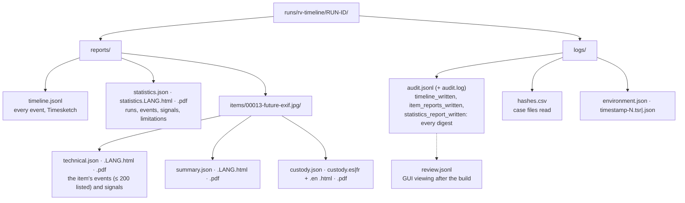
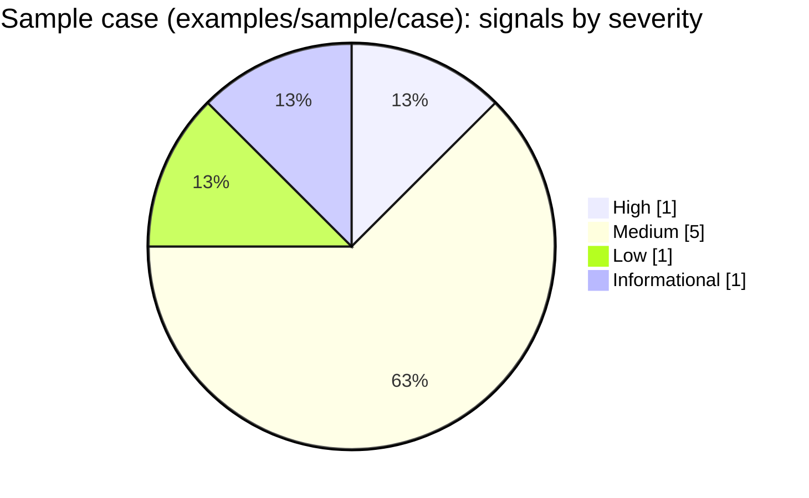
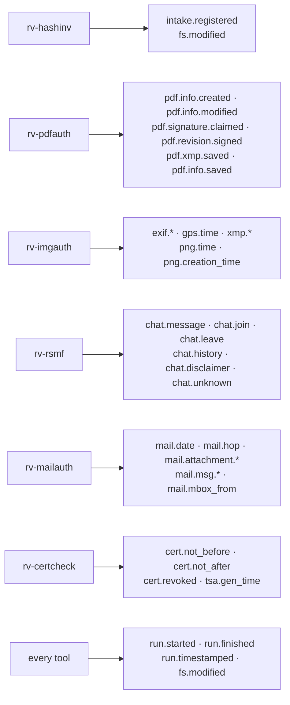

# Reports and outputs

A timeline build writes, inside the case folder under `<CASE>/runs/rv-timeline/<RUN-ID>/`: the timeline itself
(`reports/timeline.jsonl`, the Timesketch import file), one **statistics report** for the case, and for every
evidence item a **technical review** (its events and signals, for examiners and lawyers), a **customer summary**
(plain language) and a **chain-of-custody form**. Each report exists as JSON (machine-readable, language-neutral)
plus HTML and PDF in each selected language (`--lang en|es|fr|all`). Every file is hashed with the run's algorithms
and recorded in the audit log, so a report or the timeline changed after the build is detectable.



## Contents

- [Report kinds](#report-kinds)
- [Status and severity](#status-and-severity)
- [Signals catalogue](#signals-catalogue)
- [Event kinds](#event-kinds)
- [timeline.jsonl fields](#timelinejsonl-fields)
- [hashes.csv: the files read](#hashescsv-the-files-read)
- [review.jsonl](#reviewjsonl)
- [Limitations printed in every report](#limitations-printed-in-every-report)
- [JSON schemas](#json-schemas)
- [Branding, signatures and PDF notes](#branding-signatures-and-pdf-notes)

## Report kinds

| Section | Statistics | Technical review | Customer summary |
| --- | :-: | :-: | :-: |
| Run ID, case, examiner, start/end, duration, interface, display zone | ✔ | ✔ (run ID, case, zone) | case, date |
| Options: tools read, UTC window, clock skew, max events (and whether it was reached), Timesketch file | ✔ | | |
| Runs considered: tool, version, run, status (verified / excluded with reason / skipped with reason), events | ✔ | | |
| Events per tool and per kind, zone-unknown count, events outside the filters, external-sort chunks | ✔ | | |
| Signals with severity, what they show and what they do not prove | ✔ (all) | ✔ (the item's) | plain sentence |
| Item table: index, evidence id, file, status, signal count, link to the item's technical review | ✔ | | |
| Evidence id, path, registered digests, intake date (registry) | | ✔ | file name, primary digest |
| The item's events in UTC and in the display zone, original wording, kind, tool, citation (file, pointer) | | ✔ (first 200; `events_total` gives the count) | |
| First and last event, tools that recorded the item | | ✔ | ✔ |
| Method, limitations | ✔ | ✔ | "What we did" |
| Audit entries covering the item | | ✔ | |

**Which items.** Every evidence item of the registry gets a folder (`items/<NNNNN>-<name>/`), then every item a run
named outside the registry. Run-level events (`run.started`, `run.finished`, `run.timestamped`) belong to no item:
they are in `timeline.jsonl` and in the statistics counts only. Items with no event still get their reports (an
empty timeline is information too).

**Size.** An item report lists at most **200 events** (`ITEM_EVENT_ROWS`); `technical.json` gives
`events_total` and `events_listed`, and the complete list is in `timeline.jsonl`.

## Status and severity



| Severity | Signals | Item status | Exit code of `build` |
| --- | --- | --- | --- |
| High | `EXIF_AFTER_INTAKE` | `problem` | 3 |
| Medium | `MAIL_DATE_AFTER_FIRST_HOP`, `PDF_REVISION_BEFORE_PREVIOUS`, `FILE_MODIFIED_AFTER_INTAKE`, `EVENT_IN_FUTURE`, `RUN_NOT_VERIFIED` (chain broken, digest mismatch) | `attention` | 3 |
| Low | `CLOCK_SKEW_SUSPECTED`, `RUN_NOT_VERIFIED` (other reasons) | `attention` | 0, unless a run is excluded (3) |
| Informational | `ZONE_UNKNOWN_EVENTS` | `ok` | 0 |

Any excluded run makes the exit code 3, whatever its signal's severity: the timeline is incomplete. The severities
are proposals recorded in [ADR 0004](adr/0004-timeline-design-decisions.md); the rules behind each signal are in
[theory.md B8](theory.md#b8-signal-rules-and-tolerances).

## Signals catalogue

The table below is generated from `i18n/en.json` (the wording printed in the English reports);
[src/core/tests/docs_catalogue.rs](../src/core/tests/docs_catalogue.rs) fails when it differs, and checks that the
catalogue's codes are exactly `engine::SIGNAL_CODES` plus the Received-hops variant. `%{name}` is replaced by the
signal's parameter (shown in the reports and in `statistics.json` → `timeline.signals[].params`). The Spanish and
French wording is in `i18n/es.json` and `i18n/fr.json` (same keys, enforced by a test).

`CLOCK_SKEW_SUSPECTED` has two bases, told apart by the parameter `basis`: `tools` (two tools reading the same facts
of one item a constant offset apart) and `received_hops` (in one message, a relay stamped its Received time more
than the tolerance before the relay that handed it the message). The second has its own wording, i18n key
`CLOCK_SKEW_SUSPECTED.received_hops`; in it `host` and `previous_host` are the relays.

<!-- signals-catalogue:start (generated from i18n/en.json by src/core/tests/docs_catalogue.rs; do not edit by hand) -->

| Code | Severity | Title | What it shows | What it does not prove |
| --- | --- | --- | --- | --- |
| `EXIF_AFTER_INTAKE` | High (Medium when every late value is zone unknown and within tolerance + 14 h) | Photo taken after its intake (EXIF) | The photo's EXIF original time (%{exif}) is %{delta} later than its registration at intake (%{intake}), beyond the %{tolerance_s} s tolerance; zone in EXIF: %{zone}. | It does not prove the photo was replaced or edited: a wrong camera clock, a missing or wrong zone, or metadata rewritten by software produce the same result. Compare the hash with the registry and the camera's other images. |
| `MAIL_DATE_AFTER_FIRST_HOP` | Medium | Message dated after its first relay | In message %{message}, the Date header (%{date}) is %{delta} later than the first Received hop (%{hop}), beyond the %{tolerance_s} s tolerance. | It does not prove the message was forged: the sender's clock, a delayed submission or a relay's clock can explain it. Check the other hops and the authentication results. |
| `PDF_REVISION_BEFORE_PREVIOUS` | Medium | PDF revision dated before the previous one | Revision %{revision} is dated %{time}, %{delta} before revision %{previous} (%{previous_time}) that it updates. | It does not prove backdating: the signer's or editor's clock may be wrong. Read it with the content of the revisions and any trusted timestamp. |
| `FILE_MODIFIED_AFTER_INTAKE` | Medium | File modified after its intake | A file-system modification time (%{modified}) is %{delta} after the intake registration (%{intake}); %{count} value(s) concerned. | It does not prove the content changed: copying, restoring or touching a file changes its times, not its content. The hash comparison with the registry tells whether the content is the same. |
| `EVENT_IN_FUTURE` | Medium | Time later than the run that read it | %{count} time(s) (first: %{time}, %{kind}) are up to %{delta} later than the run %{run_id} that recorded them (reference: %{reference}). | It does not prove manipulation: a device clock set ahead, a wrong zone or a planned date written in the file produce the same result. |
| `CLOCK_SKEW_SUSPECTED` (basis `tools`) | Low | Possible clock offset between sources | For this item, %{tool_b} reports %{pairs} shared times about %{skew} (%{skew_s} s) apart from %{tool_a}, always in the same direction. | It does not tell which source is right, nor that either was altered: different zones, a copy made on another machine or a reader's interpretation can cause a constant offset. |
| `CLOCK_SKEW_SUSPECTED` (basis `received_hops`) | Low | Relay clocks disagree within one message | In message %{message}, Received hop %{hop} (%{host}) is stamped %{skew} (%{skew_s} s) before hop %{previous_hop} (%{previous_host}), which handed the message to it, beyond the %{tolerance_s} s tolerance. | It does not prove the headers were forged: a relay whose clock or time zone is wrong gives the same result. Compare with the other hops and the authentication results. |
| `RUN_NOT_VERIFIED` | Medium (chain_broken, digest_mismatch); Low (other reasons) | Tool run left out of the timeline | The run %{run_id} of %{tool} %{version} (%{run_dir}) was not used: %{reason_text}. %{detail} | It does not prove the run's outputs were altered: the run may not have finished, or this version may not read that tool version. Its events are missing, so the timeline is incomplete for it. |
| `ZONE_UNKNOWN_EVENTS` | Informational | Times without a time zone | %{count} time(s), from %{tools}, carry no time zone. They are placed as if written in UTC and shown as written, never converted. | It does not mean these times are wrong; their true instant may differ by up to 14 hours from where they are placed. |

<!-- signals-catalogue:end -->

`RUN_NOT_VERIFIED`'s `%{reason_text}` is the reason's wording:

| Reason | Wording (en.json `exclusion`) | Severity |
| --- | --- | --- |
| `chain_broken` | its audit chain is broken | Medium |
| `digest_mismatch` | an output differs from the digest in its audit log | Medium |
| `not_finished` | the run did not finish | Low |
| `unsupported_tool` | no reader exists for this tool | Low |
| `unsupported_version` | the reader does not support this tool version | Low |
| `unreadable` | its outputs could not be read | Low |

## Event kinds

Which tool writes which kind, from which output, with which sub-item: [theory.md B5](theory.md#b5-readers-and-time-formats).
The labels below are the `kind` section of `i18n/en.json` (`timestamp_desc` in Timesketch, the *Kind* column of the
reports). `fs.created`, `fs.accessed`, `chat.conversation.first` and `chat.conversation.last` are labelled but not
emitted by the v0.1 readers (no tool output records the first two; the last two would be derived values, which are
not events).



<!-- kinds:start (generated from i18n/en.json by src/core/tests/docs_catalogue.rs; do not edit by hand) -->

| Kind | Label (en.json) |
| --- | --- |
| `cert.not_after` | Certificate valid until (notAfter) |
| `cert.not_before` | Certificate valid from (notBefore) |
| `cert.revoked` | Certificate revoked (CRL or OCSP) |
| `chat.conversation.first` | First event of the conversation |
| `chat.conversation.last` | Last event of the conversation |
| `chat.disclaimer` | Chat notice |
| `chat.history` | Chat history event |
| `chat.join` | Participant joined the chat |
| `chat.leave` | Participant left the chat |
| `chat.message` | Chat message |
| `chat.unknown` | Chat event of another type |
| `exif.digitized` | Image digitised (EXIF DateTimeDigitized) |
| `exif.modify` | Image file changed (EXIF DateTime) |
| `exif.original` | Photo taken (EXIF DateTimeOriginal) |
| `fs.accessed` | File accessed (file system) |
| `fs.created` | File created (file system) |
| `fs.modified` | File modified (file system) |
| `gps.time` | GPS time of the photo (UTC) |
| `intake.registered` | Evidence registered in the case |
| `mail.attachment.created` | Attachment created (MIME date) |
| `mail.attachment.modified` | Attachment modified (MIME date) |
| `mail.date` | Email Date header |
| `mail.hop` | Email relayed by a server (Received) |
| `mail.mbox_from` | Mailbox separator line (mbox From) |
| `mail.msg.delivered` | Outlook message delivered |
| `mail.msg.submitted` | Outlook message submitted |
| `pdf.info.created` | PDF created (Info CreationDate) |
| `pdf.info.modified` | PDF modified (Info ModDate) |
| `pdf.info.saved` | PDF revision saved (Info date) |
| `pdf.revision.signed` | PDF revision signed (CMS signing time) |
| `pdf.signature.claimed` | Signing time written in the PDF signature (/M) |
| `pdf.xmp.saved` | PDF revision saved (XMP date) |
| `png.creation_time` | Created (PNG Creation Time) |
| `png.time` | Image last changed (PNG tIME) |
| `run.finished` | Tool run finished |
| `run.started` | Tool run started |
| `run.timestamped` | Audit log timestamped (RFC 3161) |
| `tsa.gen_time` | Trusted timestamp issued (RFC 3161 genTime) |
| `xmp.create` | Created (XMP CreateDate) |
| `xmp.exif_original` | Photo taken (XMP exif:DateTimeOriginal) |
| `xmp.history` | Edit history entry (XMP) |
| `xmp.metadata` | Metadata changed (XMP MetadataDate) |
| `xmp.modify` | Modified (XMP ModifyDate) |
| `xmp.photoshop_created` | Created (Photoshop DateCreated) |

<!-- kinds:end -->

## timeline.jsonl fields

One JSON object per line, sorted keys, in timeline order (UTC, then event id); byte-identical on every rebuild of
the same case with the same filters. Mapping and rationale: [theory.md B9](theory.md#b9-timesketch-mapping).

| Field | Type | Example (sample case) |
| --- | --- | --- |
| `message` | string | `Certificate valid from (notBefore): 2024-01-01T00:00:00Z — E0005 R:\evidence\certs\leaf-expired.crt (rv-certcheck)` |
| `datetime` | ISO 8601, `+00:00` | `2024-01-01T00:00:00+00:00` (zone-unknown events: the wall clock read as UTC) |
| `timestamp` | integer, µs since 1970 | `1704067200000000` |
| `timestamp_desc` | string | `Certificate valid from (notBefore)` |
| `rakvor_event_id` | string | `rv-certcheck:20261113T065657Z-5588dc:E0005:cert.not_before:0` |
| `rakvor_kind` | string | `cert.not_before` |
| `rakvor_evidence_id`, `rakvor_item_path`, `rakvor_item_sub`, `rakvor_item_sha256` | string | `E0005`, `R:\evidence\certs\leaf-expired.crt`, `""`, `346e2248…e0c9` |
| `rakvor_tool`, `rakvor_tool_version` | string | `rv-certcheck`, `0.2.2` |
| `rakvor_run`, `rakvor_run_dir` | string | `20261113T065657Z-5588dc`, `runs/rv-certcheck/20261113T065657Z-5588dc` |
| `rakvor_file`, `rakvor_file_sha256`, `rakvor_pointer` | string | `reports/items/00005-leaf-expired.crt/chain.json`, `6eb268b5…7ce3`, `/certificates/0/not_before` |
| `rakvor_zone` | `explicit` / `unknown` | `explicit` |
| `rakvor_offset_min` | integer or null | `0` |
| `rakvor_precision` | `day` … `nanosecond` | `second` |
| `rakvor_original` | string, as the source wrote it | `2024-01-01T00:00:00Z` |
| `rakvor_detail_<key>` | string | `rakvor_detail_issuer`, `rakvor_detail_serial`, `rakvor_detail_subject` … |

The file is written only with Timesketch output on (default; `--no-timesketch` turns it off). Its digests, line
count and format are in the audit entry `timeline_written`. The GUI timeline viewer reads this file only after
checking that digest ([usage-gui.md](usage-gui.md#the-timeline-viewer)).

## hashes.csv: the files read

rv-timeline hashes what it **reads**, not evidence: `logs/hashes.csv` lists the case files whose content entered
the timeline, hashed with the run's algorithms when the build read them (`read_files_register` in
[run.rs](../src/core/src/run.rs)):

1. `case.json`, `evidence/registry.json`;
2. for every **verified** run that was read: its `logs/audit.jsonl` and every output its audit log records with a
   digest ending in `.json`, `.csv` or `.jsonl` (the files verification and the readers check).

```text
index,path,size,sha256,status,error
1,<CASE>\case.json,276,be578186…40b148,read,
2,<CASE>\evidence\registry.json,10455,1d0912c1…7be0152,read,
3,<CASE>\runs\rv-certcheck\20261113T065657Z-5588dc\logs\audit.jsonl,46337,4c923ed0…8b17e0,read,
…
```

Paths are absolute (205 rows for the sample case). Excluded and skipped runs are not listed (they were not read).
`case-log.jsonl` is left out: this build appends to it after the register is written; its head at the start is in
the audit entry `case_linked`. The register's own digests are in `hash_register_written`.

## review.jsonl

Written by the desktop app in the build's `logs/` folder when the examiner looks at the timeline **after** the
build ([review.rs](../src/core/src/review.rs)): a hash chain of its own (same canonical rule as the audit log) whose
first entry links to the build's `run_finished` entry. Actions: `ui_timeline_viewed` (digests of `statistics.json`
and `timeline.jsonl` checked), `ui_timeline_refused` (a digest differs: nothing shown),
`ui_timeline_filter_changed`, `ui_timeline_zone_toggled`, `ui_signal_selected`, `ui_event_viewed` (with the event's
citation). `verify-log` and `verify-case` check it and print the number of review entries.

## Limitations printed in every report

Generated from `i18n/en.json` (the `limitations` section) and `report::TIMELINE_LIMITATIONS`. `TL_MAX_EVENTS` is
printed first, and only when `--max-events` was reached; `%{skew_s}` is the build's `--clock-skew`.

<!-- limitations:start (generated from i18n/en.json by src/core/tests/docs_catalogue.rs; do not edit by hand) -->

| Code | Text (en.json) |
| --- | --- |
| `TL_MAX_EVENTS` | Reading stopped at the event limit (%{max_events}); later events are neither in the timeline nor in the signals. |
| `TL_ZONE_UNKNOWN` | Times recorded without a time zone are placed as if they were UTC and shown as written; they are never converted, so their true instant may differ by up to 14 hours. |
| `TL_CLOCK_SKEW` | Cross-source comparisons tolerate %{skew_s} s of difference; smaller disagreements between clocks are not reported. |
| `TL_TOOL_OUTPUTS_ONLY` | In this version the only sources are the audited outputs of Rakvor tool runs in the case folder; times those tools did not extract (other logs, other devices) are not in the timeline. |
| `TL_READER_VERSIONS` | Each reader supports the tool output versions it was written for; runs of other versions are left out and listed, never guessed. |
| `TL_CLEAN_IS_NOT_PROOF` | A timeline without signals does not prove that the times are true; it shows that the sources read agree within the tolerance. |
| `TIMESTAMP_PROVES_EXISTENCE_ONLY` | A trusted timestamp proves the audit log existed in this exact form at the stated time; it does not prove that the examined copy matches the original source. |

<!-- limitations:end -->

## JSON schemas

| File | Schema value | Schema file |
| --- | --- | --- |
| `statistics.json` | `rakvor.statistics/1` (+ `timeline` object: `display_zone`, `runs`, `skipped`, `runs_verified`, `runs_excluded`, `events`, `events_by_tool`, `events_by_kind`, `events_filtered_out`, `events_zone_unknown`, `signals`, `signals_by_severity`, `clock_skew_s`, `max_events`, `max_events_reached`, `from_s`, `to_s`, `tools`, `timeline_file`, `sort_spilled_chunks`) | [schemas/statistics.schema.json](../schemas/statistics.schema.json) |
| `technical.json` | `rakvor.item-technical/1` (+ `timeline`: `display_zone`, `events_total`, `events_listed`, `first_utc`, `last_utc`, `tools`, `events`, `signals`) | [schemas/item-technical.schema.json](../schemas/item-technical.schema.json) |
| `summary.json` | `rakvor.item-summary/1` | [schemas/item-summary.schema.json](../schemas/item-summary.schema.json) |
| `custody.json` | `rakvor.item-custody/1` | [schemas/item-custody.schema.json](../schemas/item-custody.schema.json) |
| `case.json`, `registry.json` (read) | `rakvor.case/1`, `rakvor.registry/1` | [schemas/case.schema.json](../schemas/case.schema.json), [schemas/registry.schema.json](../schemas/registry.schema.json) |
| `describe --json` | `rakvor.describe/1` | [schemas/describe.schema.json](../schemas/describe.schema.json) |

[tests/validate_reports.py](../tests/validate_reports.py) validates a run's JSON reports against the schemas (in
CI). Signals appear in the reports' `findings` arrays with the same shape as the other tools' findings (`code`,
`severity`, `params`, `text` per language), so RV Hub and scripts read them the same way.

## Branding, signatures and PDF notes

HTML and PDF reports carry the Rakvor header band (RV mark, descriptor *FORENSICS | INCIDENT RESPONSE | SECURITY*
and the tagline in the report language) on a light, printable page. With `--sign-cert`, each report shows the
signer's certificate subject and SHA-256 fingerprint (also `run.pdf_signer_certificate_sha256` in the JSON) and
each PDF carries a digital signature that Acrobat or `pyhanko sign validate` can check
([theory.md B13](theory.md#b13-signed-pdf-reports-and-custody-forms)). The statistics report shows the trusted
timestamp, or a warning that it is pending. PDFs use the standard Helvetica and Courier fonts (WinAnsiEncoding:
English, Spanish and French characters; anything else becomes `?` in the PDF and stays exact in the JSON and HTML).
