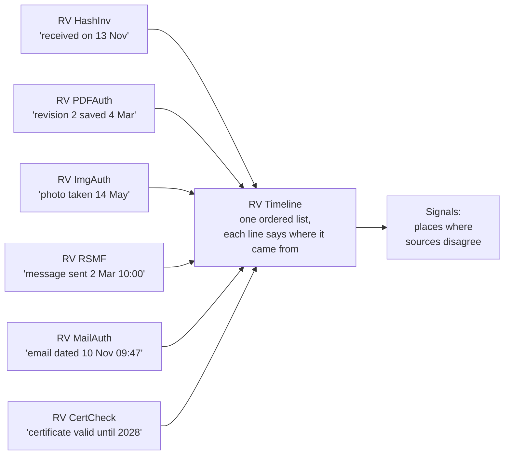
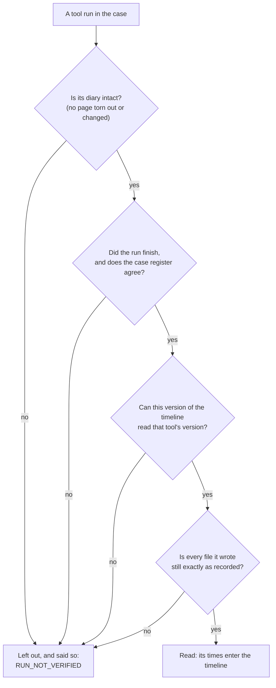
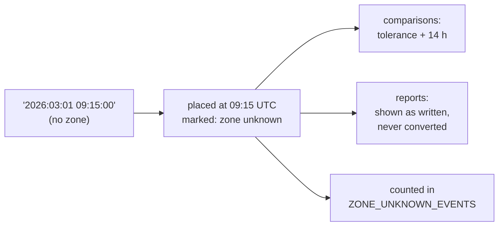
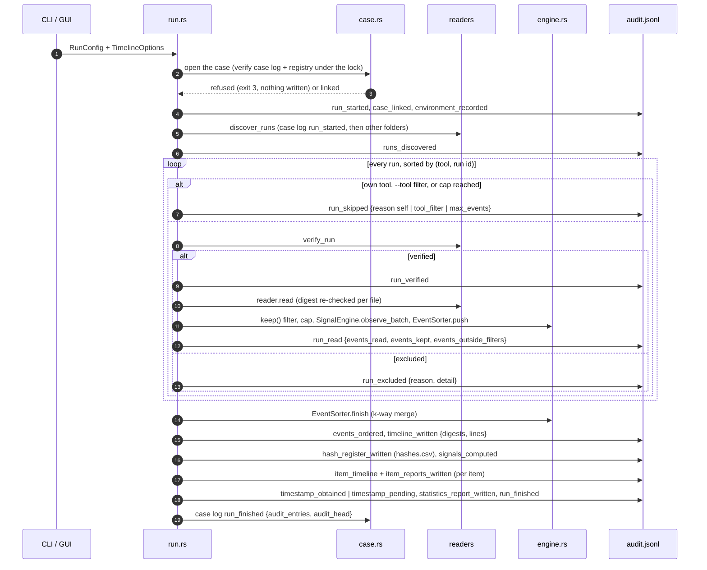
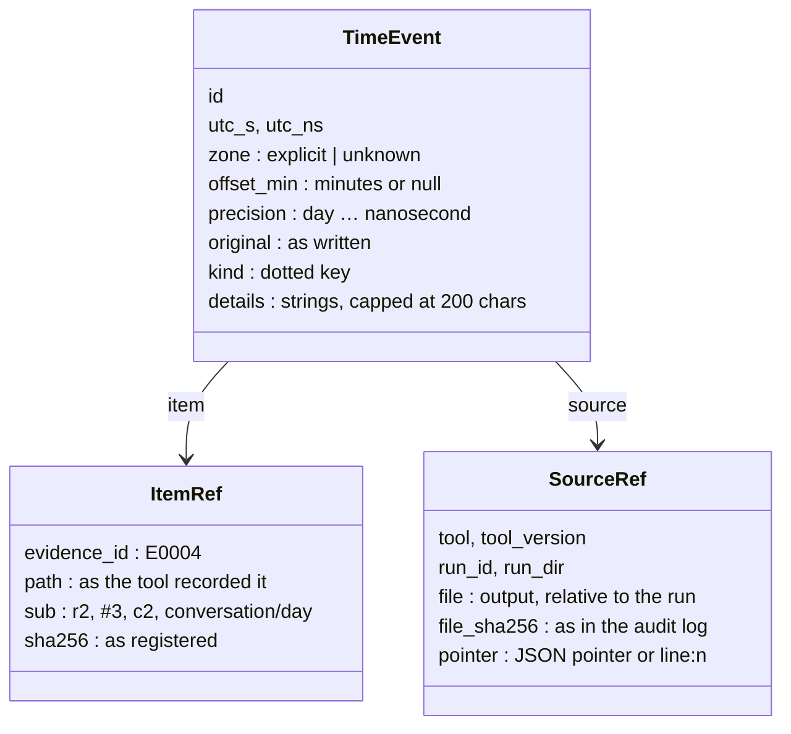
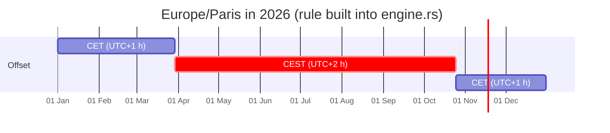
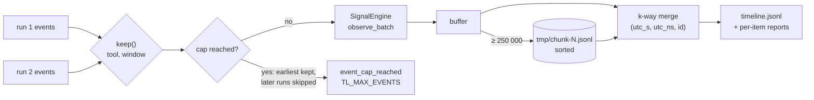
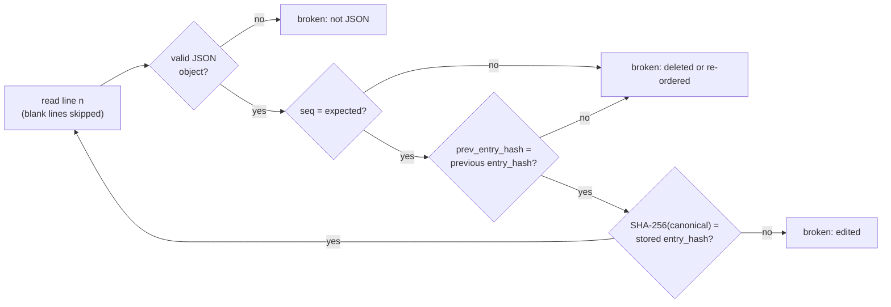
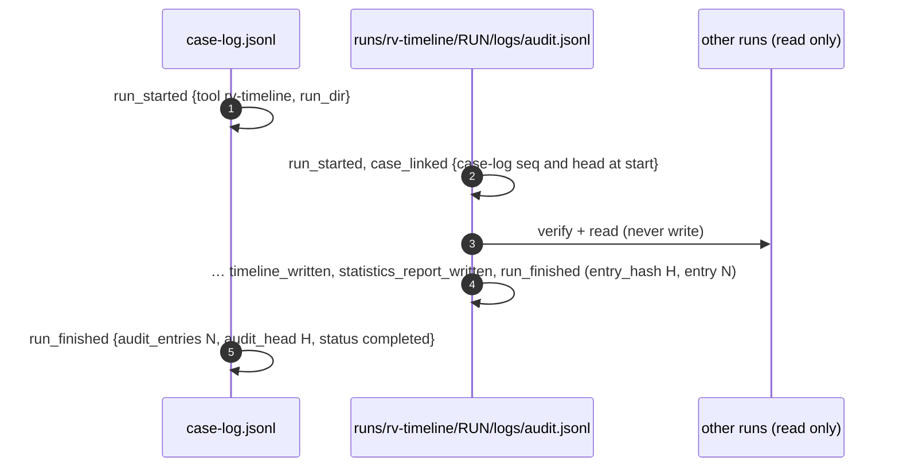
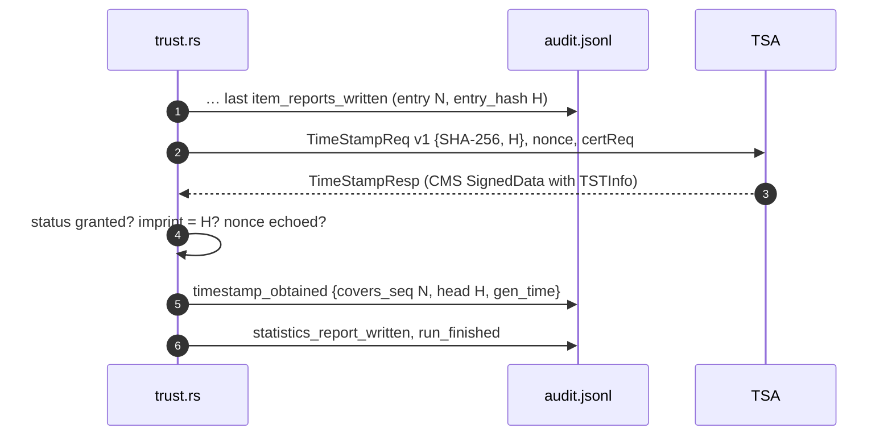

# Theory of operation

This page explains **why** each step of RV Timeline works, at two levels:

- **[Part A — For clients, lawyers and judges](#part-a--for-clients-lawyers-and-judges)**: plain language,
  analogies and pictures. No knowledge of computing or cryptography is needed.
- **[Part B — For examiners and opposing experts](#part-b--for-examiners-and-opposing-experts)**: the event model,
  the verification rules, the time-zone handling, the ordering and every signal's rule and tolerance, with the
  source file that implements each one. Every number in Part B is taken from the code of this commit or from a run
  of this build on the sample case ([examples/sample](../examples/sample/README.md)); where the code and another
  page differ, Part B says so.

It describes what the tool **does**, not what it should do. Known weaknesses are stated where they apply and
collected in [admissibility.md](admissibility.md#consolidated-gap-list). How to run the tool:
[usage.md](usage.md). How to install and verify it: [installation.md](installation.md).

## Contents

- Part A: [A1 What the tool is](#a1-what-the-tool-is-and-is-not) ·
  [A2 Why one timeline](#a2-why-one-timeline) ·
  [A3 Verified before read](#a3-verified-before-read) ·
  [A4 Why times disagree](#a4-why-times-disagree) ·
  [A5 Times without a zone](#a5-times-without-a-time-zone) ·
  [A6 What each signal shows](#a6-what-each-signal-shows-and-does-not-show) ·
  [A7 The tool's own record](#a7-the-tools-own-record) ·
  [A8 A timeline without signals](#a8-what-a-timeline-without-signals-means)
- Part B: [B1 Source map](#b1-source-map-and-constants) ·
  [B2 Pipeline](#b2-pipeline) ·
  [B3 Run discovery and verification](#b3-run-discovery-and-verification) ·
  [B4 Event model and ids](#b4-event-model-and-id-convention) ·
  [B5 Readers and time formats](#b5-readers-and-time-formats) ·
  [B6 UTC, zones and display zones](#b6-utc-zones-and-display-zones) ·
  [B7 Ordering, filters and external sort](#b7-ordering-filters-cap-and-external-sort) ·
  [B8 Signal rules](#b8-signal-rules-and-tolerances) ·
  [B9 Timesketch mapping](#b9-timesketch-mapping) ·
  [B10 Audit chain](#b10-the-audit-hash-chain) ·
  [B11 Case folder](#b11-the-case-folder-and-the-two-chains) ·
  [B12 RFC 3161](#b12-rfc-3161-trusted-timestamp) ·
  [B13 Signed PDFs and custody forms](#b13-signed-pdf-reports-and-custody-forms) ·
  [B14 Determinism](#b14-determinism-and-repeatability) ·
  [B15 References](#b15-references)

# Part A — For clients, lawyers and judges

## A1 What the tool is (and is not)

In a Rakvor case, several tools each examine one kind of evidence: RV HashInv registers every file when it is
received, RV PDFAuth looks at PDF documents, RV ImgAuth at photos, RV RSMF converts chat exports, RV MailAuth looks
at emails, RV CertCheck at certificates and trusted timestamps. Each of them writes down, among other things, the
**times** it found: when a photo says it was taken, when an email says it was sent and when each mail server passed
it on, when a PDF says it was changed, when a certificate was valid.

RV Timeline collects those times into **one list, in order**, so that a person can read the story of the evidence
from start to end — and so that disagreements between sources become visible.



What it is **not**:

- It is **not a judge of authenticity**. It reports *signals* — "this photo says it was taken after the day we
  received it" — and each signal says what it does **not** prove.
- It does **not look at the evidence itself**. It reads only what the other tools recorded. A time that no tool
  recorded (for example a Windows log, or a phone that was never examined) is not in the timeline.
- It does **not correct clocks**. It shows the times as each source wrote them and puts them in a common order; it
  never "fixes" a time it cannot be sure about.

## A2 Why one timeline

A case is usually about *when*: was the contract signed before the email that refers to it? Was the photo taken
before or after the incident? Did the message really leave at the time it shows? Each tool answers part of such a
question about one file. Placing all the answers side by side, on one clock, shows:

- **the order of events** across different kinds of evidence (a chat message, then an email, then a PDF revision);
- **contradictions**: a source that places something after the moment the evidence was already in Rakvor's hands,
  or a document revision dated before the revision it changes;
- **gaps**: periods with no recorded activity.

Every line of the timeline carries a **citation**: which tool run, which output file, the file's digital
fingerprint, and the exact place inside the file. Anyone can open that file and find the same value.

## A3 Verified before read

Each tool keeps a **diary** of its work (the audit log). Each page of the diary contains a digital fingerprint of
the page before it, so tearing out, adding or changing a page is detectable. The diary also lists the fingerprint
of every file the tool wrote. The case keeps a **register** of all tool runs (the case log), built the same way.

Before RV Timeline uses anything a tool wrote, it checks, like a notary checking the seals on an envelope before
reading the letter:



A run that fails any check is **left out entirely** — never partly used — and the timeline says which run was left
out and why. So a time in the timeline comes from a tool record that was intact at the moment the timeline was
built. That is not the same as saying the time is *true* (A4): it means the tool really wrote it and nobody changed
it afterwards.

## A4 Why times disagree

Times in evidence come from **clocks**, and clocks are set by people and devices. Disagreements are normal and
usually innocent:

| Cause | Example |
| --- | --- |
| **A clock set wrong** | A camera whose battery was replaced restarts at 1 January 2000, or is set a year ahead. Every photo it takes carries that wrong date. |
| **Time zones** | "10:00" in Bogotá is "15:00" UTC and "16:00" in Paris in winter. A source that writes the local time *with* its zone (`+01:00`) can be placed exactly; one that writes it *without* a zone cannot. |
| **Summer time** | Paris moves its clocks one hour forward in spring and back in autumn (CET in winter, CEST in summer); Colombia does not. A conversion that forgets this is off by one hour for half the year. |
| **Camera settings** | Many cameras store the local time of the menu setting, with no zone at all. The same photo, taken in Bogotá by a camera set to Paris time, carries a time six or seven hours off. |
| **Servers and relays** | Each mail server stamps the time *it* received a message, by *its* clock. One server a few minutes off makes the stamps look out of order. |
| **Copies** | Copying, restoring or unzipping a file can change its "modified" time without changing its content. |
| **Planned dates** | Some times are about the future on purpose: a certificate's expiry date, a scheduled meeting written in a document. |

That is why RV Timeline (1) keeps every time **exactly as written**, next to its position on the common UTC clock;
(2) tolerates a small difference between sources (by default **5 minutes**) before it reports anything; and (3)
says, for every signal, which of these innocent explanations could produce it.

## A5 Times without a time zone

Some sources write a time with no zone: a photo's "taken at 09:15" with no offset, the separator line of a mailbox
file, a chat export where the examiner did not state the phone's zone. Such a time could be anywhere within about
**26 hours** of the world's clocks (from 12 hours behind UTC to 14 hours ahead).

RV Timeline **never guesses** the zone. It places the time *as if* it were UTC, marks it **"zone unknown, as
written"** in every report, never converts it to the display zone, counts how many there are (the signal
`ZONE_UNKNOWN_EVENTS`), and widens its tolerance by 14 hours whenever it compares such a time with another. A
guessed zone would look precise and could be wrong by many hours; a flagged time is honest about what is known.



## A6 What each signal shows and does not show

| Signal | In plain words | What it does **not** show |
| --- | --- | --- |
| `EXIF_AFTER_INTAKE` | A photo's own "taken" date is later than the day Rakvor registered it. A photo cannot be taken after it was handed over, so at least one of the two times is wrong. | That the photo was replaced or edited: a camera clock set ahead, a wrong zone or software that rewrote the date give the same result. |
| `FILE_MODIFIED_AFTER_INTAKE` | The "modified" time of a file seen by a later tool is later than its registration. | That the content changed: copying or touching a file changes its time, not its content. The fingerprint comparison with the register answers that. |
| `MAIL_DATE_AFTER_FIRST_HOP` | An email says it was written after the first mail server had already received it. | That the email is forged: the sender's computer clock, or the server's, can be wrong. |
| `PDF_REVISION_BEFORE_PREVIOUS` | A later revision of a PDF is dated before the revision it changes. | Backdating: the editor's or signer's clock may be wrong. |
| `EVENT_IN_FUTURE` | A time is later than the moment the tool read it — it had not happened yet. | Manipulation: a device clock set ahead, a wrong zone or a planned date written in the file give the same result. |
| `CLOCK_SKEW_SUSPECTED` | Two tools reading the same facts are always the same amount apart; or, inside one email, a server stamped its time before the server that handed it the message. | Which source is right, or that either was altered: different zones or a wrong server clock explain it. |
| `RUN_NOT_VERIFIED` | A tool run was left out of the timeline, with the reason. | That the run's outputs were altered: it may simply not have finished, or this version may not read it. |
| `ZONE_UNKNOWN_EVENTS` | How many times have no zone (A5). | That those times are wrong. |

## A7 The tool's own record

RV Timeline keeps its own diary, exactly like the other tools: every run it found, verified, read, left out or
skipped; the fingerprint of the timeline file and of every report; the parameters chosen (display zone, tolerance,
filters). The diary's last page can be sealed by an independent **time-stamping authority** (proof that the diary
existed in that form at that time), the PDF reports can be signed with the examiner's certificate, and each
evidence item gets a chain-of-custody form. After the build, what the examiner looks at in the desktop app is kept
in a second, linked diary (the review log). Two commands, `verify-log` and `verify-case`, re-check all of it later.
Details: [B10](#b10-the-audit-hash-chain) to [B13](#b13-signed-pdf-reports-and-custody-forms) and
[forensic-audit.md](forensic-audit.md).

## A8 What a timeline without signals means

It means that the sources read **agree with each other** within the tolerance — not that the times are true. Two
sources set by the same wrong clock agree perfectly. It also says nothing about evidence no tool examined, nor about
runs that were left out (they are listed). Every report prints this limitation.

# Part B — For examiners and opposing experts

## B1 Source map and constants

| Concern | File | Constants and rules |
| --- | --- | --- |
| Data model (frozen for v0.1) and conventions | [src/core/src/model.rs](../src/core/src/model.rs) | `TimeEvent`, `ItemRef`, `SourceRef`, `RunRef`, `Signal`, `TimelineOptions`; module doc "Conventions" |
| Run discovery, verification, reader table | [src/core/src/readers/mod.rs](../src/core/src/readers/mod.rs) | `CASE_SCHEMA = rakvor.case/1`; reader table (tool, major.minor); `MAX_DETAIL = 200` characters; `MAX_WARNINGS = 100` |
| Readers | [readers/hashinv.rs](../src/core/src/readers/hashinv.rs), [pdfauth.rs](../src/core/src/readers/pdfauth.rs), [imgauth.rs](../src/core/src/readers/imgauth.rs), [rsmf.rs](../src/core/src/readers/rsmf.rs), [mailauth.rs](../src/core/src/readers/mailauth.rs), [certcheck.rs](../src/core/src/readers/certcheck.rs) | one per tool; kinds in [B5](#b5-readers-and-time-formats) |
| Strict time parsers | [src/core/src/readers/timefmt.rs](../src/core/src/readers/timefmt.rs) | RFC 3339/ISO 8601, RFC 5322, EXIF, PDF, X.509, OpenSSL text |
| Order, display zones, signals, Timesketch | [src/core/src/engine.rs](../src/core/src/engine.rs) | `ZONE_MARGIN_S = 50 400` (14 h); `DEFAULT_SORT_THRESHOLD = 250 000`; `SIGNAL_CODES` (8) |
| Pipeline | [src/core/src/run.rs](../src/core/src/run.rs) `timeline_pipeline` | audit actions, `hashes.csv` of the files read, item reports |
| Defaults | `TimelineOptions::default` | display zone `UTC`, `clock_skew_s = 300`, `max_events = 5 000 000`, `timesketch = true` |
| Reports | [src/core/src/report/mod.rs](../src/core/src/report/mod.rs) | `ITEM_EVENT_ROWS = 200` events listed per item report; `TIMELINE_LIMITATIONS` (6, plus `TL_MAX_EVENTS` when the cap is reached) |
| Audit chain, review log, `verify-log` | [audit.rs](../src/core/src/audit.rs), [review.rs](../src/core/src/review.rs), [verify.rs](../src/core/src/verify.rs) | SHA-256 over canonical JSON; review log anchored to `run_finished` |
| Case folder | [src/core/src/case.rs](../src/core/src/case.rs) | analysis role: the registry is read, never written |
| RFC 3161, PDF signing | [src/core/src/trust.rs](../src/core/src/trust.rs) | byte-identical in every Rakvor tool ([ADR 0002](adr/0002-tsa-token-verification.md)) |
| GUI viewer | [src/gui/src/viewer.rs](../src/gui/src/viewer.rs) | index of `timeline.jsonl`; rows read on demand, line hash re-checked |

## B2 Pipeline



The evidence files are never opened. The only files read are `case.json`, `case-log.jsonl`,
`evidence/registry.json` and, for each run, `logs/audit.jsonl` and the outputs its audit log records with a
digest. `hashes.csv` lists exactly those that entered the timeline ([reports.md](reports.md#hashescsv-the-files-read)).

## B3 Run discovery and verification

**Discovery** (`discover_runs`): `case.json` must have schema `rakvor.case/1` (otherwise the folder is refused).
Runs are listed from the `run_started` entries of `case-log.jsonl` (tool, version and `run_dir` from its details,
first occurrence of each `run_dir`), then every folder `runs/<tool>/<run>/` the case log does not announce (version
read from that run's own `run_started`). The pipeline sorts them by (tool, run id). Runs of `rv-timeline` itself are
skipped with reason `self`.

**Verification** (`verify_run` → `check_run`), in this order; the first failure excludes the run with its reason
(i18n `exclusion.<reason>`):

| # | Check | Failure → reason |
| --- | --- | --- |
| 1 | `run_dir` has the form `runs/<tool>/<run>` (no `..`, no absolute path), and the run folder, resolved with symbolic links and junctions followed, stays inside the case folder | `unreadable` |
| 2 | `logs/audit.jsonl` exists, is not empty and its chain is intact: `seq` consecutive from 1, `prev_entry_hash` links, `entry_hash` = SHA-256 of the canonical entry ([B10](#b10-the-audit-hash-chain)) | `unreadable` / `chain_broken` |
| 3 | the audit log has a `run_finished` entry, not `cancelled` | `not_finished` |
| 4 | `case-log.jsonl` is an intact chain | `chain_broken` |
| 5 | the case log announces this `run_dir` (`run_started`) and has its `run_finished` with `status: completed` (and an `exit_code` of 0 when one is recorded) | `not_finished` |
| 6 | entry `audit_entries` of the audit log has hash `audit_head` (both from the case log's `run_finished`), and only `timestamp_*` entries follow it | `chain_broken` |
| 7 | a reader exists for the tool | `unsupported_tool` |
| 8 | the run's version has the reader's major.minor (a patch number is required) and equals the version its own `run_started` records | `unsupported_version` |
| 9 | every output the audit log records with a digest and whose name ends in `.json`, `.csv` or `.jsonl` exists and matches **every** recorded digest (any of the six algorithms the run used) | `digest_mismatch` / `unreadable` |

Each reader then reads only files the audit log records, and re-checks the digest of each file at the moment it
reads it (`RunData::check_file`), so a file changed between verification and reading is caught too. A recorded
output path is accepted only as a plain relative path (forward slashes; no `..`, root, drive, empty component or
`:`), and the file, resolved, must stay inside the run folder: a symlink or junction leading out of the case is
refused (`unreadable`). A reader error
also excludes the run. HTML and PDF renderings are not read and not checked here; `verify-log` and `verify-case` re-hash them
([forensic-audit.md](forensic-audit.md)).

Supported versions (the reader table): rv-hashinv **0.4.x**, rv-pdfauth **0.4.x**, rv-imgauth **0.3.x**, rv-rsmf
**0.3.x**, rv-mailauth **0.2.x**, rv-certcheck **0.2.x**. A new minor version of a tool is excluded
(`unsupported_version`, low severity) until a reader is added for it ([development.md](development.md#adding-or-updating-a-reader)).

What verification proves: the run's record is internally consistent, anchored in the case log, and its
machine-readable outputs are the ones it recorded. What it does not prove: that the tool's analysis was right
(that rests on each tool's own validation), or that the run's whole record was not rewritten consistently by
someone who could also rewrite the case log ([B11](#b11-the-case-folder-and-the-two-chains) and the RFC 3161 token
limit that).

## B4 Event model and id convention

One event is **one time value written in a tool's audited output, once per run that wrote it** (model.rs
"Conventions"). A value derived from other events (first or last message of a conversation, a duration) is not an
event; two different source values with the same instant are two events (a PDF signature's `/M` and its CMS
signingTime).



**Event id** — `<tool>:<run_id>:<item>[/<sub>]:<kind>:<n>`:

- `<item>` is the evidence id (`E0004`); `i<index>` (the run's item index) when the run did not link the item to the
  registry; `run` for run-level events.
- `/<sub>` only when the item has a sub-item: PDF revision `r<n>` (from 1), mbox message `#<n>`, chat
  `<conversation id>/<day>`, certificate `c<n>` of a file holding several (none when it holds one).
- `<n>` counts **from 0** per (run, item/sub, kind), in the order the values appear in the source file.

Example from the sample: `rv-mailauth:20261113T232800Z-08b8d1:E0016/#3:mail.hop:1` is the second Received hop read
(in file order) of message 3 of the mbox registered as E0016. Ids are unique in a timeline and identical on every
rebuild of the same case, so a signal, a report or a Timesketch annotation can refer to them.

**Run-level events** (every tool, item `run`, from the run's hash-chained `logs/audit.jsonl`): `run.started` and
`run.finished` = `ts_utc` of the `run_started` / `run_finished` entries; `run.timestamped` = `details.gen_time` of
each `timestamp_obtained`. `reports/statistics.json` holds close but different times (written before the final
audit entry) and is not used. `fs.modified` comes from every tool: `item_started.details.modified_utc` in the audit
log, once per item and run.

## B5 Readers and time formats

| Tool (version) | Kinds (source file) | Sub-item |
| --- | --- | --- |
| rv-hashinv (0.4.x) | `intake.registered` (`technical.json` `/case/intake_utc`, only items this run registered); `fs.modified` | none |
| rv-imgauth (0.3.x) | `exif.original`, `exif.digitized`, `exif.modify` (EXIF DateTimeOriginal / DateTimeDigitized / IFD0 DateTime with OffsetTime* and SubSecTime*), `gps.time`, `xmp.create`, `xmp.modify`, `xmp.metadata`, `xmp.photoshop_created`, `xmp.exif_original`, `xmp.history`, `png.time`, `png.creation_time` (`metadata.json`); `fs.modified` | none |
| rv-pdfauth (0.4.x) | `pdf.info.created`, `pdf.info.modified` (Info dictionary of each revision, `objects.json`); `pdf.signature.claimed` (a signature dictionary's `/M`); `pdf.revision.signed` (CMS signingTime, `technical.json`); `pdf.xmp.saved`; `pdf.info.saved` (only without `objects.json`); `fs.modified` | `r<n>`, revision from 1 |
| rv-rsmf (0.3.x) | `chat.message`, `chat.join`, `chat.leave`, `chat.history`, `chat.disclaimer`, `chat.unknown` (one per `rsmf/trace.json` row, by its RSMF kind); `fs.modified` | `<conversation>/<day>` |
| rv-mailauth (0.2.x) | `mail.date`, `mail.hop` (`headers.json`), `mail.attachment.created`, `mail.attachment.modified`, `mail.msg.submitted`, `mail.msg.delivered`, `mail.mbox_from` (`mbox_index.json`, the mbox `From ` line); `fs.modified` (once per container) | `#<n>` in an mbox |
| rv-certcheck (0.2.x) | `cert.not_before`, `cert.not_after`, `cert.revoked`, `tsa.gen_time` (`chain.json`) | `c<n>` when the file holds several certificates |

The parsers in [timefmt.rs](../src/core/src/readers/timefmt.rs) are strict: each accepts exactly its format and
returns nothing otherwise; the value is then skipped (never invented) and counted: `times_skipped` (with up to 100
examples) in the run's `run_read` audit entry, the total in `statistics.json`, and the limitation
`TL_TIMES_SKIPPED` in every report.

When the analysis run that wrote an item's outputs found that its copy **differs from the registry**
(`evidence_verified_against_case` with `match: false`), every event of that item from that run carries the detail
`registry_match: differs`: its times describe a file that is not bit-identical to the registered evidence. Every value keeps its **precision** (`day` for
a date alone, `second`, `millisecond` …) and its **zone**:

| Format | Example | Zone |
| --- | --- | --- |
| RFC 3339 / ISO 8601 (XMP subsets) | `2026-11-10T10:00:00.5+01:00`, `2026-11-10T10:00`, `2026-11-10` | explicit with an offset or `Z`; unknown without |
| RFC 5322 | `Tue, 10 Nov 2026 11:00:00 +0100` | explicit; `-0000` = unknown (RFC 5322 §3.3) |
| EXIF | `2026:11:10 10:00:00` + OffsetTime* `+01:00` + SubSecTime* `123` | explicit only with the matching OffsetTime* |
| PDF | `D:20261110100000+01'00'` (any prefix from `D:2026`) | explicit with `Z` or an offset; unknown without |
| X.509 | UTCTime `261110100000Z`, GeneralizedTime `20261110100000.5Z` | always UTC |
| OpenSSL text | `Nov 10 10:00:00 2026 GMT` | UTC |
| mbox `From ` line | `From bruno@example.org Wed Nov 11 09:40:00 2026` | unknown (asctime has no zone) |
| PNG tIME | written by rv-imgauth as UTC | explicit (UTC by the PNG specification) |
| chat time | `02/03/2026, 10:00` converted by rv-rsmf | explicit when the examiner gave rv-rsmf `--timezone` (the zone is in `details.zone_applied`; `offset_min` is that zone's offset at the instant when this version knows its rules — UTC, a fixed offset, America/Bogota, Europe/Paris — and null for other names); unknown otherwise |

## B6 UTC, zones and display zones

Every event is placed by its instant in UTC (`utc_s` seconds since the Unix epoch and `utc_ns` nanoseconds; integers
only, because the audit chain is canonical JSON without floats). For an explicit zone, `utc = local − offset`: the
rv-pdfauth value `D:20260304121500-05'00'` is `2026-03-04T17:15:00Z`, offset −300 min. For a zone-unknown value, the
wall-clock time is read **as UTC** (`2026:03:01 09:15:00` → `2026-03-01T09:15:00Z`, offset null) and the event is
flagged; no zone is ever guessed.

The **display zone** (`--display-zone`, GUI *Display zone*) only adds a column; ordering is always by UTC
(`engine::DisplayZone`, no tz database):

| Zone | Rule | Label |
| --- | --- | --- |
| `UTC` (also `Z`, `GMT`, `Etc/UTC`, `+00:00`) | offset 0 | `UTC` |
| fixed offset `±HH[:MM]`, `±HHMM`, `UTC±…`, `GMT±…` | at most ±14:00, minutes < 60 | `UTC-05:00` |
| `America/Bogota` | UTC−05:00 all year (no daylight saving time in Colombia since 1993) | `COT` |
| `Europe/Paris` | CET (UTC+01:00); CEST (UTC+02:00) from the **last Sunday of March 01:00 UTC** to the **last Sunday of October 01:00 UTC** (EU rules in force since 1996) | `CET` / `CEST` |



The switch instants are computed per year from the 31st of the month backwards to the Sunday (`last_sunday_0100_utc`):
in 2026, 29 March 01:00 UTC and 25 October 01:00 UTC. Before 1996 the EU rule differed; Paris times before that year
are shown with today's rule [to verify against the historical tz rules if a case needs them].

A zone-unknown event is **never converted** to the display zone: its UTC column shows the wall clock without `Z`
and its display column shows "zone unknown, as written". Comparisons that involve such an event widen their
tolerance by `ZONE_MARGIN_S` = 14 h, the largest distance between a wall clock and UTC (UTC+14 / UTC−12).

## B7 Ordering, filters, cap and external sort

- **Order**: `(utc_s, utc_ns, id)` (`cmp_events`). Ids are unique, so the order is total and the same on every
  rebuild; two events at the same instant are ordered by id (tool name first). Zone-unknown events sit at their
  wall-clock time read as UTC.
- **Filters**: `--tool` (runs of other tools are skipped, `run_skipped` with reason `tool_filter`) and the
  inclusive UTC window `--from`/`--to` (`keep`: events outside are dropped and counted, `events_outside_filters`
  per run, `events_filtered_out` in the statistics). Signals are computed **only over the events kept**: narrowing
  the window can remove a signal's partner event (for example the intake), and the signal with it.
- **Cap**: `--max-events` (default 5 000 000) counts kept events across runs in run order. When a run would
  exceed it, that run's events are sorted and its **earliest** are kept (deterministic cut), `event_cap_reached`
  is audited with the number dropped, every later run is skipped (`max_events`), and the reports print
  `TL_MAX_EVENTS`. Never silent.
- **External sort** (`EventSorter`): past 250 000 events in memory the buffer is sorted and written as a chunk
  (JSON lines) under `<RUN>/tmp/`; `finish` merges all chunks with a binary heap (k-way merge) and removes the
  folder. `events_ordered` records `sort: memory | external`, the number of chunks and the threshold. Signals are
  computed incrementally per run batch (`SignalEngine`) and keep only the few kinds they compare, so memory stays
  bounded; chat messages and mail hops are left out of the cross-tool skew comparison for that reason.



## B8 Signal rules and tolerances

`tol` = `--clock-skew` (default 300 s). `+14 h` means `ZONE_MARGIN_S` is added when either compared value is zone
unknown. `end(x)` is the last second a value covers (`x + 86 399` for a date, `x + 59` for minute precision,
`x` otherwise). The **intake anchor** of an evidence item is the earliest of its registry `registered_utc`
(read from `evidence/registry.json`) and any explicit-zone `intake.registered` event; when they tie, the event wins
(it carries an id to cite). Signals are sorted by (item, code, events, params); run-level and case-level signals
come last. Wording: [reports.md](reports.md#signals-catalogue).

| Code | Severity | Rule (engine.rs `SignalEngine::finish`) |
| --- | --- | --- |
| `EXIF_AFTER_INTAKE` | **high**; medium when every late value is zone unknown and within `tol + 14 h` | For an item with an intake anchor: the `exif.original` values later than `anchor + tol`. High because a capture time after the audited intake contradicts the registry; a zone-unknown value within 14 h could be explained by the zone alone. One signal per item, citing the intake event and every late value; `delta` is the largest gap. |
| `FILE_MODIFIED_AFTER_INTAKE` | medium | For an item with an intake anchor: an `fs.modified` value that is either later than `anchor + tol` (`+14 h`), or (explicit zone) later than the anchor, recorded by a run other than the intake run, while the intake run recorded other `fs.modified` value(s) for the item. The second branch needs no tolerance: the time changed after registration whatever the clocks. One signal per item. |
| `MAIL_DATE_AFTER_FIRST_HOP` | medium | Per message (item and sub-item): the first hop is the Received hop with the lowest `position` (1 = closest to the sender), else the earliest hop. Each `mail.date` later than `end(first hop) + tol` (`+14 h`). |
| `CLOCK_SKEW_SUSPECTED`, basis `received_hops` | low | Per message and per run: hops with a position, sorted by position; for consecutive hops *a* (earlier position) and *b*: *a* stamped later than `end(b) + tol` (`+14 h`), i.e. a relay stamped its time before the relay that handed it the message. `skew` = a − b. |
| `PDF_REVISION_BEFORE_PREVIOUS` | medium | Per PDF: each revision's time is its first `pdf.revision.signed`, else `pdf.info.modified`, else `pdf.info.saved`, else `pdf.xmp.saved` (the per-revision kinds the rv-pdfauth reader emits; revision number from the sub-item `r<n>` or `details.revision`). For consecutive timed revisions *a* < *b*: `end(b) + tol` (`+14 h`) earlier than *a*. |
| `EVENT_IN_FUTURE` | medium | Per item and run: a value later than the reference of the run that read it + `tol` (`+14 h`). Reference: that run's `run.finished`, else its `run.started`, else the start encoded in its run id. Not checked: `run.*` events and kinds that legitimately lie ahead (`cert.not_after`, `crl.next_update`, `ocsp.next_update`). |
| `CLOCK_SKEW_SUSPECTED`, basis `tools` | low | Per item: for kinds starting with `fs.`, `exif.`, `xmp.`, `pdf.info.`, `mail.date`, `cert.`, `tsa.` (same kind and sub-item = the same fact), the first explicit-zone value of each tool. For each pair of tools with **at least two** shared facts: every difference larger than `tol`, all of the same sign, spread (max − min) ≤ `tol` → a constant offset; `skew` = median. Zone-unknown values are not compared. |
| `RUN_NOT_VERIFIED` | medium for `chain_broken`, `digest_mismatch`; low otherwise | One per excluded run, no item, params tool, version, run id, run folder, reason, detail. |
| `ZONE_UNKNOWN_EVENTS` | info | One per case when at least one kept event has no zone; params count and tools. |

Worked values from the sample case (`clock_skew_s` 300): `MAIL_DATE_AFTER_FIRST_HOP` on
`20-date-after-first-hop.eml` — Date `Tue, 10 Nov 2026 09:47:00 +0100` (08:47:00Z) against hop 1
`Tue, 10 Nov 2026 09:00:00 +0100` (08:00:00Z): 2 820 s > 300 s. `CLOCK_SKEW_SUSPECTED` (`received_hops`) on mbox
message `#3` — hop 1 `smtp.example.org` at 10:00:00Z, hop 2 `mx.acme.example` at 09:40:00Z: hop 2 is 1 200 s
before hop 1. `PDF_REVISION_BEFORE_PREVIOUS` on `backdated-revision.pdf` — r2 ModDate
`D:20260304121500-05'00'`, r3 ModDate `D:20260303091500-05'00'`: r3 is 97 200 s (1 d 03 h) before r2.
`EXIF_AFTER_INTAKE` (high) and `EVENT_IN_FUTURE` on `future-exif.jpg`, whose EXIF dates say 2031 with `+02:00`.

Exit code 3 of `build` = at least one excluded run **or** at least one medium- or high-severity signal; a low or
info signal alone gives 0.

**Severities are proposals**, recorded in [ADR 0004](adr/0004-timeline-design-decisions.md): high only where a
source contradicts the audited intake; medium where two sources disagree beyond what clocks usually explain; low
where a clock offset is the likely explanation; info for counts.

## B9 Timesketch mapping

`reports/timeline.jsonl` is one JSON object per line, in timeline order, with sorted keys and no trailing spaces
(`engine::timesketch_line`), so a line is byte-identical on every rebuild. Timesketch's JSONL importer requires
`message`, `datetime` and `timestamp_desc`; the rest are attributes.

| Field | Value |
| --- | --- |
| `message` | `<kind label (en)>: <original> — <evidence id> <path> [<sub>] (<tool>)` |
| `datetime` | `utc` as ISO 8601 with `+00:00`; microseconds when the event has sub-second precision. For a zone-unknown event this is the **wall clock read as UTC** — check `rakvor_zone` |
| `timestamp` | microseconds since the Unix epoch |
| `timestamp_desc` | the English kind label (`Photo taken (EXIF DateTimeOriginal)`) |
| `rakvor_event_id`, `rakvor_kind` | the id ([B4](#b4-event-model-and-id-convention)) and the kind key |
| `rakvor_evidence_id`, `rakvor_item_path`, `rakvor_item_sub`, `rakvor_item_sha256` | the item |
| `rakvor_tool`, `rakvor_tool_version`, `rakvor_run`, `rakvor_run_dir`, `rakvor_file`, `rakvor_file_sha256`, `rakvor_pointer` | the citation |
| `rakvor_zone` (`explicit` / `unknown`), `rakvor_offset_min`, `rakvor_precision`, `rakvor_original` | how the time was written |
| `rakvor_detail_<key>` | each detail (camera model, relay host, revision, sender…) |

The file's digests are recorded in the audit log (`timeline_written`, with `lines`, `format: timesketch-jsonl`,
`display_zone`). Signals are not in the file; they are in `statistics.json` and cite event ids, which Timesketch
users can search as `rakvor_event_id:"…"`.

## B10 The audit hash chain

Each line of `audit.jsonl` is one JSON object: `seq`, `ts_utc`, `run_id`, `actor`, `action`, optional `item`,
`details`, `prev_entry_hash`, `entry_hash` ([audit.rs](../src/core/src/audit.rs)). `audit.log` is a readable copy of
the same actions; it is not chained and not authoritative. The same rule applies to every Rakvor tool's audit log,
to the case log and to the review log, which is why the readers can check other tools' chains.

```text
canonical(e)      = JSON of e without "entry_hash"; keys sorted at every level; no whitespace; UTF-8,
                    non-ASCII not escaped; integers only
                    (Python: json.dumps(e, sort_keys=True, separators=(",", ":"), ensure_ascii=False))
entry_hash_n      = SHA-256( canonical(e_n) )                 hex, lower case
prev_entry_hash_1 = 64 × "0";   prev_entry_hash_n = entry_hash_(n-1);   seq_n = n
```



| Proves | Does not prove, on its own |
| --- | --- |
| No entry was edited, inserted, deleted or reordered **before the last entry present** | That entries were not removed **from the end**; only an anchor outside the log (case log, RFC 3161 token) shows that |
| The order of work equals the order of entries | That the whole chain was not recomputed by someone who rewrote it from scratch |
| Output digests are bound to the run | When the entries were written (host clock, `ts_utc`) |

`verify-log` checks the chain, every RFC 3161 token the log records, the end of the log against the case log's
`run_finished` (`audit_entries`, `audit_head`) and the token's `covers_seq`, and the run's `review.jsonl` when
present ([forensic-audit.md](forensic-audit.md), [verify.rs](../src/core/src/verify.rs)). Real output for a
timeline build of the sample case:

```text
OK  67 entries, chain intact: …/runs/rv-timeline/20261113T131620Z-d8af51/logs\audit.jsonl
    truncation: the final entry #67 is anchored by the case log (run_finished)
    review log: none
    outputs: 409 verified of 409 recorded (md5, sha256)
```

The `outputs:` line is the re-hash of every file the log says the build wrote (`timeline.jsonl`, reports,
`hashes.csv`, `environment.json`) with every recorded algorithm ([outputs.rs](../src/core/src/outputs.rs), shared
byte-identical by every Rakvor tool); an edited, deleted or replaced file is a problem (exit 3). `verify-case` does
the same for every run of the case.

The review log (`review.jsonl`) is a second chain whose first entry carries `anchor_seq`/`anchor_hash` = the run's
`run_finished` entry: viewing after the run cannot be added to the closed audit chain, and an edited review log, or
one copied next to another run, fails `verify-log` and `verify-case` ([review.rs](../src/core/src/review.rs)).
`verify-log` prints `review log: <n> entries, chain intact` (or `review log: none`); `verify-case` prints the
review entries counted across all runs.
Independent check: [tests/verify_chain.py](../tests/verify_chain.py) re-implements the chain in Python.

## B11 The case folder and the two chains

Layout and contract: [case-folder.md](case-folder.md). rv-timeline is an **analysis-role** tool: it reads the
registry, never writes it, and registers no evidence. At the start, under the case lock, it re-verifies the case log
chain, `case.json` and the registry digest; a broken case is refused (exit 3) and nothing is written to it. Its run
is announced in the case log (`run_started`), linked from its audit log (`case_linked` quotes the case-log head at
start), and closed in the case log by `run_finished` with the run's final `audit_entries` and `audit_head`:



The same anchoring is what rv-timeline checks on every **other** run before reading it ([B3](#b3-run-discovery-and-verification)
steps 4–6). So rewriting one run's audit log consistently also requires rewriting the case log after it, which breaks
every later run's `case_linked` reference and every RFC 3161 token over those logs.

## B12 RFC 3161 trusted timestamp

The head of the run's audit chain (the 32 bytes of `entry_hash` of entry *N*, declared as a SHA-256 value, not
hashed again) is sent to an RFC 3161 time-stamping authority (default `http://timestamp.digicert.com`); the response
is stored as `logs/timestamp-<N>.tsr` with `timestamp-<N>.json` (tsa, gen_time, covers_seq, head, token_sha256)
and audited as `timestamp_obtained`. Offline (`--no-timestamp`, `RV_NO_TIMESTAMP=1`, or no network) the run records
`timestamp_pending` and `rv-timeline timestamp <LOG>` adds the token later.



`verify-log` and `verify-case` re-check every token: file digest, imprint = `entry_hash` of `covers_seq`, and the
TSA's CMS signature (one SignerInfo whose certificate is in the token, message digest over TSTInfo, ESS
signing-certificate binding, RSA PKCS#1 v1.5, critical EKU `id-kp-timeStamping` only). The TSA certificate chain is
validated only with `verify-log --tsa-ca <bundle>`, at genTime; **revocation is never checked**
([ADR 0002](adr/0002-tsa-token-verification.md), gap G18). The token proves that this audit log existed in this
form at genTime; it says nothing about when the evidence's own events happened.

`run.timestamped` events in the timeline come from the **other** tools' `timestamp_obtained` entries: they mark
when each run's record was sealed, which is useful context for `EVENT_IN_FUTURE` and for reading the order of the
case's work.

## B13 Signed PDF reports and custody forms

With `--sign-cert <P12>` every PDF report is written once with a signature placeholder and signed in place with the
examiner's certificate (CMS `adbe.pkcs7.detached`, SHA-256, RSA; [trust.rs](../src/core/src/trust.rs)
`PdfSigner`); the certificate subject and SHA-256 fingerprint are audited as `signing_certificate_loaded` and
printed on every report; the password is read from `--sign-pass-env` (default `RV_SIGN_PASSWORD`) or a prompt and
never logged. It is a plain ISO 32000-1 signature, not PAdES, without a signature timestamp or revocation data;
its legal weight depends on the certificate (gap G3). The test suite validates signed PDFs with pyHanko
([tests/validate_pdf_signature.py](../tests/validate_pdf_signature.py)).

Each evidence item gets a chain-of-custody form (`custody.json` plus HTML and PDF in the case's jurisdiction
language — Colombia: Spanish, Fiscalía style; France: French, scellés — and in English): case id, evidence id,
intake date from the registry, the registered digests, the operation (tool, version, run id, start and end, audit
entries), and blank transfer and signature rows to complete by hand. In a case folder the case's own jurisdiction
(`case.json`) applies; `--jurisdiction` is recorded as requested. The form is a working aid, not the official
Fiscalía *Registro de Cadena de Custodia* or a French *scellé* record (gap G9).

## B14 Determinism and repeatability

| Same case + same options + same build gives the same … | Varies between builds |
| --- | --- |
| runs discovered and their status; event ids, UTC times, order | run id, `ts_utc`, every `entry_hash` |
| `timeline.jsonl`, byte for byte (no run-specific value in it) | report digests (reports print run id, times, the audit head) |
| signals, their events and parameters | absolute paths in `hashes.csv`, host, OS user (`environment.json`) |
| `hashes.csv` digests of the case files read | the RFC 3161 token and nonce |

Measured for this page: builds of the sample case with this build give `timeline.jsonl` with the same SHA-256
(`ef38f42b…afbbec28d`, 154 lines) whatever the display zone (the zone changes the reports, not the file);
[determinism.rs](../src/core/tests/determinism.rs) checks it in CI, together with the reports' JSON once the run's
own id, times and durations are blanked. The sample's ground truth ([examples/sample/expected_timeline.json](../examples/sample/expected_timeline.json))
is derived by an independent Python script from the tools' outputs and compared with the engine's runs, event ids,
times, zone-unknown count and signals by [sample_case.rs](../src/core/tests/sample_case.rs).

The timeline depends on the case folder's **current** content: a later tool run, a new reader version or a
different `--tool`/`--from`/`--to`/`--clock-skew`/`--max-events` changes it. All of them are recorded in
`runs_discovered`, `run_skipped` and the statistics report, so a second examiner can repeat the build on a copy of
the same case with the same options.

## B15 References

Standards and specifications

- RFC 3339 (Date and Time on the Internet: Timestamps, 2002); ISO 8601-1:2019; RFC 5322 §3.3 (date and time
  specification, `-0000`); CIPA DC-008 / JEITA CP-3451 (Exif 2.3x: DateTimeOriginal, OffsetTime*, SubSecTime*);
  ISO 16684-1 (XMP); ISO 32000-1:2008 §7.9.4 (PDF dates) and §12.8 (digital signatures); ISO/IEC 15948 (PNG tIME);
  RFC 5280 §4.1.2.5 (X.509 validity: UTCTime, GeneralizedTime).
- Directive 2000/84/EC (EU summer-time arrangements: last Sunday of March and of October, 01:00 UTC)
  [to verify against the official text before citing].
- RFC 3161 (Time-Stamp Protocol), RFC 5816 (ESSCertIDv2), RFC 5652 (CMS), RFC 8017 (PKCS #1 v2.2).
- Timesketch JSONL import format (`message`, `datetime`, `timestamp_desc`): Timesketch user documentation
  [to verify the current field requirements against the deployed Timesketch version].
- ISO/IEC 27037:2012, ISO/IEC 27041:2015, ISO/IEC 27042:2015 — see [admissibility.md](admissibility.md).

Independent oracles used to cross-check this tool: [tests/make_sample_case.py](../tests/make_sample_case.py)
(standard-library Python, derives the expected timeline from the tools' outputs); the six released tools' own
`verify-case` on the sample case and its tampered copies; [tests/verify_chain.py](../tests/verify_chain.py) and
[tests/validate_reports.py](../tests/validate_reports.py) (chain and JSON schemas, in CI); pyHanko for signed PDFs;
the Python profile's golden case ([tests/golden/](../tests/golden/regenerate.py)).
