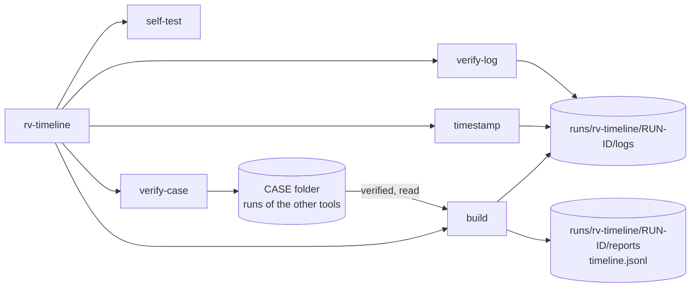

# Command-line reference

<!-- Generated by `rv-timeline docs-cli`. Do not edit by hand: CI fails if this file differs. -->



## rv-timeline

```text
DESCRIPTION:
  rv-timeline reads a Rakvor case folder (the folder that holds case.json) and builds one timeline
  of everything the other Rakvor tools recorded about the evidence: rv-hashinv (intake, file
  times), rv-pdfauth (PDF dates and revisions), rv-imgauth (EXIF, XMP, PNG times), rv-rsmf (chat
  messages), rv-mailauth (Date and Received hops) and rv-certcheck (validity, revocation, RFC 3161
  times). It never opens the evidence itself. For the case it:
    1. verifies the case log and the evidence registry (a broken case is refused, exit 3);
    2. verifies every tool run before reading it: audit chain intact, run finished, and the
       SHA-256 of every output it reads equal to the one in the run's audit log. A run that fails
       is excluded (no event from it) and reported with the reason;
    3. reads the time values of each verified run, in UTC, keeping the original wording and a
       citation (run, output file, its SHA-256, JSON pointer) for each event;
    4. orders all events, computes cross-source signals and writes reports/timeline.jsonl
       (Timesketch), one report per evidence item and a statistics report.
  The run is written inside the case, under <CASE>/runs/rv-timeline/<RUN-ID>/, and recorded in
  the case log. Every action is appended to a hash-chained log that `rv-timeline verify-log` can
  check later; `rv-timeline verify-case <CASE>` checks the whole case.

Usage: rv-timeline <COMMAND>

Commands:
  build        Build the timeline of a case folder from the verified runs of the other Rakvor tools
  verify-log   Verify an audit log (audit.jsonl): edited, deleted or re-ordered entries, and
               truncation
  self-test    Check every hash algorithm against known-answer test vectors
  timestamp    Add an RFC 3161 timestamp to a finished run (e.g. after working offline)
  verify-case  Verify a whole case folder: case log, evidence registry and every run's audit log
  help         Print this message or the help of the given subcommand(s)

Options:
  -h, --help
          Print help (see a summary with '-h')

  -V, --version
          Print version

Run `rv-timeline <COMMAND> --help` for the options, examples and exit codes of each command.
```

## rv-timeline build

```text
DESCRIPTION:
  rv-timeline reads a Rakvor case folder (the folder that holds case.json) and builds one timeline
  of everything the other Rakvor tools recorded about the evidence: rv-hashinv (intake, file
  times), rv-pdfauth (PDF dates and revisions), rv-imgauth (EXIF, XMP, PNG times), rv-rsmf (chat
  messages), rv-mailauth (Date and Received hops) and rv-certcheck (validity, revocation, RFC 3161
  times). It never opens the evidence itself. For the case it:
    1. verifies the case log and the evidence registry (a broken case is refused, exit 3);
    2. verifies every tool run before reading it: audit chain intact, run finished, and the
       SHA-256 of every output it reads equal to the one in the run's audit log. A run that fails
       is excluded (no event from it) and reported with the reason;
    3. reads the time values of each verified run, in UTC, keeping the original wording and a
       citation (run, output file, its SHA-256, JSON pointer) for each event;
    4. orders all events, computes cross-source signals and writes reports/timeline.jsonl
       (Timesketch), one report per evidence item and a statistics report.
  The run is written inside the case, under <CASE>/runs/rv-timeline/<RUN-ID>/, and recorded in
  the case log. Every action is appended to a hash-chained log that `rv-timeline verify-log` can
  check later; `rv-timeline verify-case <CASE>` checks the whole case.

Usage: rv-timeline build [OPTIONS] --case-dir <DIR>

Options:
      --case-dir <DIR>
          The case folder to read (the one that holds case.json), written by the other Rakvor tools.
          The timeline run is written inside it, under <DIR>/runs/rv-timeline/<RUN-ID>/.
          Default: none (required)
          Example: --case-dir E:\CASE-014

      --display-zone <ZONE>
          Zone the reports show times in, next to UTC: UTC, a fixed offset (-05:00, +01:00), or
          America/Bogota or Europe/Paris (summer time built in). Events are always ordered by UTC;
          an event whose source has no zone is never converted.
          Default: UTC
          Example: --display-zone America/Bogota

      --tool <TOOL>
          Only the runs of these tools, comma-separated or repeated: rv-hashinv, rv-pdfauth,
          rv-imgauth, rv-rsmf, rv-mailauth, rv-certcheck. Other runs are skipped and logged.
          Default: every supported tool
          Example: --tool rv-mailauth,rv-imgauth

      --from <TIME>
          Only events at or after this instant (RFC 3339, e.g. 2026-11-01T00:00:00Z or with an
          offset, 2026-11-01T00:00:00-05:00).
          Default: no lower bound
          Example: --from 2026-11-01T00:00:00Z

      --to <TIME>
          Only events at or before this instant (RFC 3339).
          Default: no upper bound
          Example: --to 2026-11-30T23:59:59Z

      --clock-skew <SECONDS>
          Difference in seconds tolerated between two sources' clocks before their order becomes a
          signal (smaller differences are within clock skew).
          Default: 300
          Example: --clock-skew 120

      --max-events <N>
          Stop reading after this many events (the earliest of the last run read are kept). Reaching
          it is recorded in the audit log and the reports, never silent.
          Default: 5000000
          Example: --max-events 100000

      --no-timesketch
          Do not write reports/timeline.jsonl (the Timesketch import file).
          Default: off (timeline.jsonl is written and its digests logged)
          Example: --no-timesketch

  -H, --hash <ALGO>
          Hash algorithm(s) for the files this run writes (timeline.jsonl, reports, logs): one or
          two of md5, sha1, sha256, sha512, sha3-256, blake3. More than two is refused (exit code
          2).
          Default: sha256
          Example: --hash sha256,md5

  -o, --out <DIR>
          Not used by build: every output goes inside the case folder (<CASE>/runs/rv-timeline/).
          Accepted so that scripts shared with the other Rakvor tools keep working.
          Default: ./rakvor-out (ignored)
          Example: --out E:\case-014\rv-timeline

  -l, --lang <LANG>
          Report language(s): en, es, fr (comma-separated), or all. JSON is language-neutral.
          Default: en
          Example: --lang es   or   --lang all

  -a, --actor <NAME>
          Name of the examiner, written in every audit entry and report (alias: --examiner).
          Default: the operating-system user name
          Example: --actor "Ana Ruiz"

  -c, --case <ID>
          Case identifier: when given, it must match the case folder's case.json (exit 2 otherwise).
          Default: none (the case id is read from case.json)
          Example: --case CASE-2026-014

  -p, --progress <MODE>
          How progress is shown: bar, jsonl or none.
          Default: bar (hidden automatically when stderr is not a terminal)
          Example: --progress jsonl

          Possible values:
          - bar:   Progress bar with elapsed time and the runs done on stderr
          - jsonl: One JSON event per line on stdout (for scripts and other tools)
          - none:  No progress output; only the final summary

  -j, --jurisdiction <CC>
          Chain-of-custody form per item: co (Colombia, Fiscalía style, Spanish) or fr (France,
          scellés, French); an English copy is always added. The case's own jurisdiction
          (case.json) applies; the value given here is recorded as requested.
          Default: co
          Example: --jurisdiction fr

      --tsa-url <URL>
          RFC 3161 time-stamping authority for the audit chain head.
          Default: http://timestamp.digicert.com
          Example: --tsa-url https://freetsa.org/tsr

      --no-timestamp
          Do not request a trusted timestamp (offline labs). Also set by RV_NO_TIMESTAMP=1.
          Default: off (a timestamp is requested)
          Example: --no-timestamp

      --sign-cert <P12>
          Examiner's certificate (.p12/.pfx, RSA) used to sign every PDF report. The password is
          read
          from the environment variable named by --sign-pass-env, or asked for interactively.
          Default: none (PDFs are not signed)
          Example: --sign-cert C:\certs\ana-ruiz.p12

      --sign-pass-env <VAR>
          Environment variable holding the certificate password.
          Default: RV_SIGN_PASSWORD
          Example: --sign-pass-env CERT_PASS

  -h, --help
          Print help (see a summary with '-h')

EXAMPLES:
  Build the timeline of a case (UTC, English reports):
    rv-timeline build --case-dir E:\CASE-014
  Show local times for Colombia as well, Spanish reports, check the case id:
    rv-timeline build --case-dir E:\CASE-014 --case CASE-014 --display-zone America/Bogota --lang es
  Only mail and images, one week, French and English reports, machine-readable progress:
    rv-timeline build --case-dir E:\CASE-014 --tool rv-mailauth,rv-imgauth \
      --from 2026-11-01T00:00:00Z --to 2026-11-08T00:00:00Z --lang fr,en --progress jsonl
  Then verify the run's audit log and the whole case:
    rv-timeline verify-log E:\CASE-014\runs\rv-timeline\<RUN-ID>\logs
    rv-timeline verify-case E:\CASE-014
  Import into Timesketch: upload <CASE>/runs/rv-timeline/<RUN-ID>/reports/timeline.jsonl.

EXIT CODES:
  0    Timeline built; every run verified and no medium- or high-severity signal.
  1    Runtime error (case log locked by another tool, output not writable, signing
       certificate unreadable, ...). See the audit log.
  2    Usage error (unknown option, more than two hash algorithms, unsupported language,
       unknown display zone or tool, --from/--to not RFC 3339 or in the wrong order,
       --max-events 0, a folder that is not a case folder, --case of another case).
  3    Timeline built with at least one run excluded (not verified: chain broken, digest
       mismatch, not finished, unsupported tool version, unreadable) or at least one medium- or
       high-severity signal to review; or the case folder fails verification (nothing is written
       to it).
  130  Cancelled with Ctrl+C. Partial reports and the cancellation are written to the audit log.

FILES WRITTEN:
  Inside the case folder, <RUN> = <CASE>/runs/rv-timeline/<RUN-ID>:
  <RUN>/logs/audit.jsonl              Hash-chained log of every action (one JSON object per line):
                                      runs discovered, verified, read, excluded or skipped, events
                                      ordered, timeline written (with its digests), signals.
  <RUN>/logs/audit.log                The same actions, human-readable.
  <RUN>/logs/environment.json         Tool and dependency versions, OS, host, user, command line.
  <RUN>/logs/timestamp-<SEQ>.tsr|.json  RFC 3161 token for the audit chain head.
  <RUN>/reports/timeline.jsonl        Every event, one JSON object per line, Timesketch import
                                      format (message, datetime, timestamp_desc + the citation).
                                      Its digests are in the audit log (timeline_written).
                                      Not written with --no-timesketch.
  <RUN>/reports/statistics.json       Runs (verified, excluded with reason, skipped), events per
                                      tool and kind, signals (+ statistics.<LANG>.html and .pdf).
  <RUN>/reports/items/<NNNNN>-<NAME>/technical.json|.<LANG>.html|.<LANG>.pdf  Item timeline.
  <RUN>/reports/items/<NNNNN>-<NAME>/summary.json|.<LANG>.html|.<LANG>.pdf    Customer summary.
  <RUN>/reports/items/<NNNNN>-<NAME>/custody.json|.<es|fr>.html|.pdf|.en.html|.pdf  Custody form.
  <CASE>/case-log.jsonl               run_started and run_finished of this run are appended.
  Nothing else in the case folder changes: the other tools' runs and the evidence are only read.

FORENSIC NOTES:
  - Verification comes before reading: a run whose audit chain is broken, that did not finish,
    or whose output differs from the digest in its own audit log is excluded, never read. The
    exclusion and its reason are in the audit log, the statistics report and a RUN_NOT_VERIFIED
    signal.
  - In this version the only sources are the outputs of Rakvor tool runs in the case folder; the
    evidence files are not opened. A time no tool recorded is not in the timeline.
  - Times are kept as the source wrote them (original) and placed in UTC. A source without a
    time zone (e.g. EXIF without OffsetTime) is never converted with a guessed zone: the event
    is placed as if it were UTC, marked zone unknown and counted (ZONE_UNKNOWN_EVENTS).
    --display-zone only adds a local-time column; ordering is always by UTC.
  - A signal shows that events from different sources disagree in time (e.g. an EXIF date after
    the intake, a mail Date after its first hop). It does not show who changed what, or that a
    file was tampered with: clocks can be wrong or skewed (--clock-skew), and every signal says
    what it does not prove. An empty signal list does not prove the evidence is authentic.
  - --tool, --from/--to and --max-events narrow the timeline; what was left out is recorded in
    the audit log and printed in the reports, never silent.
  - Each audit entry stores the SHA-256 of the previous one; the run's audit head is recorded in
    the case log, so the two chains vouch for each other. The chain head is timestamped by an
    RFC 3161 authority; offline, the run finishes with `timestamp_pending`: run
    `rv-timeline timestamp <LOG>` later.
  - With --sign-cert every PDF is signed with the examiner's certificate; the password is never
    logged.
```

## rv-timeline verify-log

```text
Verify an audit log (audit.jsonl): edited, deleted or re-ordered entries, and truncation

Usage: rv-timeline verify-log [OPTIONS] <LOG>

Arguments:
  <LOG>
          Path to audit.jsonl, or to the run's log folder that contains it.
          
          Example: rakvor-out/logs/20261019T101500Z-a1b2c3

Options:
      --tsa-ca <PEM>
          CA bundle (PEM with one or more certificates, or one DER certificate) that the TSA
          certificate of every timestamp token must chain to, at the token's genTime.
          
          Default: none (the TSA signature is checked, the chain is not).
          Example: --tsa-ca C:\certs\tsa-roots.pem

  -h, --help
          Print help (see a summary with '-h')

CHECKS:
  - every entry links to the previous one (hash chain): an edited, deleted or re-ordered entry
    breaks it;
  - every timestamp token the log records (timestamp_obtained) is still next to it with its
    metadata (timestamp-<SEQ>.tsr with the recorded SHA-256, timestamp-<SEQ>.json agreeing): a
    missing file is a problem, never a skipped check; a token file no entry records is checked
    too. Every token covers the hash of the entry it names;
  - the TSA's CMS signature of every token: signer certificate in the token, ESS
    signing-certificate binding, message digest over TSTInfo, RSA signature, and an extended key
    usage that is critical and only timeStamping (RFC 3161). With --tsa-ca, also the TSA
    certificate path up to that CA bundle at the token's genTime (every candidate issuer tried;
    CA flag, keyCertSign, pathLenConstraint, directoryName name constraints, no unsupported
    critical extension); without it the output says "chain not checked". Revocation is
    never checked: establish it from CRL/OCSP evidence covering genTime;
  - truncation: a chain alone cannot show that entries were removed from its end. The log must
    still contain the entry covered by its RFC 3161 timestamp (covers_seq) and, for a run inside
    a case folder (<CASE>/runs/<TOOL>/<RUN-ID>/logs), end with the audit head that the case log
    recorded at run_finished (only timestamp_obtained may follow). Entries after the last
    anchored one are listed as not provable; with neither record the output says
    "truncation not detectable without a timestamp or case record".
  - the review log (review.jsonl next to audit.jsonl, written when the timeline is viewed after
    the run): its chain, its anchor to this run's run_finished entry and the run id of every
    entry. The output prints its entry count ("review log: none" when there is none); an
    edited or misplaced review log is a problem;
  - recorded outputs: every file the log says the run wrote (timeline.jsonl, item reports,
    statistics, hashes.csv, environment.json) is re-hashed with each algorithm recorded and
    compared; the latest entry for a file wins. A missing, edited or replaced file is a
    problem; a recorded path that is absolute, contains .. or resolves outside the run folder
    (symlink, junction) is rejected and not read. Timestamp tokens (checked above) are listed
    as not re-hashed, with the reason. Output: "outputs: N verified of M recorded
    (algorithms)".

EXAMPLES:
  rv-timeline verify-log rakvor-out/logs/20261019T101500Z-a1b2c3/audit.jsonl
  rv-timeline verify-log rakvor-out/logs/20261019T101500Z-a1b2c3
  rv-timeline verify-log E:\CASE-014\runs\rv-timeline\20261019T101500Z-a1b2c3\logs
  rv-timeline verify-log rakvor-out/logs/20261019T101500Z-a1b2c3 --tsa-ca digicert-tsa-roots.pem

EXIT CODES:
  0  The chain is intact and agrees with its timestamps and case record (if any), and every
     output file it records (timeline.jsonl, reports, hashes.csv, environment.json) still has
     the recorded digests.
  1  The log or the --tsa-ca file cannot be read.
  3  The chain is broken (an entry was edited, deleted or re-ordered), a timestamp does not
     match or does not verify (altered token, invalid TSA signature, chain not trusted by
     --tsa-ca), the log is shorter than its timestamp or case record says (truncated), the
     review log is edited or misplaced, or a recorded output file was edited, deleted or
     replaced after the run (named in the output; a recorded path that leads outside the run
     folder is rejected, not read).
```

## rv-timeline self-test

```text
Check every hash algorithm against known-answer test vectors

Usage: rv-timeline self-test

Options:
  -h, --help
          Print help (see a summary with '-h')

EXAMPLES:
  rv-timeline self-test

EXIT CODES:
  0  All algorithms give the published answer for the input "abc".
  1  At least one algorithm failed: do not use this build for evidence.
```

## rv-timeline timestamp

```text
Add an RFC 3161 timestamp to a finished run (e.g. after working offline)

Usage: rv-timeline timestamp [OPTIONS] <LOG>

Arguments:
  <LOG>
          The run's log folder (or its audit.jsonl).
          
          Example: rakvor-out/logs/20261019T101500Z-a1b2c3

Options:
      --tsa-url <URL>
          RFC 3161 time-stamping authority.
          Default: http://timestamp.digicert.com
          Example: --tsa-url https://freetsa.org/tsr

  -a, --actor <NAME>
          Name written in the new audit entry.
          Default: the operating-system user name
          Example: --actor "Ana Ruiz"

  -h, --help
          Print help (see a summary with '-h')

EXAMPLES:
  rv-timeline timestamp rakvor-out/logs/20261019T101500Z-a1b2c3
  rv-timeline timestamp rakvor-out/logs/20261019T101500Z-a1b2c3 --tsa-url https://freetsa.org/tsr

EXIT CODES:
  0  Timestamp obtained and logged.
  1  The TSA could not be reached (nothing changed; try again).
  3  The log is missing or broken: no timestamp is added.
```

## rv-timeline verify-case

```text
Verify a whole case folder: case log, evidence registry and every run's audit log

Usage: rv-timeline verify-case [OPTIONS] <CASE>

Arguments:
  <CASE>
          The case folder (the one that holds case.json).
          
          Example: E:\CASE-014

Options:
      --rehash
          Also re-hash every registered item still reachable and compare it with the registry.
          Default: off (only the registry's digest is checked)
          Example: --rehash

  -h, --help
          Print help (see a summary with '-h')

CHECKS:
  - case-log.jsonl is an intact hash chain starting with case_created; case.json is unchanged;
  - evidence/registry.json has the SHA-256 recorded at the last registry change;
  - every run announced in the case log has an intact audit.jsonl (and valid timestamp
    tokens: imprint and TSA signature; the TSA chain is not checked, use verify-log
    --tsa-ca), its case_linked entry points to its run_started entry, and the audit head
    recorded at run_finished is its final entry (only timestamp_obtained may follow);
  - every run's review log (review.jsonl, viewing after the run), when present: its chain and its
    anchor to that run; the output prints the review entries counted across the runs;
  - every output file a run's audit log records (timeline.jsonl, reports, hashes.csv,
    environment.json) is re-hashed and compared with the recorded digests (edited, deleted or
    replaced: a problem);
  - with --rehash: every registered item still reachable at its registered path is read again
    and its digests are compared with the registry (the latest registration of a path).

EXAMPLES:
  rv-timeline verify-case E:\CASE-014
  rv-timeline verify-case E:\CASE-014 --rehash

EXIT CODES:
  0  The case folder is intact (warnings, e.g. a run still in progress or an item not
     reachable for --rehash, are printed).
  1  The folder is not a case folder (no case.json).
  3  At least one check failed: the case was edited, truncated or re-ordered, a run's
     recorded output (timeline, report, register) was edited, deleted or replaced, or
     (--rehash) an evidence file differs from the registry.
```

## rv-timeline describe

```text
Describe this tool as JSON (schema rakvor.describe/1) for RV Hub and scripts

Usage: rv-timeline describe [OPTIONS]

Options:
      --json
          Print JSON: one pretty-printed object with sorted keys.
          Default: on (JSON is the only format)
          Example: --json

  -h, --help
          Print help (see a summary with '-h')

DESCRIPTION:
  Prints what this tool is, what it accepts and how to launch it, validated by
  schemas/describe.schema.json. RV Hub reads it to list the tool and start its GUI on a case
  folder (rv-timeline-gui.exe --case-dir <CASE>). rv-timeline's input is a case folder, not
  evidence files: the files it reads are the case's JSON documents and JSON Lines logs and the
  other tools' JSON outputs, so it is never suggested for an evidence file.
  Fields: schema, tool, title, version, role (analysis), main_verb (build), accepts (json,
  jsonl; no signature), case_formats, log_formats, cli_exe, gui_exe, exit_codes. Nothing is
  read or written; no audit log is created.

EXAMPLES:
  rv-timeline describe --json

EXIT CODES:
  0  The description was printed.
```

