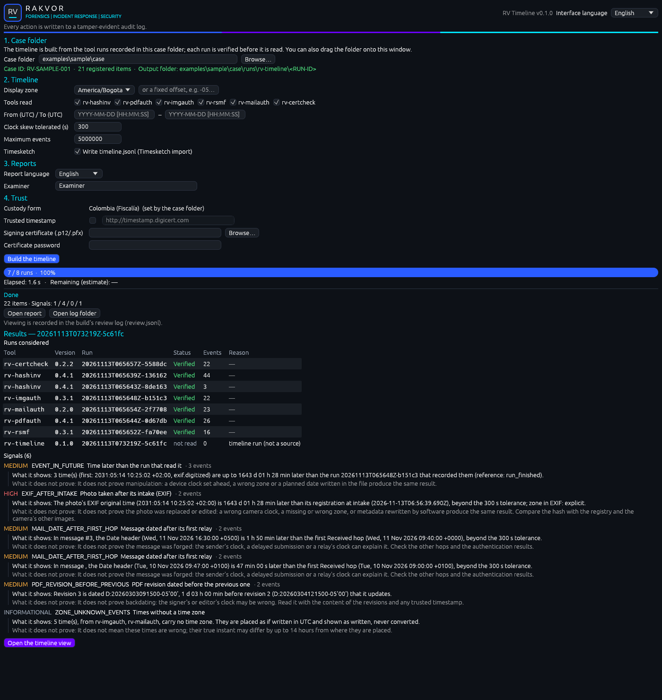
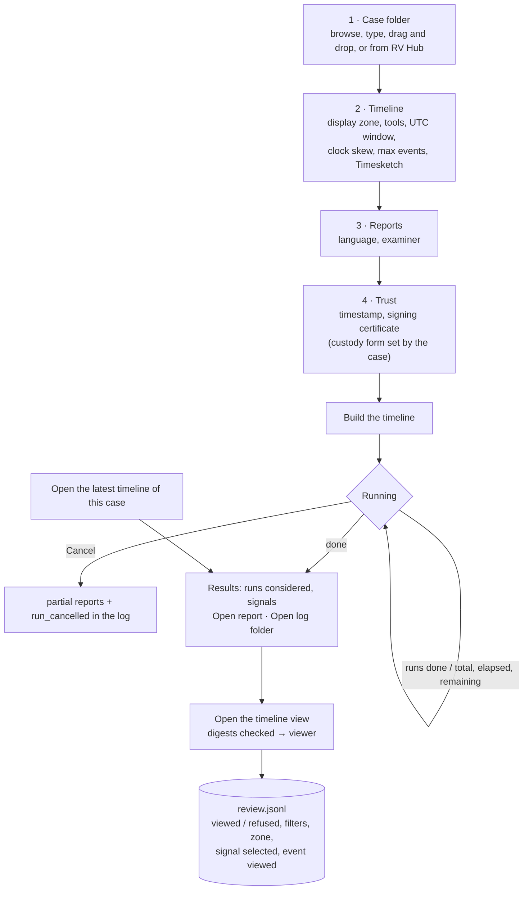
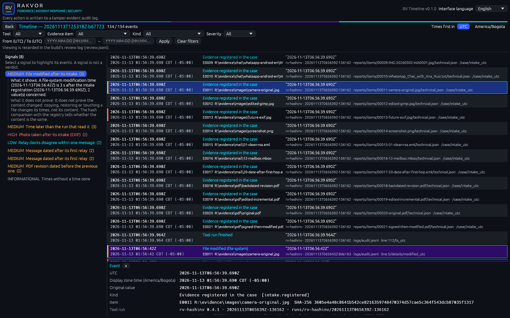

# Using the desktop app (Windows 10/11)

Start **RV Timeline** from the Start menu (installer) or double-click `rv-timeline-gui.exe` (portable zip). It runs
the same engine as `rv-timeline build`, needs no other software, and also runs on virtual machines without a
graphics driver (software rendering). The interface language (English, Español, Français, top right) changes every
label at once and is independent of the report language.



## Workflow



## The window

| Area | What it does |
| --- | --- |
| **1. Case folder** | *Browse…*, type or paste a path, or drag the folder onto the window (or onto the `.exe` icon). The case is opened and verified at once: the line below shows the case id, the number of registered items and the output folder (`<case>\runs\rv-timeline\<RUN-ID>`, not editable). **Open the latest timeline of this case** opens the most recent finished build without building again. |
| **2. Timeline** | *Display zone* (UTC, America/Bogota, Europe/Paris, or a typed fixed offset such as `-05:00`); *Tools read* (one tick per tool; at least one stays ticked; all ticked = every supported tool); *From / To (UTC)* (`YYYY-MM-DD [HH:MM:SS]`, an RFC 3339 time with an offset also works; a date alone covers the whole day); *Clock skew tolerated (s)* (0 to 604 800); *Maximum events*; *Write timeline.jsonl (Timesketch import)*. |
| **3. Reports** | Report language (English, Español, Français, or all three) and examiner name (defaults to your Windows user). Hashes of the build's own files: SHA-256. |
| **4. Trust** | *Custody form* is set by the case folder (shown, not editable); *Trusted timestamp* (on by default; TSA address editable); *Signing certificate* (`.p12`/`.pfx`) and its password (kept in memory only, never logged) so every PDF is signed. |
| **Build the timeline / Cancel** | Enabled once a case folder is chosen and every setting is valid. During a build the settings are locked and the button becomes *Cancel*. |
| **Progress** | Bar by runs examined (`7 / 8 runs`), elapsed time and estimated time remaining. |
| **Results** | Counts (items, signals high / medium / low / info), **Open report** (statistics page in the report language), **Open log folder**, the **Runs considered** table (tool, version, run, status *Verified* / *Excluded* / *not read*, events, reason) and the **Signals**, each with what it shows and what it does not prove. **Open the timeline view** opens the viewer. |

Validation messages appear next to the field and block the build until fixed (for example "The start of the
window is after its end.", "Clock skew: a whole number of seconds, at most 604800 (7 days).", "At least one tool
must be read."). They are not logged: no build, and therefore no log, exists yet.

## The timeline viewer



The viewer shows a finished build **only** from its audited outputs, and only when they still match the audit log:

```mermaid
sequenceDiagram
    participant U as Examiner
    participant G as GUI
    participant A as audit.jsonl (chain verified, run_finished present)
    participant F as reports/statistics.json, timeline.jsonl
    participant R as review.jsonl
    U->>G: Open the timeline view
    G->>A: verify the chain; digests of statistics_report_written and timeline_written
    G->>F: hash statistics.json; one streaming pass over timeline.jsonl (digest + line index)
    alt digests equal
        G-->>U: viewer (runs, signals, events)
        G->>R: ui_timeline_viewed {files + digests}
    else a digest differs or a file is missing
        G-->>U: "The timeline was not shown:" + reason
        G->>R: ui_timeline_refused {reason}
    end
    U->>G: scroll
    G->>F: seek + read only the visible rows, line hash = indexed hash?
```

| Part | Shows |
| --- | --- |
| Header | Build id, `shown / total events`, *Times first in* **UTC** or the build's display zone (toggle) |
| Filters | Tool, Evidence item, Kind, Severity (events named by a signal of at least that severity), From / To (UTC); **Apply**, **Clear filters** |
| Signals (left) | Every signal with its severity; selecting one shows what it shows and what it does not prove, highlights its events and scrolls to the first one. "A signal is not a verdict." |
| Event list | One row per event: UTC time and display-zone time (zone-unknown events: "zone unknown, as written", never converted), kind label, evidence id, path and sub-item, the original wording in quotes, the tool, run and citation (output file and JSON pointer or log line) |
| Event details (bottom) | UTC, display-zone time, original value, kind (label and key), item (evidence id, path, SHA-256), tool run (tool, version, run id, run folder), citation (file, its SHA-256, pointer), details |

The list is **virtualised**: the viewer indexes `timeline.jsonl` once (a few dozen bytes per event: offset,
length, line hash, time, tool, item, kind, zone flag, highest signal severity) and reads only the rows on screen,
re-checking each row's hash against the index. Timelines of millions of events open without loading them into
memory. A build made with `--no-timesketch` has no `timeline.jsonl`: the viewer says so and shows runs and signals
only.

If the review log cannot be written (for example a read-only case folder), the status line says so and the entry
is noted in the audit preamble of the next build instead. `rv-timeline verify-log <RUN>\logs` and `verify-case`
check the review log and print its entry count ([usage.md](usage.md#8-verifying-a-build)).

## Case folder and RV Hub

The GUI works only inside an existing case folder ([case-folder.md](case-folder.md)): register the evidence with
RV HashInv first and run the analysis tools. RV Hub opens the app with the case folder already filled:
`rv-timeline-gui.exe --case-dir <CASE>` (or `--case-dir=<CASE>`). The audit log then starts with
`ui_case_dir_from_launcher`; a `--case-dir` without a folder is ignored, shown in the window and logged as
`ui_launch_argument_ignored`.

## What the GUI records

Your choices are part of the evidence record. Before the build starts, the GUI writes them to the build's audit log
(audit preamble, each with the time it was made); viewing after the build goes to the build's review log.

| Action | Logged as |
| --- | --- |
| Case folder (chosen or from RV Hub) | `ui_case_dir_changed`, `ui_case_dir_from_launcher`, `ui_launch_argument_ignored` |
| Timeline settings | `ui_display_zone_changed`, `ui_tools_filter_changed`, `ui_window_changed`, `ui_clock_skew_changed`, `ui_max_events_changed`, `ui_timesketch_changed` |
| Report and interface language | `ui_language_changed`, `ui_interface_language_changed` |
| Trust settings | `ui_timestamp_changed`, `ui_signing_certificate_changed` (path only, never the password) |
| Press *Build the timeline* | `ui_start_clicked` (final settings) |
| Press *Cancel* | `run_cancelled` |
| Open the timeline view | `ui_timeline_viewed` or `ui_timeline_refused` in `review.jsonl` |
| Filters, zone toggle, signal, event | `ui_timeline_filter_changed`, `ui_timeline_zone_toggled`, `ui_signal_selected`, `ui_event_viewed` (with the event's citation) in `review.jsonl` |

## Same results as the command line

A GUI build of the same case with the same settings gives the same `timeline.jsonl` (same SHA-256) and signals as
`rv-timeline build`; `environment.json` records `"frontend": "gui"` and the settings used. The screenshots on this
page come from `cargo run -p rv-timeline-gui --example gui_screenshot` on the sample case.
