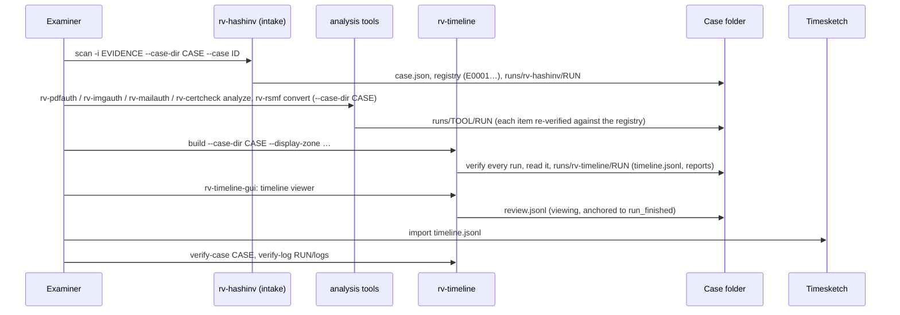

# Usage guide: from intake to a case timeline

This guide walks an examiner through one case end to end: registering the evidence with **RV HashInv**, examining
it with the analysis tools, building the timeline with **RV Timeline**, reading it (reports, desktop viewer,
Timesketch) and verifying the whole case before handing it over. Every option: [usage-cli.md](usage-cli.md)
(generated from `--help`). The desktop app: [usage-gui.md](usage-gui.md). Why each step works:
[theory.md](theory.md). What each output holds: [reports.md](reports.md).



## Contents

- [1. Before you start](#1-before-you-start)
- [2. Case walkthrough](#2-case-walkthrough) (incl. [RV Hub](#26-starting-from-rv-hub---case-dir-and-describe---json))
- [3. Reading the outputs](#3-reading-the-outputs)
- [4. Interpreting each signal](#4-interpreting-each-signal)
- [5. Narrowing a build](#5-narrowing-a-build)
- [6. Timestamps](#6-timestamps)
- [7. Signing reports with the examiner certificate](#7-signing-reports-with-the-examiner-certificate)
- [8. Verifying a build](#8-verifying-a-build)
- [9. Troubleshooting](#9-troubleshooting)

## 1. Before you start

| Check | How |
| --- | --- |
| The installed tool is the genuine release and works | [installation.md](installation.md) steps 2–6: `SHA256SUMS`, provenance, Authenticode, `rv-timeline self-test`, the sample case |
| The case folder exists and is intact | Created by rv-hashinv at intake; `rv-timeline verify-case <CASE>` exits 0 |
| The analysis runs are finished and of supported versions | rv-hashinv 0.4.x, rv-pdfauth 0.4.x, rv-imgauth 0.3.x, rv-rsmf 0.3.x, rv-mailauth 0.2.x, rv-certcheck 0.2.x ([theory.md B3](theory.md#b3-run-discovery-and-verification)); other versions are excluded, never guessed |
| The zone of each source is documented | Device settings noted at collection (camera menu, phone settings, mail server zone); for chat exports, the zone you give rv-rsmf `--timezone`. A source without a zone stays "zone unknown" ([theory.md A5](theory.md#a5-times-without-a-time-zone)) |
| The workstation clock | Synchronised (time source noted); the build's audit log and `EVENT_IN_FUTURE` references use run times |
| Legal basis | Mandate and data-protection basis ([admissibility.md](admissibility.md#55-personal-data)) |

## 2. Case walkthrough

Commands and outputs below are real: the sample case ([examples/sample](../examples/sample/README.md)), written by
the six released tools, built with this version (paths shortened, timestamps off).

### 2.1 Intake with RV HashInv

rv-hashinv opens the case folder and registers every file once (evidence ids `E0001`…), with the intake time that
anchors the timeline's intake signals. rv-timeline is an **analysis-role** tool: it never writes the registry
([case-folder.md](case-folder.md)).

```powershell
rv-hashinv scan -i R:\evidence -r --case-dir R:\case --case RV-SAMPLE-001 --jurisdiction co --hash sha256,md5 --actor "Ana Ruiz"
```

### 2.2 The analysis tools

Each tool re-hashes the items it examines, compares them with the registry and writes its run under
`runs/<tool>/<RUN-ID>/` (the commands that wrote the sample case, from `tests/make_sample_case.sh`):

```powershell
rv-pdfauth   analyze -i R:\evidence\pdf    --case-dir R:\case --hash sha256,md5
rv-imgauth   analyze -i R:\evidence\images --case-dir R:\case --hash sha256,md5 --maps none
rv-rsmf      convert -i R:\evidence\chat -r --timezone Europe/Paris --case-dir R:\case --hash sha256,md5
rv-mailauth  analyze -i R:\evidence\mail   --dkim-keys R:\inputs\dkim-keys.txt --own-domain acme.example --case-dir R:\case --hash sha256,md5
rv-certcheck analyze -i R:\evidence\certs  --anchor R:\anchors\rakvor-lab-root.crt --at 2026-06-01T00:00:00Z --case-dir R:\case --hash sha256,md5
```

Let every run finish: a cancelled or failed run is excluded from the timeline (`not_finished`). Offline runs can
be timestamped later with each tool's `timestamp` command; the timeline does not require tokens but shows them as
`run.timestamped` events.

### 2.3 Build the timeline

```powershell
rv-timeline build --case-dir R:\case --hash sha256,md5 --display-zone America/Bogota --lang all --actor "Ana Ruiz"
```

```text
DONE (to review: excluded runs or medium/high signals)  run 20261113T115004Z-dcb88e
  case:     RV-SAMPLE-001
  runs:     verified 7, excluded 0, skipped 0
  events:   154 (zone unknown: 5)  items: 21  elapsed: 2.4 s
  signals:  high 1, medium 5, low 1, info 1
  timeline: R:\case\runs\rv-timeline\20261113T115004Z-dcb88e\reports\timeline.jsonl
  timestamp: off
  report:   R:\case\runs\rv-timeline\20261113T115004Z-dcb88e\reports\statistics.en.html
  logs:     R:\case\runs\rv-timeline\20261113T115004Z-dcb88e\logs
```

Exit code 3 here means "to review": every run verified, and the sample plants medium- and high-severity signals.
The same command on the tampered copy `examples/sample/tampered/digest-mismatch` (one rv-imgauth output changed
after its run) leaves that run out and says why:

```text
  runs:     verified 6, excluded 1, skipped 0
  events:   132 (zone unknown: 3)  items: 21
  signals:  high 0, medium 5, low 1, info 1
  excluded: runs/rv-imgauth/20261113T065648Z-b151c3 (digest_mismatch: reports/items/00003-future-exif.jpg/metadata.json: md5 differs from logs/audit.jsonl)
```

The planted `EXIF_AFTER_INTAKE` disappears with the excluded run: its events are not in the timeline at all.

### 2.4 Review in the desktop app

Start **RV Timeline**, choose the case folder, **Open the latest timeline of this case** (or build it), then
**Open the timeline view**: every event in UTC and in the display zone, filters by tool, item, kind, severity and
UTC window, signals that highlight their events, and each event's citation. Each view, filter and selection is
recorded in the build's `review.jsonl` ([usage-gui.md](usage-gui.md)).

### 2.5 Timesketch

`reports/timeline.jsonl` is in Timesketch's JSONL import format (`message`, `datetime`, `timestamp_desc` plus
`rakvor_*` attributes, [reports.md](reports.md#timelinejsonl-fields)). In Timesketch: *Upload timeline* → choose the
file → give it a name that includes the case id and the rv-timeline run id. Search `rakvor_zone:"unknown"` to see
the zone-unknown events (their `datetime` is the wall clock read as UTC), `rakvor_event_id:"…"` to find the events
a signal cites, `rakvor_tool:"rv-mailauth"` to restrict to one source. Keep Timesketch annotations separate from the
tool's outputs: they are the examiner's work, not part of the audited build. Importing sends the file to the
Timesketch server: check where it runs and who can read it (personal data, [admissibility.md](admissibility.md#55-personal-data)).

### 2.6 Starting from RV Hub: `--case-dir` and `describe --json`

RV Hub (the Rakvor launcher) finds the installed tools and opens them on a case folder:

- **`rv-timeline-gui.exe --case-dir <CASE>`** starts the desktop app with **Case folder** filled
  (`--case-dir=<CASE>` also works). The preset is written to the build's audit log as `ui_case_dir_from_launcher`
  followed by `ui_case_dir_changed`; a `--case-dir` without a folder is ignored, shown in the window and logged as
  `ui_launch_argument_ignored`.
- **`rv-timeline describe --json`** prints one JSON object (sorted keys, schema
  [`schemas/describe.schema.json`](../schemas/describe.schema.json), `rakvor.describe/1`) that RV Hub reads. It reads
  and writes nothing.

| Field | Value for rv-timeline |
| --- | --- |
| `tool`, `title`, `version` | `rv-timeline`, `RV Timeline`, the product version (`version.txt`) |
| `role` | `analysis` (reads the registry; never writes it) |
| `main_verb` | `build` |
| `accepts` | `json`, `jsonl`, no signature: its input is a case folder, so RV Hub never suggests it for an evidence file |
| `case_formats`, `log_formats` | `rakvor.case/1`; the audit and review logs |
| `cli_exe`, `gui_exe` | `rv-timeline.exe`, `rv-timeline-gui.exe` |
| `exit_codes` | 0, 1, 2, 3, 130 (section 9) |

### 2.7 Verify the whole case

```powershell
rv-timeline verify-case R:\case
# OK  case RV-SAMPLE-001: 19 case-log entries, 21 registered items, 8 runs verified: R:\case
rv-timeline verify-log R:\case\runs\rv-timeline\20261113T115004Z-dcb88e\logs
# OK  67 entries, chain intact: …\audit.jsonl
#     truncation: the final entry #67 is anchored by the case log (run_finished)
#     review log: none
#     outputs: 409 verified of 409 recorded (md5, sha256)
```

`verify-log` re-hashes every file the build's audit log records (`timeline.jsonl`, reports, `hashes.csv`,
`environment.json`); `verify-case` does the same for every run of the case and prints
`outputs: N verified of M recorded by the runs' audit logs`. An edited, deleted or replaced output is named
(`output reports/timeline.jsonl: sha256 differs from audit entry #…`) and gives exit 3. `verify-case` also prints
`review logs: <n> entries across the runs, all verified`; after viewing in the GUI,
`verify-log` prints `review log: <n> entries, chain intact`. Then hand over the whole case folder.

## 3. Reading the outputs

```text
R:\case\runs\rv-timeline\<RUN-ID>\
  logs\audit.jsonl             every run discovered / verified / read / excluded / skipped, every digest
  logs\hashes.csv              the case files the build read (205 rows for the sample)
  logs\review.jsonl            GUI viewing after the build (when any)
  reports\timeline.jsonl       154 events, Timesketch format
  reports\statistics.<lang>.html|.pdf|.json   runs table, events per tool and kind, signals, limitations
  reports\items\00013-future-exif.jpg\technical.<lang>.html   the item's events (UTC, display zone, original, citation) and signals
```

Start with the **statistics report**: the *runs considered* table (any excluded or skipped run, with its reason),
then the signals, then the items with signals. In an item's technical review, each event row shows the UTC time,
the display-zone time (or "zone unknown, as written"), the original wording, the kind, the tool and the citation
(output file and JSON pointer): open that file in the tool's run folder to see the value in context. Output
formats in detail: [reports.md](reports.md).

## 4. Interpreting each signal

Every signal is a **difference between sources**, never a conclusion. Before relying on one, check the innocent
explanations it lists ([reports.md](reports.md#signals-catalogue)) against what you know about the devices.

| Signal | First checks |
| --- | --- |
| `EXIF_AFTER_INTAKE` | The camera's other photos (same offset?), the zone in EXIF (`zone` parameter), the photo's hash against the registry (rv-imgauth's report), XMP history. |
| `FILE_MODIFIED_AFTER_INTAKE` | Which run saw the new time (cited events); whether the content still matches the registry (the analysis tool's case check); how the copy was handled after intake. |
| `MAIL_DATE_AFTER_FIRST_HOP` | The other hops, the sender's zone, rv-mailauth's DKIM result and `TIMEZONE_INCONSISTENT`-type findings for the message. |
| `PDF_REVISION_BEFORE_PREVIOUS` | rv-pdfauth's revision report (what changed in that revision), any signature's CMS signing time and RFC 3161 token. |
| `EVENT_IN_FUTURE` | The device clock (other files from it), planned dates (contracts, events), the zone. |
| `CLOCK_SKEW_SUSPECTED` | Whether the offset matches a zone difference (3 600 s multiples) or a known clock error; it often explains other signals on the same item. |
| `RUN_NOT_VERIFIED` | The reason: `not_finished` (re-run the tool), `unsupported_version` (use a supported version), `chain_broken` / `digest_mismatch` (investigate; never repair a log by hand). |
| `ZONE_UNKNOWN_EVENTS` | Which sources (`tools`); establish their zone from collection notes before relying on their order. |

## 5. Narrowing a build

| Need | Option | Recorded as |
| --- | --- | --- |
| Only some tools | `--tool rv-mailauth,rv-imgauth` | `run_skipped` (`tool_filter`) per other run |
| A time window | `--from 2026-11-01T00:00:00Z --to 2026-11-08T00:00:00Z` (RFC 3339, an offset is allowed) | `events_outside_filters` per run, `events_filtered_out` |
| A bound on size | `--max-events 100000` | `event_cap_reached`, later runs `run_skipped` (`max_events`), `TL_MAX_EVENTS` |
| Another tolerance | `--clock-skew 120` (seconds) | `run_started`, every signal's `tolerance_s`, `TL_CLOCK_SKEW` |
| No Timesketch file | `--no-timesketch` | `run_started`; the GUI viewer then has nothing to list |

Signals are computed over the events **kept**: a window that excludes an item's intake also removes its intake
signals. For a court report, build once over the whole case and narrow in the viewer or in Timesketch; keep any
narrowed build with its options.

## 6. Timestamps

By default the build asks an RFC 3161 authority (`--tsa-url`, default `http://timestamp.digicert.com`) to timestamp
its audit chain head. Offline, use `--no-timestamp` (or `RV_NO_TIMESTAMP=1`); a build that cannot reach the TSA
finishes with `timestamp_pending`. Add the token later:

```powershell
rv-timeline timestamp R:\case\runs\rv-timeline\<RUN-ID>\logs
rv-timeline verify-log R:\case\runs\rv-timeline\<RUN-ID>\logs --tsa-ca digicert-tsa-roots.pem
# → … TSA signature valid (signer: …); chain validated to … (revocation not checked)
```

Independent check with OpenSSL (the imprint is the `head` in `timestamp-<N>.json`):
`openssl ts -verify -digest <head> -in timestamp-<N>.tsr -CAfile tsa-roots.pem` → `Verification: OK` (signature and
chain only, not revocation: establish the TSA certificate's status at genTime from CRL/OCSP evidence,
[ADR 0002](adr/0002-tsa-token-verification.md)).

## 7. Signing reports with the examiner certificate

```powershell
$env:RV_SIGN_PASSWORD = Read-Host -AsSecureString | ConvertFrom-SecureString -AsPlainText
rv-timeline build --case-dir R:\case --sign-cert C:\certs\ana-ruiz.p12 --lang es
Remove-Item Env:\RV_SIGN_PASSWORD
```

Every PDF is signed (RSA certificates only); the certificate's subject and SHA-256 fingerprint are logged
(`signing_certificate_loaded`) and printed on every report; the password is never logged. Check with
`pyhanko sign validate --pretend-trust <cert> <file.pdf>` or Acrobat ([theory.md B13](theory.md#b13-signed-pdf-reports-and-custody-forms)).

## 8. Verifying a build

Anyone — you, a colleague, an opposing expert — can check a build with the case folder:

| Step | Command | Proves |
| --- | --- | --- |
| 1 | `rv-timeline verify-log <RUN>\logs` (exit 0 intact, 3 broken, truncated or an output changed) | No entry edited, deleted or reordered; timestamp tokens match; the log reaches the final entry the case log recorded; `review.jsonl` intact and anchored to this build; every output the log records still has its digests (`outputs:` line) |
| 2 | `python tests/verify_chain.py <RUN>/logs` (source tree) | Same, with an independent implementation; also re-hashes the files listed in `hashes.csv` |
| 3 | `rv-timeline verify-case <CASE>` (add `--rehash` where the evidence is reachable) | Every run, the build's included, is the one the case log announced and complete, with every recorded output unchanged; the registry is intact |
| 4 | Step 1 (`outputs:` line); script below for an independent check | `timeline.jsonl`, every report, `environment.json` and `hashes.csv` still have the digests recorded in the log |
| 5 | Rebuild on a **copy** of the case with the same options | The same `timeline.jsonl` SHA-256 ([theory.md B14](theory.md#b14-determinism-and-repeatability)) |
| 6 | `python tests/validate_reports.py <RUN>/reports` | Every JSON report matches its schema |

Step 4 is built into `verify-log` and `verify-case`. To check it with code you can read in one screen (an
independent implementation, e.g. for an opposing expert), re-hash every file the build recorded:

```bash
python - "<RUN>/logs" "<RUN>/reports" <<'EOF'
import hashlib, json, pathlib, sys
log, rep = pathlib.Path(sys.argv[1]), pathlib.Path(sys.argv[2])
def digest(p, algo):
    h = hashlib.new({"sha3-256": "sha3_256"}.get(algo, algo)); h.update(p.read_bytes()); return h.hexdigest()
checked = bad = 0
for line in (log / "audit.jsonl").open(encoding="utf-8"):
    e = json.loads(line); a, d = e["action"], e["details"]
    if a in ("item_reports_written", "timeline_written"):
        files = {rep / d["folder"].removeprefix("reports").lstrip("/") / k: v for k, v in d["files"].items()}
    elif a == "statistics_report_written":
        files = {rep / k: v for k, v in d["files"].items()}
    elif a in ("environment_recorded", "hash_register_written"):
        files = {log / e["item"]: d}
    else:
        continue
    for p, digests in files.items():
        algo = next(x for x in ("sha256", "sha512", "sha3-256", "sha1", "md5", "blake3") if x in digests)
        if algo == "blake3":
            continue  # not in hashlib; another algorithm of the run is checked when present
        checked += 1
        got = digest(p, algo) if p.is_file() else "missing"
        if got != digests[algo]:
            bad += 1; print("MISMATCH", p, algo, got)
print(f"{checked} files checked, {bad} mismatches"); sys.exit(3 if bad else 0)
EOF
```

A single file in PowerShell: `(Get-FileHash <file> -Algorithm SHA256).Hash.ToLower()` and search the value in
`audit.jsonl`.

## 9. Troubleshooting

### Exit codes

| Command | 0 | 1 | 2 | 3 | 130 |
| --- | --- | --- | --- | --- | --- |
| `build` | built; every run verified, no medium/high signal | runtime error (case log locked, output not writable, certificate unreadable) | usage error (unknown option, tool or display zone, three algorithms, unsupported language, `--from`/`--to` not RFC 3339 or reversed, `--max-events 0`, not a case folder, `--case` of another case) | built with ≥ 1 excluded run or ≥ 1 medium/high signal; or the case fails verification (nothing written) | cancelled (Ctrl+C), partial reports written |
| `verify-log` | intact | log or `--tsa-ca` unreadable | — | broken chain, token mismatch, truncated, or a recorded output edited, deleted or replaced | — |
| `verify-case` | case intact (warnings printed) | not a case folder (no `case.json`) | — | at least one check failed | — |
| `timestamp` | obtained and logged | TSA unreachable (nothing changed) | — | log missing or broken (nothing added) | — |
| `self-test` | all pass | a failure: do not use the build | — | — | — |
| `describe` | description printed | — | usage error | — | — |

### Common situations

| Situation | Fix |
| --- | --- |
| A run is excluded `not_finished` | The tool run was cancelled or failed, or the case log has no `run_finished` for it: run that tool again on the case, then rebuild. |
| A run is excluded `unsupported_version` | The case holds a run of a tool version this rv-timeline does not read; the statistics report lists the supported versions. Use a supported tool version, or wait for a reader. |
| A run is excluded `unsupported_tool` | A run folder of a tool rv-timeline has no reader for (for example a newer Rakvor tool); its events are missing. |
| A run is excluded `chain_broken` or `digest_mismatch` | The run's record or an output changed after the run. Do **not** repair it: run `verify-case`, investigate, document; re-run the tool in a new run if needed. |
| `the case folder … fails verification; a broken case is never extended` (exit 3) | The case log, `case.json` or the registry changed. Nothing was written. Investigate with `verify-case`; never edit a case log by hand. |
| `the case log is locked by <tool> (…); try again when it has finished` | Another tool is writing; wait and run again. A lock older than 10 minutes is reported as stale and never deleted automatically. |
| `--from`/`--to` refused | Use RFC 3339 with a zone: `2026-11-01T00:00:00Z` or `2026-11-01T00:00:00-05:00`. |
| `unknown display zone '…'` | `UTC`, a fixed offset (`-05:00`, `+0100`), `America/Bogota` or `Europe/Paris` only (no tz database). |
| Fewer events than expected for an item | The source tool did not write that time, the reader skipped a value it could not parse (`TL_TIMES_SKIPPED` in the reports; `times_skipped` and examples in the run's `run_read` audit entry), the window or cap left it out, or the run is excluded. Check the source tool's report for the item. |
| Events carry `registry_match: differs` | The analysis run examined a copy that did not match the registry (its own report has `EVIDENCE_HASH_MISMATCH_WITH_CASE`): those times describe another file. Find the right copy and re-run that tool. |
| A run is excluded `unreadable` with a path outside the case | A recorded output path is not a plain relative path, or a symbolic link or junction in the run folder leads out of the case folder: the build refuses to follow it. Investigate how the case folder was assembled. |
| `warning: timestamp pending (…)` | See [Timestamps](#6-timestamps). |
| `truncated: …` (`verify-log`) | Entries were removed from the end of the log; investigate, do not repair. |
