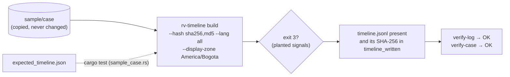

# Examples

## `sample/` — a real case folder written by the six Rakvor tools

| Path | What it is |
| --- | --- |
| `sample/case/` | A Rakvor case folder (`rakvor.case/1`, case `RV-SAMPLE-001`) with one completed run of each released tool — rv-hashinv (intake, then a second run after one file was touched), rv-pdfauth, rv-imgauth, rv-rsmf, rv-mailauth, rv-certcheck — over 21 synthetic evidence files. The evidence itself is not included: rv-timeline never opens it. |
| `sample/tampered/` | Three copies of the case, each broken in one way: `digest-mismatch` (an rv-imgauth output edited), `chain-broken` (an rv-mailauth audit entry edited), `not-finished` (rv-certcheck's run cut before `run_finished`). |
| `sample/expected_timeline.json` | The ground truth: runs, every event (id, UTC time, original wording, zone, citation) and every signal (code, item, severity, events) for the clean case and each tampered copy, derived by an independent standard-library Python script from the tools' own outputs. |
| `sample/derived-evidence.json`, `sample/tool-versions.json` | The three planted files and how they were derived; the version, commit and SHA-256 of each tool executable that wrote the case. |
| `sample/run.sh`, `sample/run.ps1` | Build the timeline of a copy of the case and check the result. |
| `sample/README.md` | What is planted where, and where every field of the ground truth comes from. |

Planted signals (clean case, `--clock-skew 300`): `EXIF_AFTER_INTAKE` (high) and `EVENT_IN_FUTURE` on a photo whose
EXIF dates say 2031; `FILE_MODIFIED_AFTER_INTAKE` on the touched photo; `PDF_REVISION_BEFORE_PREVIOUS` on a PDF
whose third revision is dated before the second; `MAIL_DATE_AFTER_FIRST_HOP` on two messages;
`CLOCK_SKEW_SUSPECTED` (Received hops out of order in mbox message `#3`); `ZONE_UNKNOWN_EVENTS` (5: two EXIF dates
without OffsetTime and three mbox `From ` lines). Each tampered copy adds exactly one `RUN_NOT_VERIFIED`.



Run it (the scripts work on a copy in `sample/out/`, or `$RV_SAMPLE_OUT`; the committed case is never changed):

```bash
examples/sample/run.sh target/release/rv-timeline          # Linux / macOS / Git Bash
```

```powershell
.\examples\sample\run.ps1 -Bin .\rv-timeline.exe          # Windows
```

Expected: `build` exits 3 with `runs: verified 7, excluded 0, skipped 0`, `events: 154 (zone unknown: 5)`,
`signals: high 1, medium 5, low 1, info 1`; then `timeline.jsonl is listed in the audit log (…)` and two `OK` lines.
Try a tampered copy by hand: `rv-timeline build --case-dir <copy of sample/tampered/digest-mismatch>` excludes the
rv-imgauth run with `digest_mismatch`.

Regenerating the sample (only when a tool version or a convention changes): `tests/make_sample_case.sh`
([development.md](../docs/development.md#the-sample-case-and-its-ground-truth)). Nothing in `sample/` is edited by
hand.

`sample/evidence/` and `sample/expected_hashes.csv` come from the project template (three files of the forge's
inventory sample). `build` does not use them; the shared evidence pipeline's unit tests (`run.rs`) and the
golden-case generator (`tests/golden/regenerate.py`) still do.
