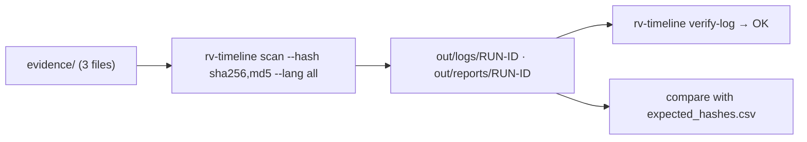
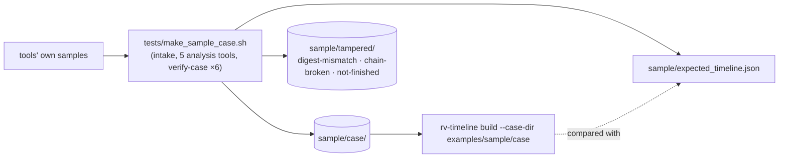

# Examples

## `sample/` — three files that exercise every report section

| File | What it demonstrates | Expected finding |
| --- | --- | --- |
| `evidence/acta.txt` | Plain text | DUPLICATE (info) |
| `evidence/acta-copia.txt` | Same content as `acta.txt` | DUPLICATE (info) |
| `evidence/foto-vacaciones.jpg` | A PDF renamed as a photo | EXTENSION_MISMATCH (medium) |

`expected_hashes.csv` holds the digests of the three files in all six algorithms, computed independently with
Python's `hashlib` and `blake3`, so you can check the tool's output.



Run it:

```bash
examples/sample/run.sh target/release/rv-timeline          # Linux / macOS
```

```powershell
.\examples\sample\run.ps1 -Bin .\rv-timeline.exe          # Windows
```

Expected summary: 3 items, 0 errors, findings `high 0, medium 1, low 0, info 2`, exit code 0.

## `sample/case/` — a case folder from all six tools (ground truth for the timeline)

`sample/case/` is a Rakvor case folder written by the released rv-hashinv, rv-pdfauth, rv-imgauth, rv-rsmf,
rv-mailauth and rv-certcheck on 21 synthetic evidence files, with planted time anomalies. `sample/tampered/` holds
three broken copies (edited output, edited audit line, unfinished run) and `sample/expected_timeline.json` the runs,
events and signals the timeline must produce. Details, planted signals and the origin of every expected field:
[sample/README.md](sample/README.md).



Rebuild it (after `cargo build --release --locked -p <tool>-cli` in each tool repository next to this one):

```bash
tests/make_sample_case.sh ..            # Git Bash on Windows, Linux, macOS
```

```powershell
.\tests\make_sample_case.ps1 -RakvorRoot ..
```

`sample/run.sh` and `sample/run.ps1` still run the template scan of `sample/evidence/`; they will call
`rv-timeline build --case-dir examples/sample/case` once the CLI exists.
