# Sample case: ground truth for rv-timeline

`case/` is a real Rakvor case folder (`rakvor.case/1`) written by the six released tools on a curated, fully
synthetic evidence set. `tampered/` holds three copies of it, each broken in one way. `expected_timeline.json` says
what `rv-timeline build --case-dir examples/sample/case` must find: the runs, every time event with its UTC time and
original string, and the cross-source signals with the events and items they cite. All of it is regenerated by
`tests/make_sample_case.sh` (Windows: `tests/make_sample_case.ps1`); nothing here is edited by hand.

```mermaid
flowchart LR
    S["tool samples<br/>(6 repos, examples/sample)"] -->|copy + 3 derived files| E[("evidence/ (21 files)<br/>fixed mtime")]
    E --> H1["rv-hashinv scan<br/>(intake E0001-E0021)"]
    H1 --> T["touch camera-original.jpg"]
    T --> H2["rv-hashinv scan --evidence"]
    H2 --> A["rv-pdfauth · rv-imgauth · rv-rsmf<br/>rv-mailauth · rv-certcheck"]
    A --> P["prune HTML/PDF renderings"]
    P --> V{"verify-case<br/>× 6 tools"}
    V -- OK --> C[("case/")]
    C --> X["tamper"] --> TT[("tampered/<br/>digest-mismatch · chain-broken · not-finished")]
    C --> J["make_sample_case.py expected"] --> EJ["expected_timeline.json"]
    TT --> J
```

## Evidence (all synthetic)

Copied byte for byte from the tools' own samples, except three derived files (same-length byte replacements in a
copy, listed with their SHA-256 in `derived-evidence.json`). Every file gets the modification time
2026-11-12T06:00:00Z before the intake. The lab root certificate (`anchors/`) is an input of rv-certcheck, not
evidence; the sample private key of rv-certcheck (`leaf-mismatch.key`) is deliberately left out.

| Folder | Files | From | Planted |
| --- | --- | --- | --- |
| `pdf/` | original, edited-incremental, signed-then-modified, **backdated-revision** | rv-pdfauth | revision 3's ModDate moved before revision 2's → `PDF_REVISION_BEFORE_PREVIOUS` |
| `images/` | camera-original, edited-gimp, screenshot.png, **future-exif** | rv-imgauth | future-exif: EXIF dates (+02:00) in 2031 → `EXIF_AFTER_INTAKE`, `EVENT_IN_FUTURE`; screenshot.png: EXIF without OffsetTime → zone unknown (counted in `ZONE_UNKNOWN_EVENTS`); camera-original: touched after the intake → `FILE_MODIFIED_AFTER_INTAKE` |
| `chat/` | WhatsApp Android export (txt + photo) | rv-rsmf | converted with `--timezone Europe/Paris` |
| `mail/` | 01-clean-rsa.eml, 12-mailbox.mbox (3 messages), **20-date-after-first-hop.eml** | rv-mailauth | 20-…: Date 47 min after its first hop; mbox #3: Date after first hop and hops 20 min out of order → `MAIL_DATE_AFTER_FIRST_HOP` ×2, `CLOCK_SKEW_SUSPECTED` |
| `certs/` | leaf, leaf-expired, leaf-revoked, intermediate (+CRL), TSA certificate, data.txt + its RFC 3161 token | rv-certcheck | judged `--at 2026-06-01T00:00:00Z` against the lab root |

The tools ran from a neutral drive (`R:\`, mapped with `subst`) with a neutral host and user name, so the case holds
no local path or account name. Versions, commits and SHA-256 of the executables: `tool-versions.json`. Options:
`--hash sha256,md5 --lang en --no-timestamp`, no signing certificate, `--maps none` for rv-imgauth.

**Pruned:** the HTML and PDF renderings of the reports (and rv-imgauth's preview PNGs) are deleted after the runs
to keep the case small. Their digests stay in the audit logs; every JSON output is kept. Each tool's `verify-case`
passes on the pruned case (it checks the chains and their anchoring, not the report files).

## Tampered copies

| Copy | Run | Change | `verify-case` (all six tools) | rv-timeline |
| --- | --- | --- | --- | --- |
| `digest-mismatch` | rv-imgauth | future-exif's `metadata.json` (the EXIF dates the timeline reads): year 2031 → 2026 | exit 0: report files are not re-hashed | excluded, `digest_mismatch` |
| `chain-broken` | rv-mailauth | one `item_analyzed` audit entry edited (a finding removed), hash not recomputed | exit 3 | excluded, `chain_broken` |
| `not-finished` | rv-certcheck | its `run_finished` removed from the case log (last entry) and its audit log cut before `run_finished` | exit 0 with the warning *no run_finished in the case log* | excluded, `not_finished` |

Every other run of each copy stays verified, and each copy has exactly one `RUN_NOT_VERIFIED` signal.

## `expected_timeline.json`: where each field comes from

| Field | Source |
| --- | --- |
| `clean.runs[]` (tool, version, run id, run_dir) | `case-log.jsonl` `run_started`; status verified = audit chain intact + `run_finished` present (checked by `verify-case`) |
| `events[].source.file_sha256` | the run's `audit.jsonl` (`item_reports_written`, `statistics_report_written`, `output_written`, `trace_written`); the script checks it equals the file's SHA-256 |
| `events[].item` (evidence id, path, sha256) | `evidence/registry.json` |
| `intake.registered` | rv-hashinv intake run, `technical.json` `/case/intake_utc` (only the run that registered the item) |
| `fs.modified` | every run's `technical.json` `/item/modified_utc`, the value its audit entry `item_started` records (rv-timeline cites the audit log); mbox messages: once, from the container |
| `exif.modify` / `exif.original` / `exif.digitized` | rv-imgauth `metadata.json` `/tags/<n>/value` (IFD0 DateTime, DateTimeOriginal, DateTimeDigitized); zone from OffsetTime / OffsetTimeOriginal / OffsetTimeDigitized, `unknown` when absent |
| `png.time` | rv-imgauth `metadata.json` PNG tIME (UTC by the PNG specification) |
| `xmp.modify` / `xmp.metadata` / `xmp.history` | rv-imgauth `metadata.json` XMP tags and `/xmp_history/<n>/when` |
| `pdf.info.created` / `pdf.info.modified` / `pdf.signature.claimed` | rv-pdfauth `objects.json`: each revision's Info dictionary, each signature dictionary's `/M`; sub `r<n>` |
| `pdf.revision.signed` / `pdf.xmp.saved` | rv-pdfauth `technical.json` `/pdf/signatures/<n>/signing_time` (CMS), `/pdf/revisions/<n>/saved_at_xmp` |
| `chat.message` / `chat.join` / `chat.leave` / `chat.history` / `chat.disclaimer` | rv-rsmf `rsmf/trace.json`, by the row's kind (`source_time` is the original, `utc` the instant; offset = the `--timezone` the examiner gave, recorded in `details.timezone_basis`); sub `<conversation>/<day>` (the row's `conversation`, the stem of its `rsmf_file`) |
| `mail.date` / `mail.hop` | rv-mailauth `headers.json` `/headers/date_raw`, `/headers/hops/<n>/date_raw` (position 1 = first hop); mbox messages have `sub` `#<n>` |
| `mail.mbox_from` | rv-mailauth `mbox_index.json` `/messages/<n>/from_line` (the mbox `From ` line: asctime, zone unknown) |
| `cert.*` / `tsa.gen_time` | rv-certcheck `chain.json` (see the pointers in the file); sub `c<n>` only when the file holds several certificates |
| `run.started` / `run.finished` | `ts_utc` of each run's `run_started` / `run_finished` entry in `logs/audit.jsonl` (not `reports/statistics.json`, written before the last entry) |

**Decided, not read from the tools** (the conventions documented in `src/core/src/model.rs`, which the readers
follow too): which values are events (one per time value a tool wrote, nothing derived) and their `kind`; the event
id `<tool>:<run_id>:<evidence_id>[/]:<kind>:<n>` (n from 0 per run, item/sub and kind, in file order); and the
signal rules, with `clock_skew_s` = 300:

- `EXIF_AFTER_INTAKE`: an EXIF date with a stated zone later than the item's `intake.registered`.
- `FILE_MODIFIED_AFTER_INTAKE`: an `fs.modified` later than the item's `intake.registered`, either by more than 300 s
  or by any amount when it differs from the one the intake run recorded (cites every run that saw it). The sample's
  touch is 3 s after the intake.
- `PDF_REVISION_BEFORE_PREVIOUS`: a revision's ModDate earlier than the previous revision's.
- `MAIL_DATE_AFTER_FIRST_HOP`: a message's Date more than 300 s after its first (position 1) hop.
- `CLOCK_SKEW_SUSPECTED` (basis `received_hops`): a hop more than 300 s earlier than the hop before it (the servers'
  clocks disagree). The engine's other basis (two tools a constant offset apart) does not occur in the sample.
- `EVENT_IN_FUTURE`: an occurrence (not a validity bound such as `cert.not_after`) after the case's last `run.finished`.
- `ZONE_UNKNOWN_EVENTS`: one case-level signal (no item) with the count of zone-unknown events (here 5: the two
  EXIF dates of screenshot.png and the three mbox `From ` lines).
- `RUN_NOT_VERIFIED`: one per excluded run (tampered copies only): medium for `chain_broken` and `digest_mismatch`, low
  otherwise (the engine's severities). Each tampered copy's full signal list is in `tampered.<copy>.signals`.

Severities are proposals; codes and items are the ground truth (`src/core/tests/sample_case.rs` compares runs, event
ids and times, the zone-unknown count and each signal's code, item and severity). Left out on purpose: the DKIM `t=`
values (rv-mailauth 0.2 does not write them out).

**Not deterministic** across rebuilds: run ids, run and intake times and the touch time (the tools have no fixed
clock). Rebuilding rewrites `expected_timeline.json` from the new outputs, so the two always agree.
